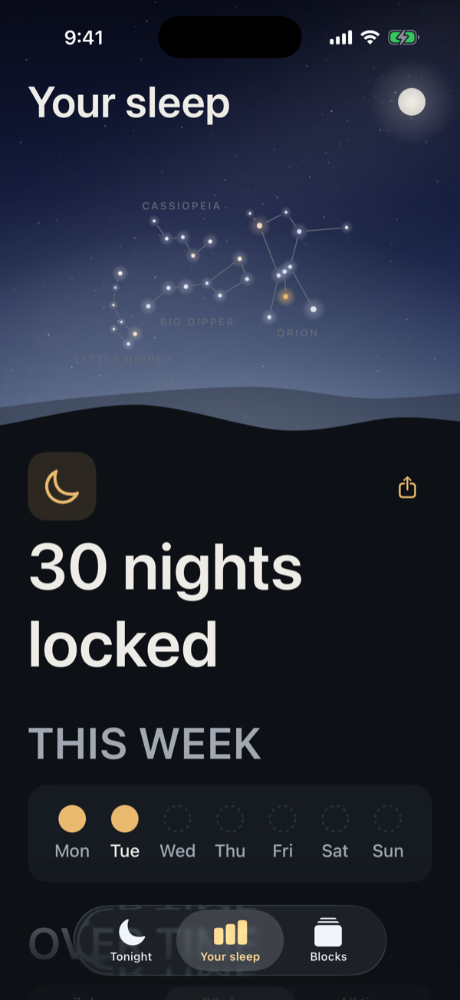
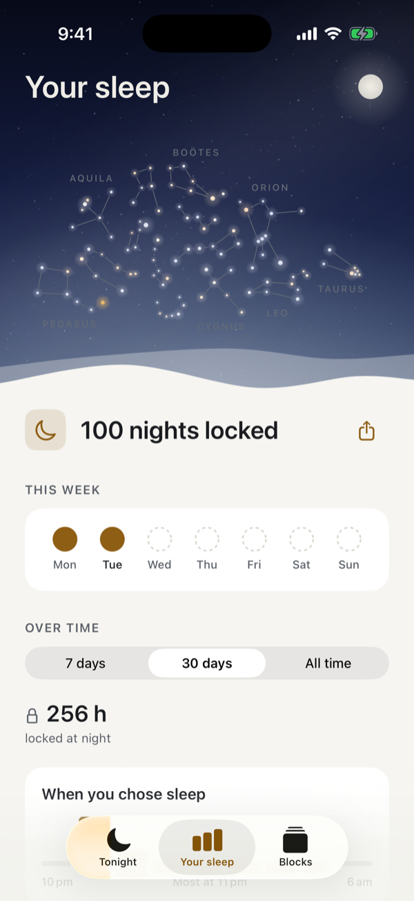
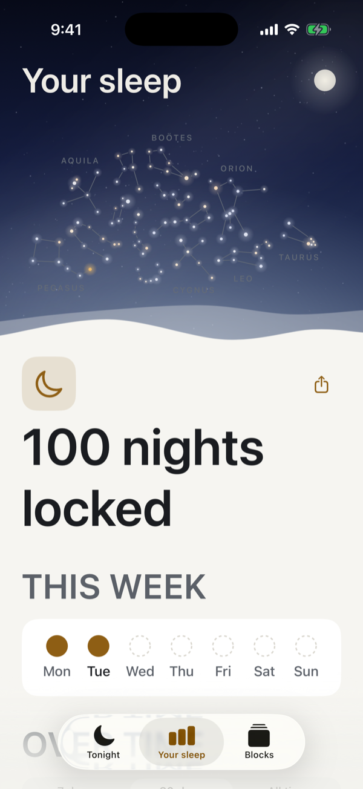
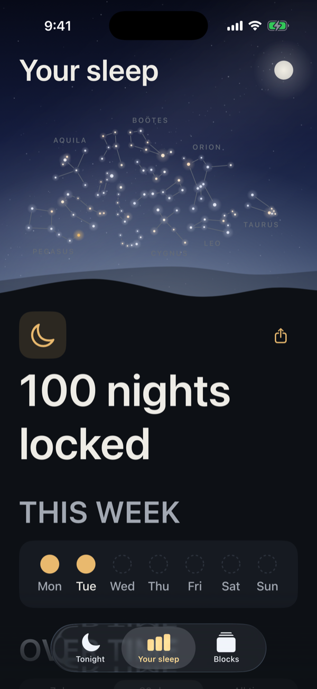
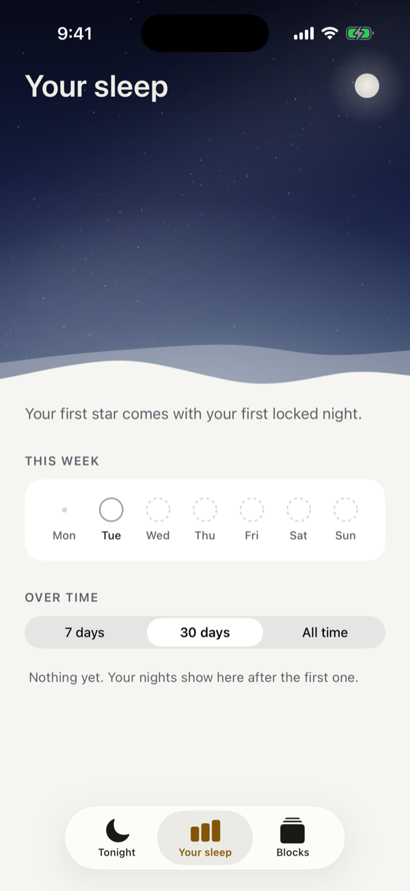
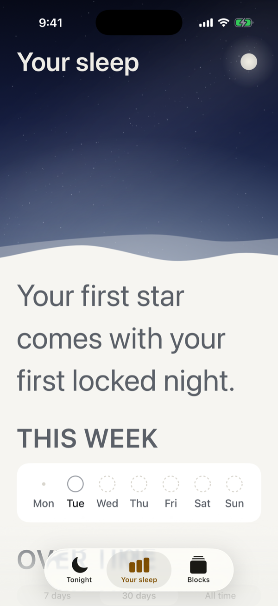
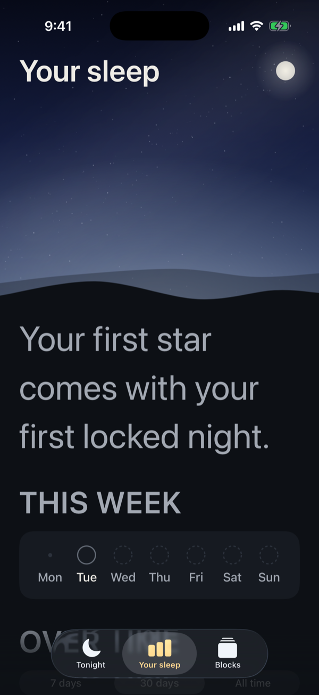

# Renders

Commit `04a50f5` · 2026-11-25 05:40 UTC · Xcode 26.6 · iPhone-17 iOS-26-5

Each folder holds screen.png, ui.json (accessibility tree), log.txt (app log), launch.txt, and any
crash report. Where the time went: timings.txt.

| Scenario | light | ax5 | dark-ax5 |
|---|---|---|---|
| `sleep-sky-30` |  |  |  |
| `sleep-sky-100` |  |  |  |
| `sleep-sky-0` |  |  |  |
