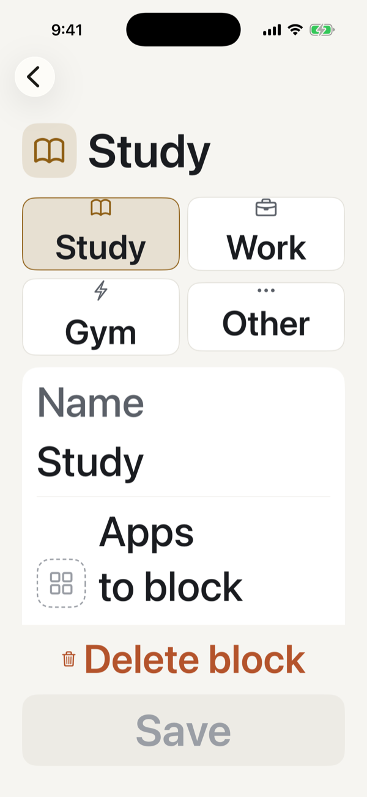

# Renders

Commit `9c395b9` · 2026-11-20 01:45 UTC · Xcode 26.6 · iPhone-17 iOS-26-5

Each folder holds screen.png, ui.json (accessibility tree), log.txt (app log), launch.txt, and any
crash report. Where the time went: timings.txt.

| Scenario | ax5 |
|---|---|
| `home-evening` |  |
| `home-first-week` |  |
| `settings` |  |
| `insights` |  |
| `purchase` |  |
| `block-edit` |  |
| `blocklist` |  |
