# Renders

Commit `f91a604` · 2026-11-24 17:47 UTC · Xcode 26.6 · iPhone-17 iOS-26-5

Each folder holds screen.png, ui.json (accessibility tree), log.txt (app log), launch.txt, and any
crash report. Where the time went: timings.txt.

| Scenario | light | dark | ax5 | wordless |
|---|---|---|---|---|
| `settings` |  |  |  | 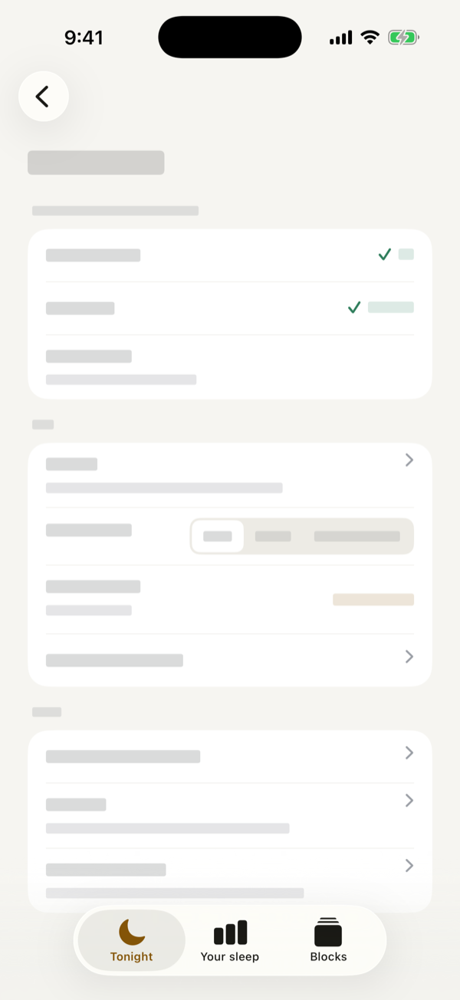 |
| `settings: tap --label "How it works" --wait-timeout 5` | 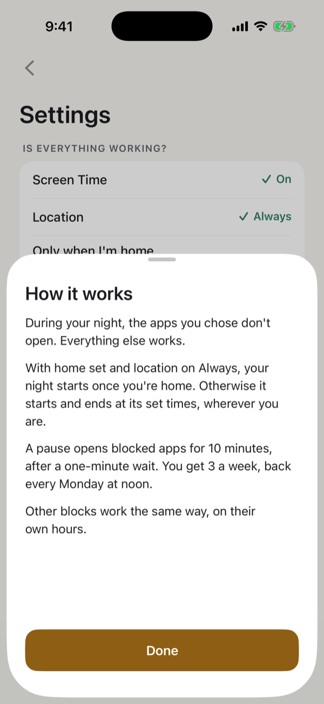 | 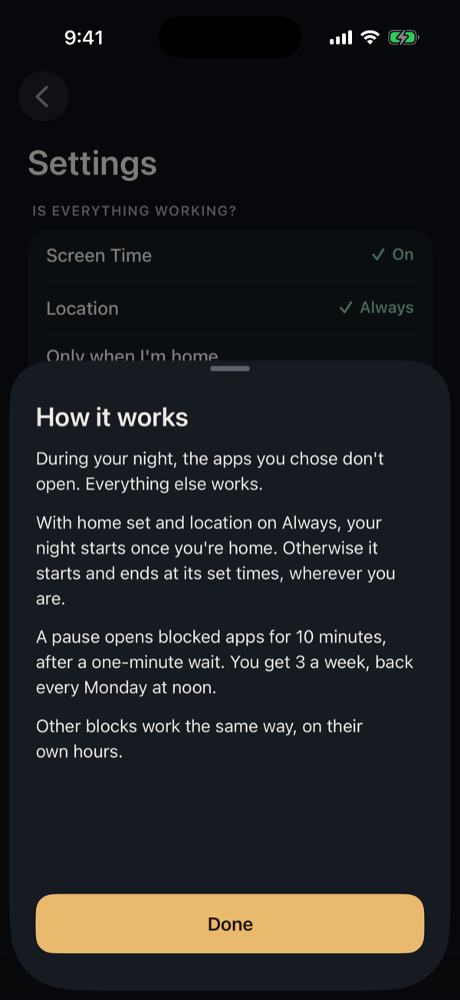 | 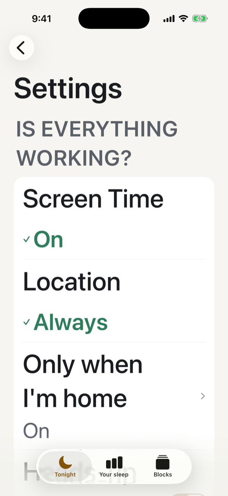 | 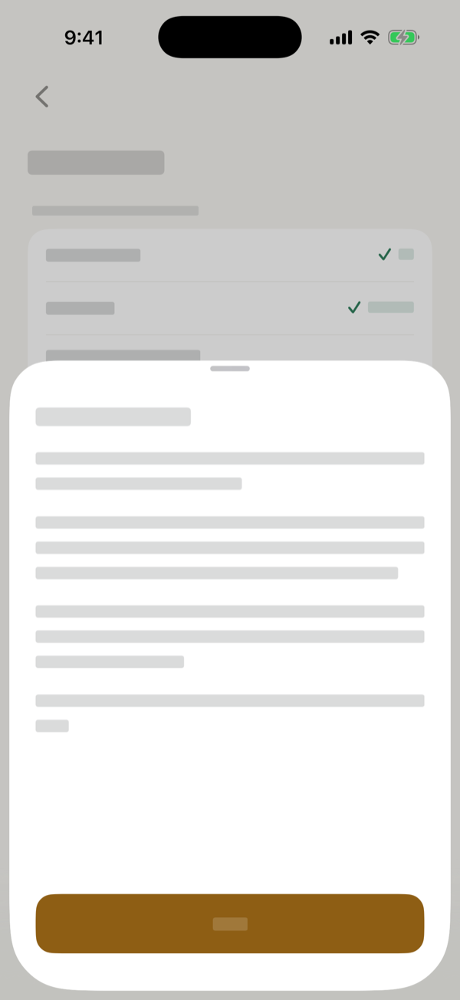 |
| `set-home-always` |  |  | 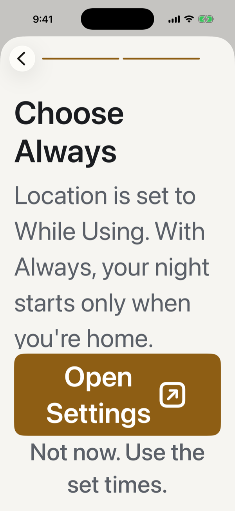 | 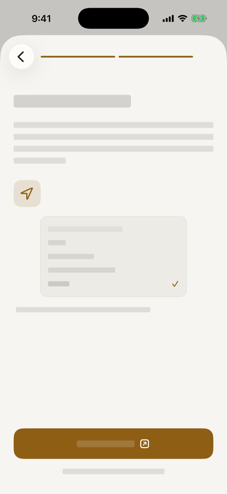 |
| `block-new-gym` |  |  |  |  |
| `block-edit-on` |  | 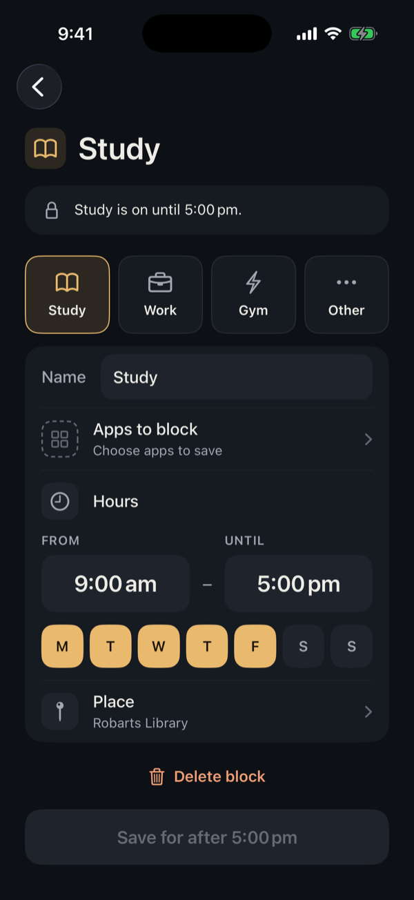 |  | 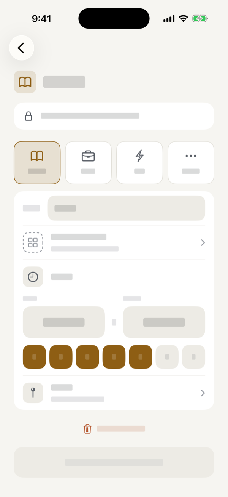 |
| `blocks` |  |  |  |  |
| `sleep-best` |  | 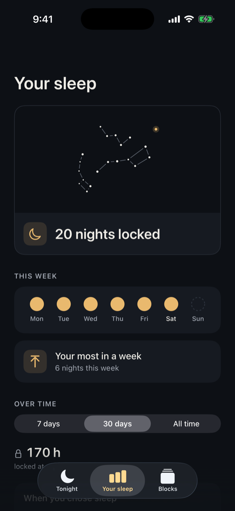 |  | 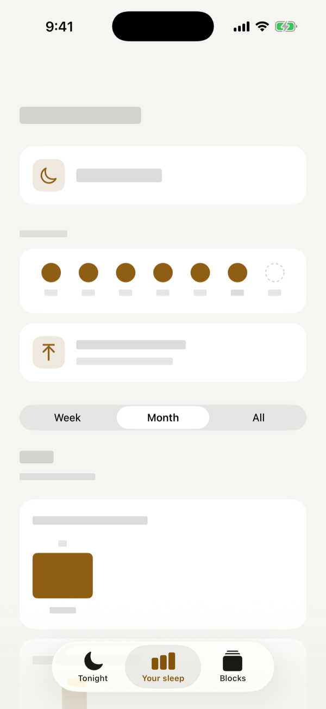 |
| `door-open` |  |  |  |  |
| `purchase` | 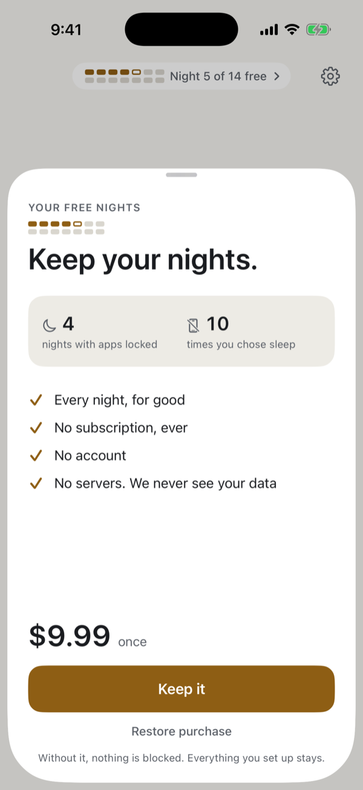 |  |  |  |
| `insights` |  |  | 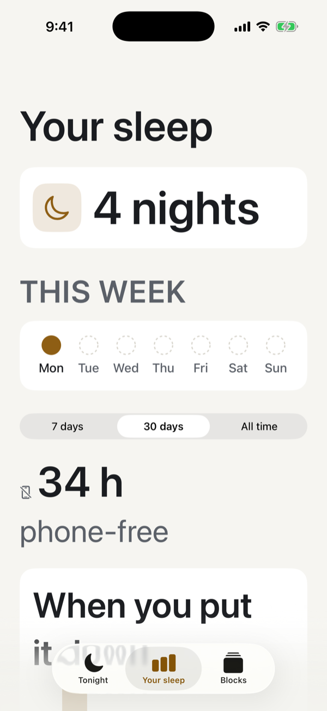 |  |
