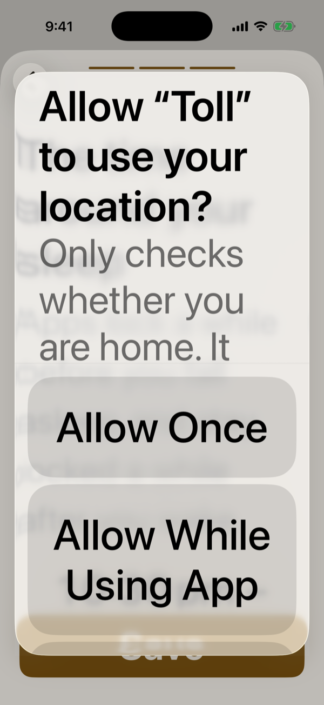
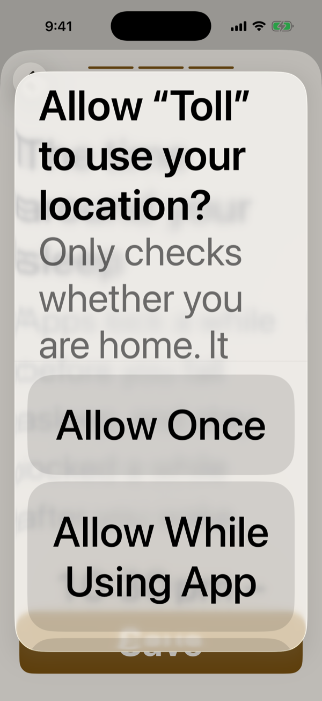

# Renders

Commit `f40a2b0` · 2026-11-27 21:07 UTC · Xcode 26.6 · iPhone-17 iOS-26-5

Each folder holds screen.png, ui.json (accessibility tree), log.txt (app log), launch.txt, and any
crash report. Where the time went: timings.txt.

| Scenario | ax5 |
|---|---|
| `fit-sheet-around: wait 3; tap --label "Don’t Allow" --wait-timeout 10; wait 2` |  |
| `fit-sheet-around-fitted: wait 3; tap --label "Don’t Allow" --wait-timeout 10; wait 2` |  |
