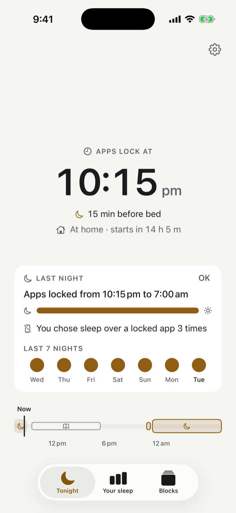
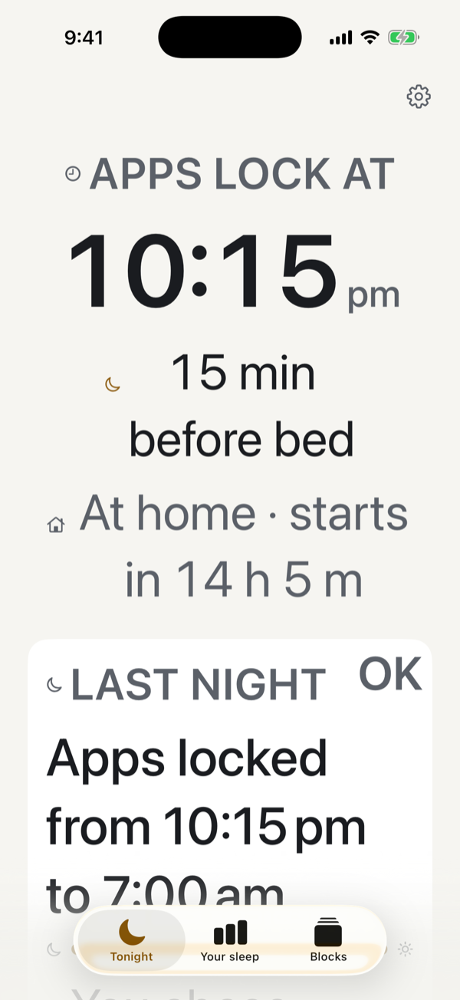
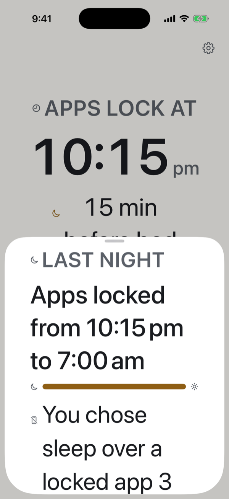
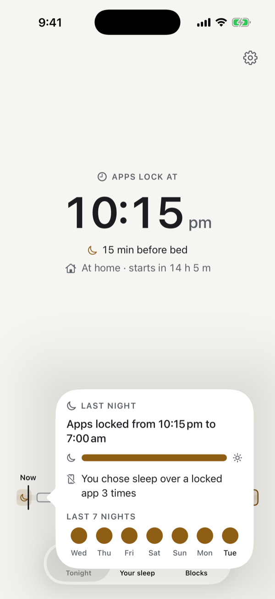

# Renders

Commit `5762263` · 2026-11-25 17:37 UTC · Xcode 26.6 · iPhone-17 iOS-26-5

Each folder holds screen.png, ui.json (accessibility tree), log.txt (app log), launch.txt, and any
crash report. Where the time went: timings.txt.

| Scenario | ax5 | light |
|---|---|---|
| `home-morning: gesture scroll-down` |  |  |
| `home-morning-landmark: gesture scroll-down` |  |  |
| `home-strip-last-night` |  |  |
| `home-morning-landmark` |  |  |
