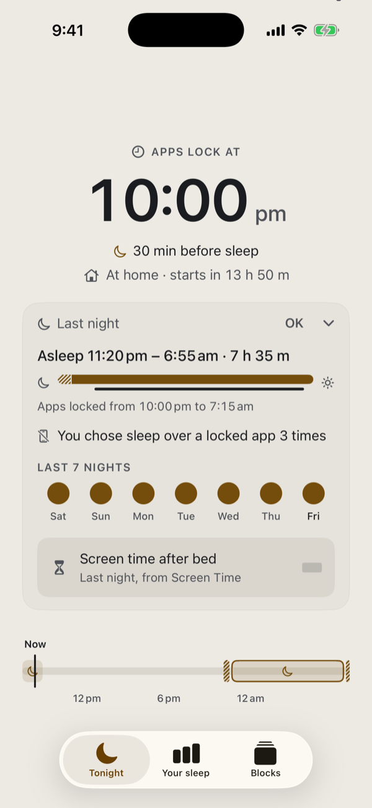
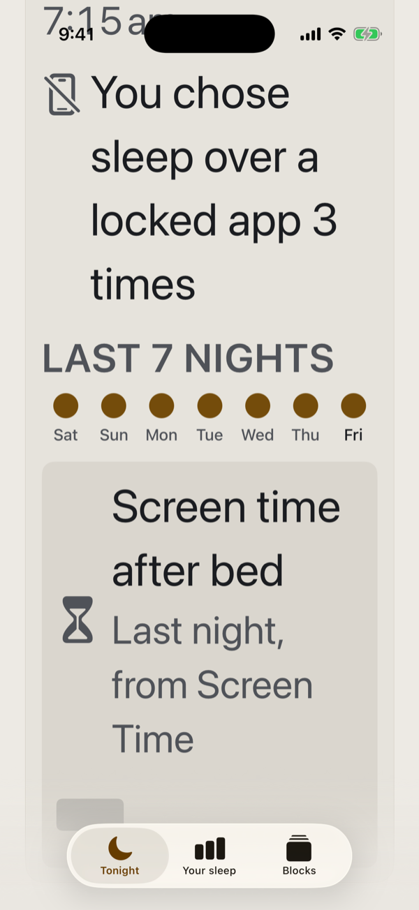
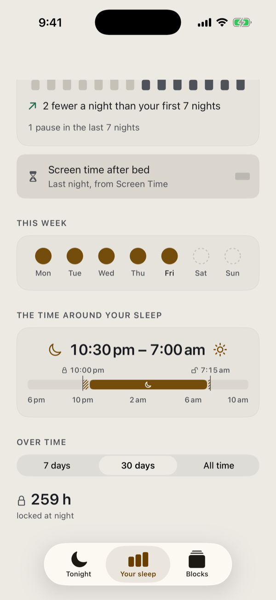
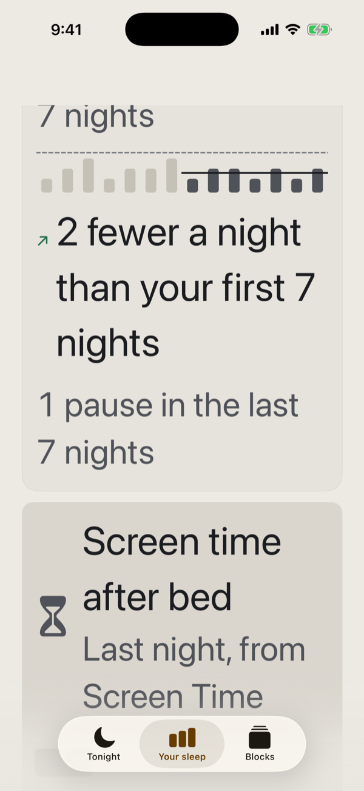
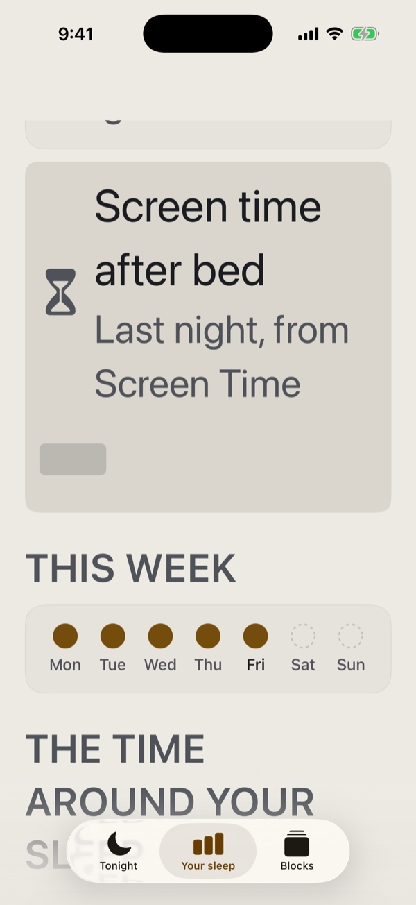

# Renders

Commit `374c22d` · 2026-11-28 05:45 UTC · Xcode 26.6 · iPhone-17 iOS-26-5

Each folder holds screen.png, ui.json (accessibility tree), log.txt (app log), launch.txt, and any
crash report. Where the time went: timings.txt.

| Scenario | light | ax5 |
|---|---|---|
| `home-morning-asleep-open: swipe --start-x 200 --start-y 650 --end-x 200 --end-y 120 --duration 0.6; swipe --start-x 200 --start-y 650 --end-x 200 --end-y 120 --duration 0.6` |  |  |
| `sleep-health-improving: swipe --start-x 202 --start-y 650 --end-x 202 --end-y 120 --duration 0.6; swipe --start-x 202 --start-y 650 --end-x 202 --end-y 120 --duration 0.6; swipe --start-x 202 --start-y 650 --end-x 202 --end-y 120 --duration 0.6; swipe --start-x 202 --start-y 650 --end-x 202 --end-y 120 --duration 0.6; swipe --start-x 202 --start-y 650 --end-x 202 --end-y 120 --duration 0.6` |  |  |
| `sleep-health-improving: swipe --start-x 203 --start-y 650 --end-x 203 --end-y 120 --duration 0.6; swipe --start-x 203 --start-y 650 --end-x 203 --end-y 120 --duration 0.6; swipe --start-x 203 --start-y 650 --end-x 203 --end-y 120 --duration 0.6; swipe --start-x 203 --start-y 650 --end-x 203 --end-y 120 --duration 0.6; swipe --start-x 203 --start-y 650 --end-x 203 --end-y 120 --duration 0.6; swipe --start-x 203 --start-y 650 --end-x 203 --end-y 120 --duration 0.6` |  |  |
