# Renders

Commit `5594bba` · 2026-11-27 21:29 UTC · Xcode 26.6 · iPhone-17 iOS-26-5

Each folder holds screen.png, ui.json (accessibility tree), log.txt (app log), launch.txt, and any
crash report. Where the time went: timings.txt.

| Scenario | dark | wordless |
|---|---|---|
| `home-morning-gap: tap --id tonight.lastNight --wait-timeout 5` | 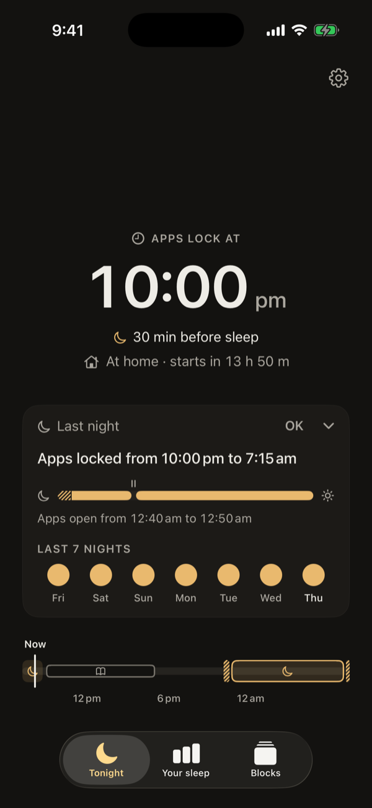 | 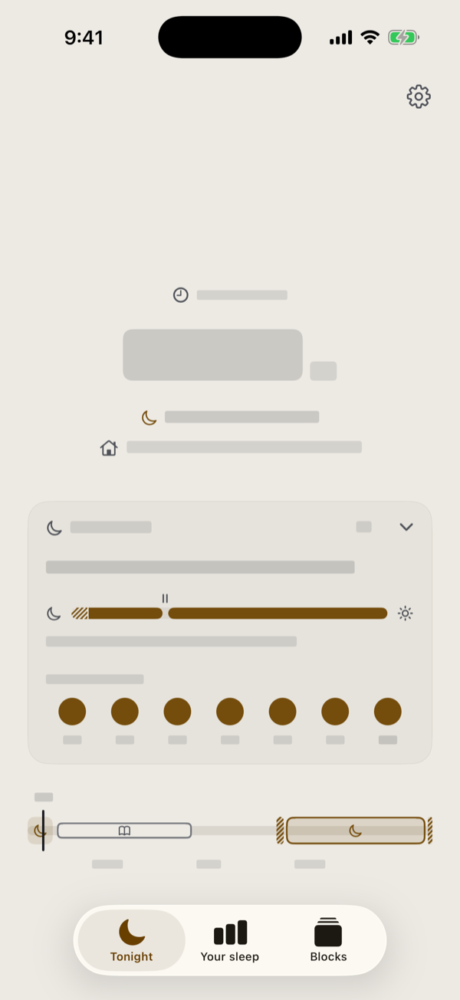 |
| `door-choosing` | 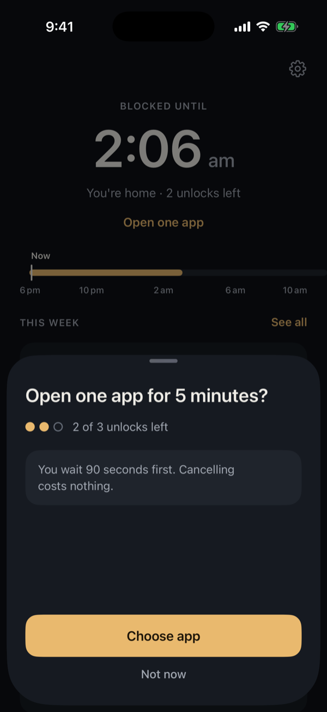 |  |
| `door-none` | 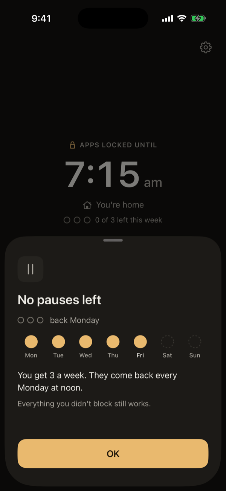 |  |
| `door-open` |  |  |
| `purchase` |  |  |
| `purchase-done` | 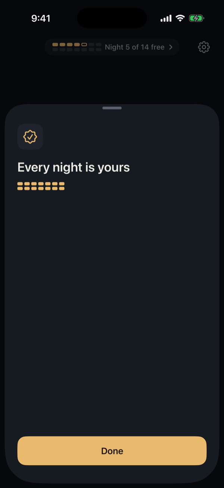 |  |
| `set-home-off` | 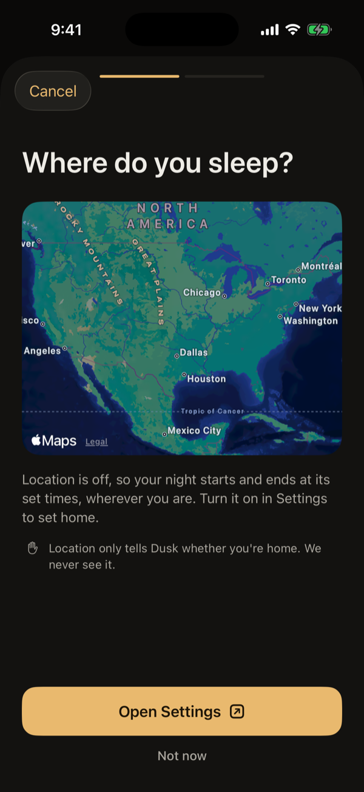 | 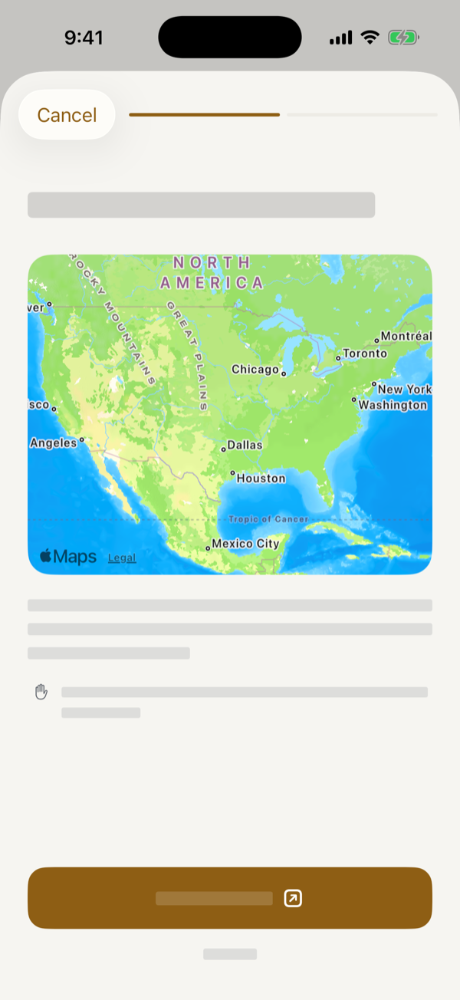 |
| `ready` |  | 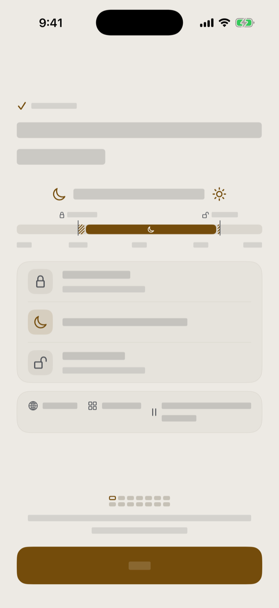 |
| `blocks` |  |  |
| `home-morning-landmark-open` | 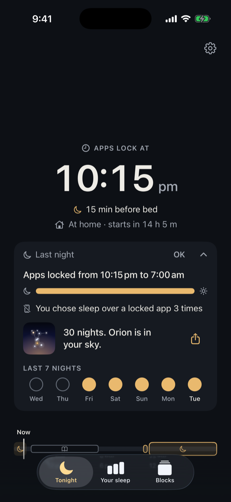 |  |
| `sky-share` |  |  |
| `home-held-home` | 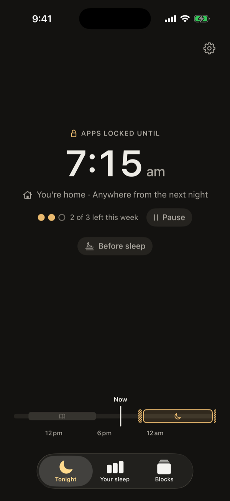 | 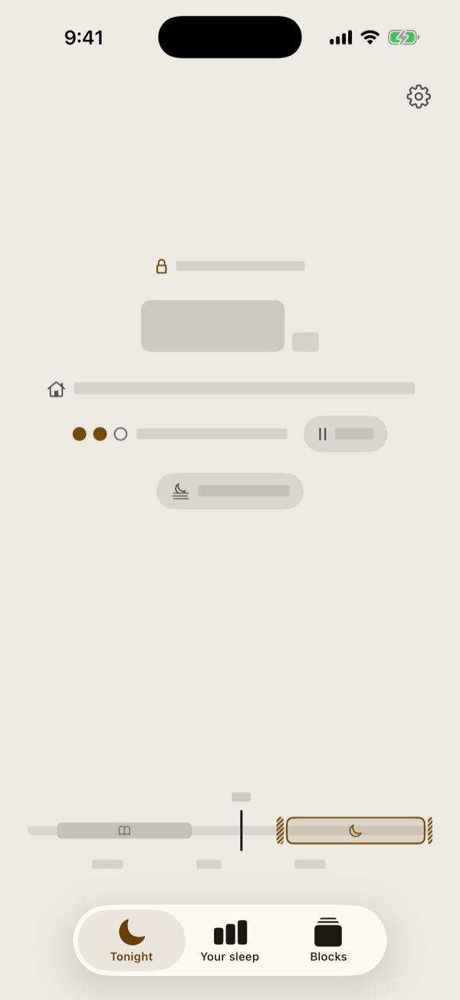 |
| `sleep-after-trial` | 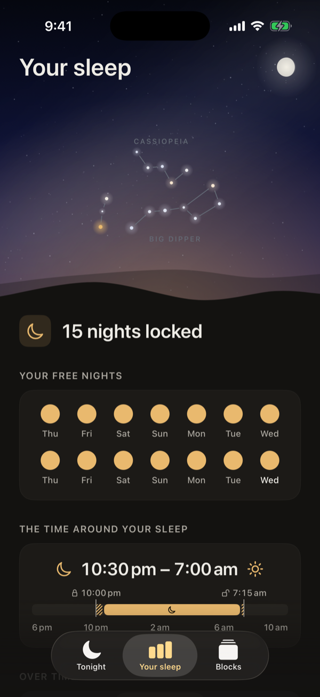 | 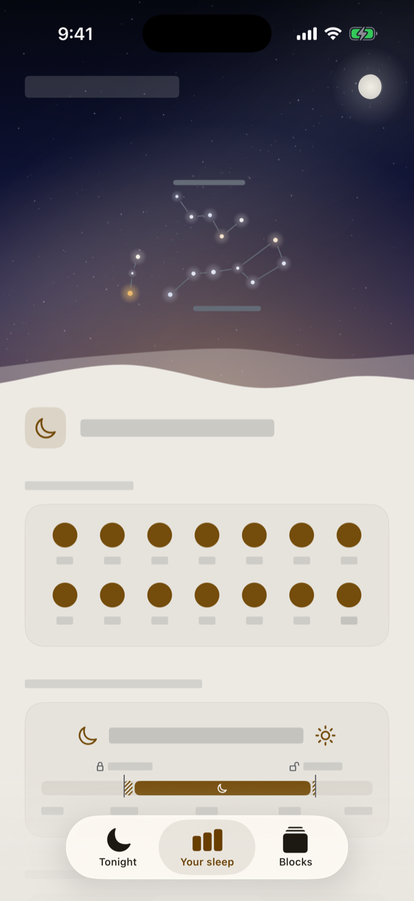 |
| `welcome-bought` | 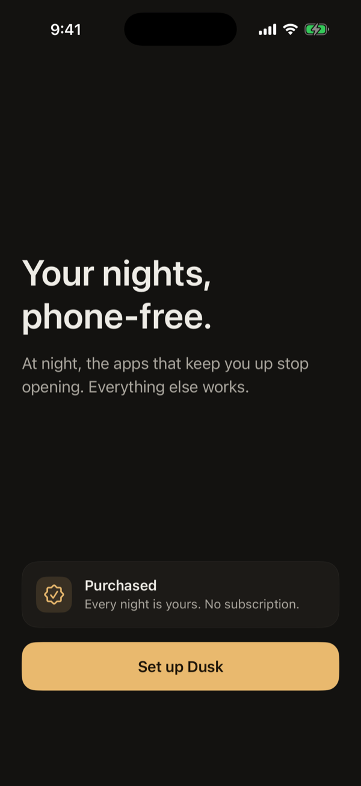 | 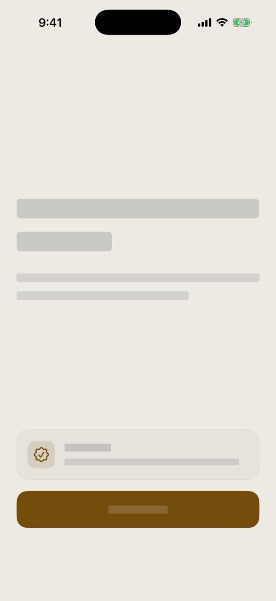 |
