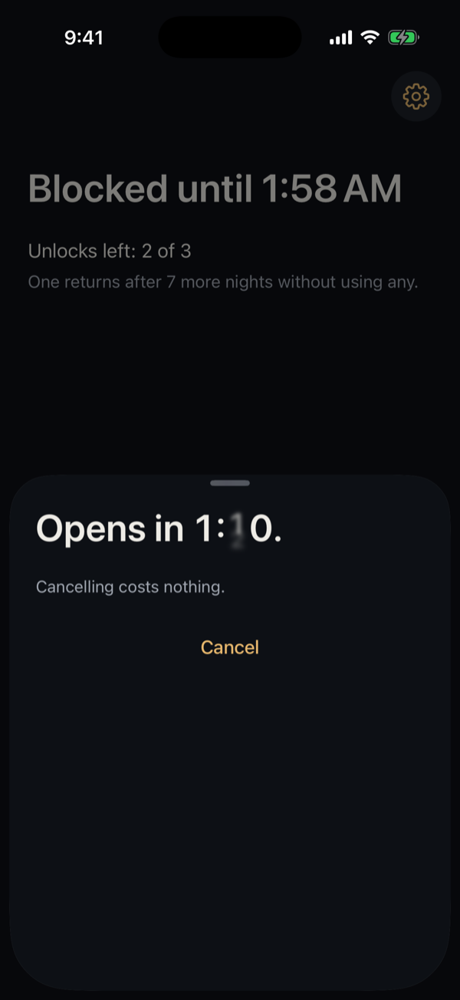

# Renders

Commit `bee542d` · 2026-11-21 14:45 UTC · Xcode 26.6 · iPhone-17 iOS-26-5

Each folder holds screen.png, ui.json (accessibility tree), log.txt (app log), launch.txt, and any
crash report. Where the time went: timings.txt.

| Scenario | light | wordless |
|---|---|---|
| `door-choosing` |  |  |
| `door-waiting` |  |  |
| `door-open` |  |  |
| `door-none` |  |  |
