# Renders

Commit `532ea7f` · 2026-11-25 04:56 UTC · Xcode 26.6 · iPhone-17 iOS-26-5

Each folder holds screen.png, ui.json (accessibility tree), log.txt (app log), launch.txt, and any
crash report. Where the time went: timings.txt.

| Scenario | light | dark | ax5 | wordless |
|---|---|---|---|---|
| `block-edit` |  |  |  |  |
| `block-edit-on` | 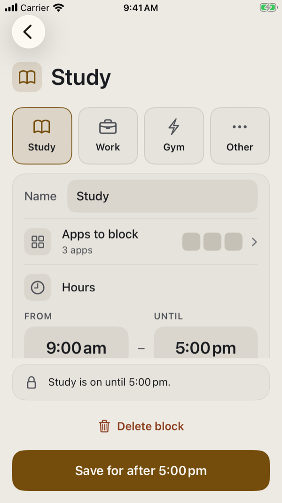 |  |  |  |
| `block-night` |  | 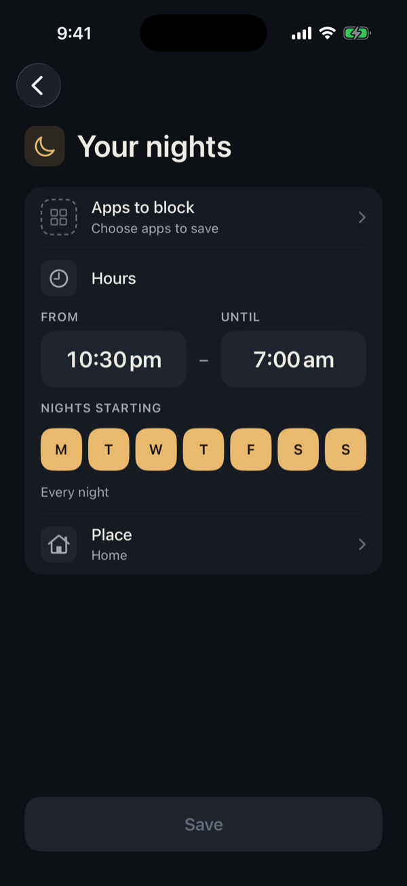 | 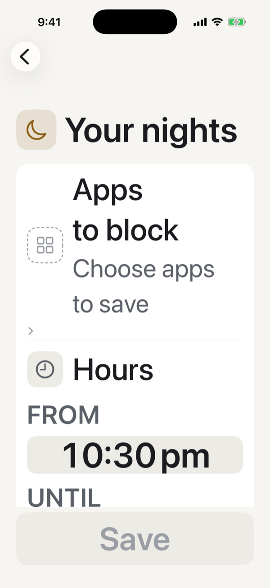 |  |
| `door-choosing` |  |  |  | 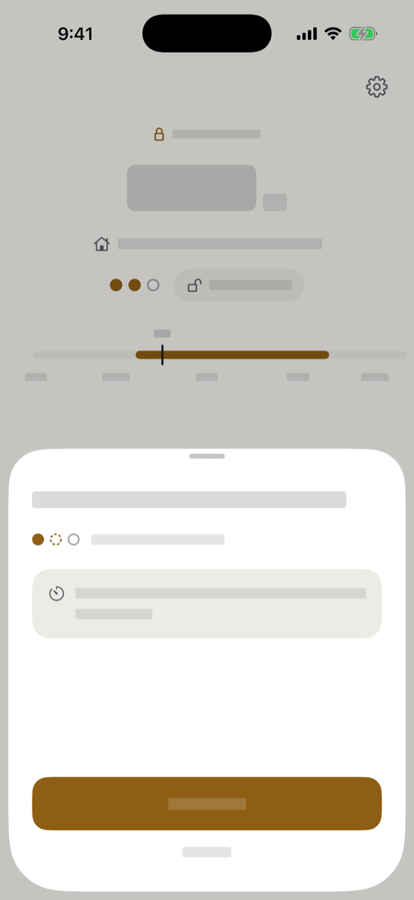 |
| `door-waiting` |  |  |  |  |
| `door-open` |  | 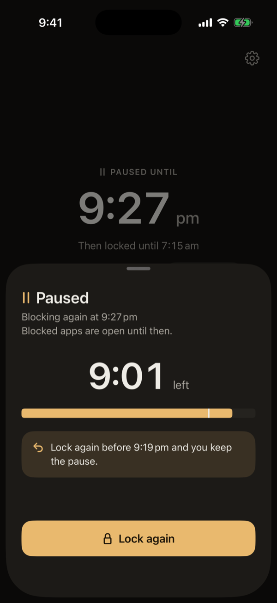 |  |  |
| `purchase` |  | 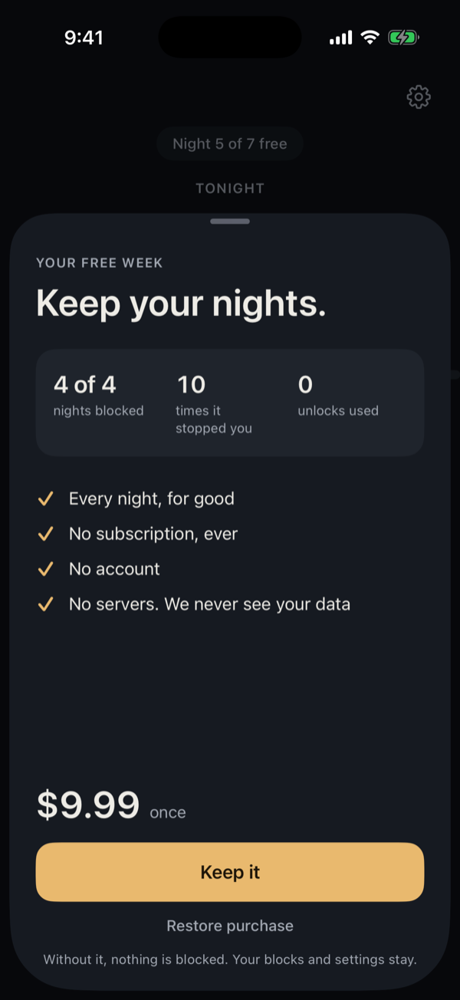 | 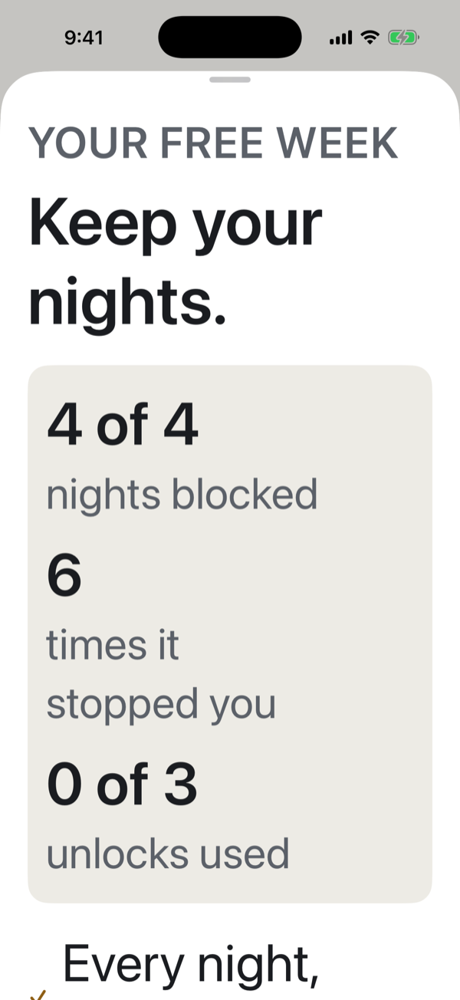 | 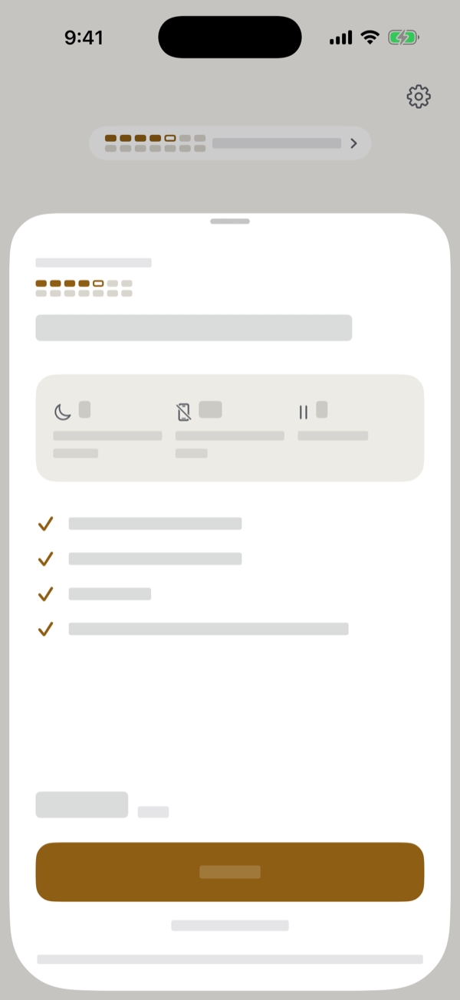 |
| `purchase-pending` |  | 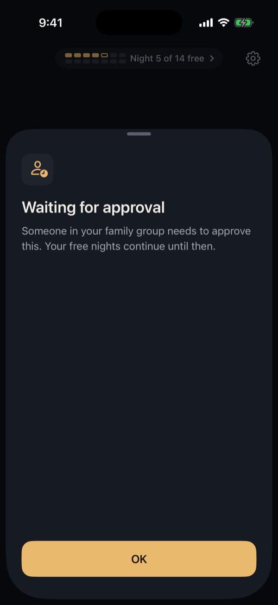 |  |  |
| `purchase-failed` | 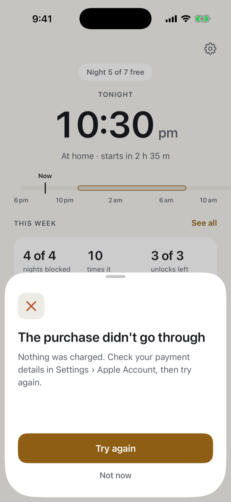 | 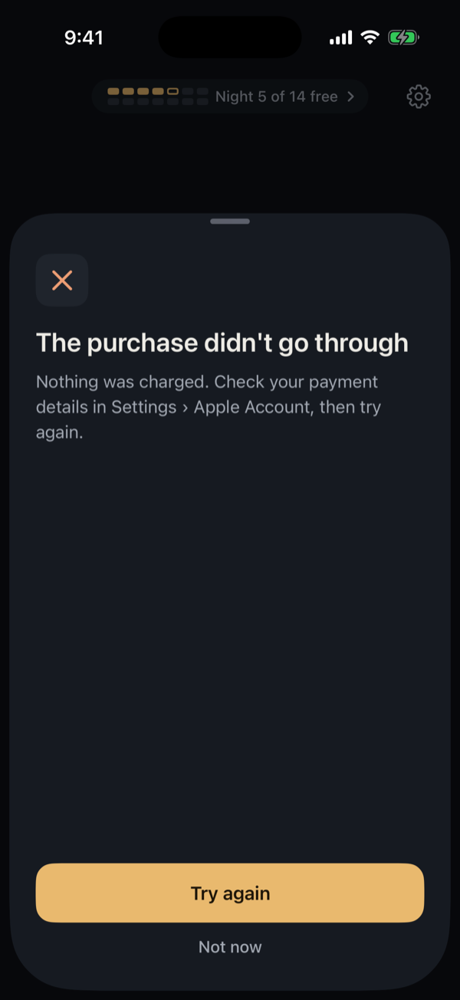 |  | 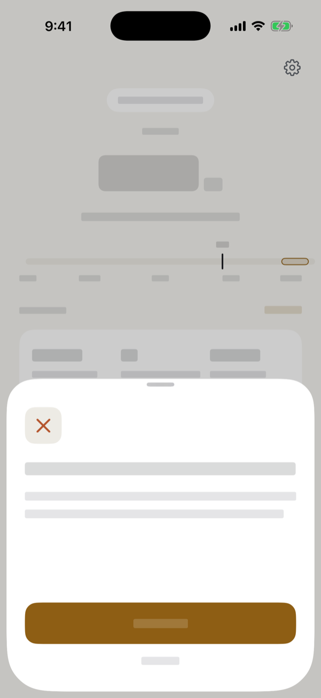 |
| `purchase-done` |  |  | 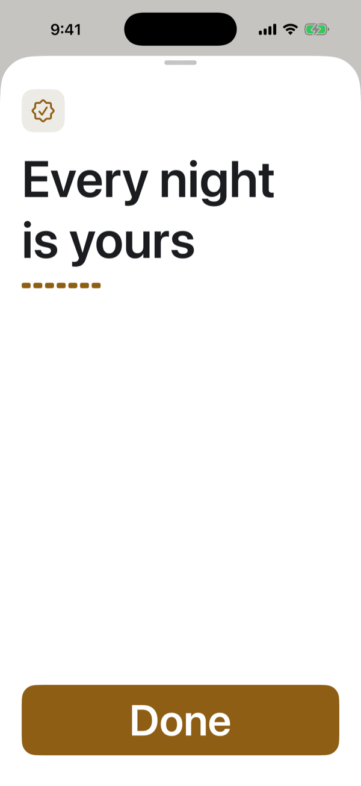 |  |
| `before-bed-breathe` | 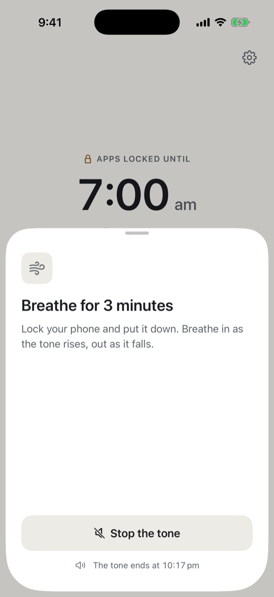 | 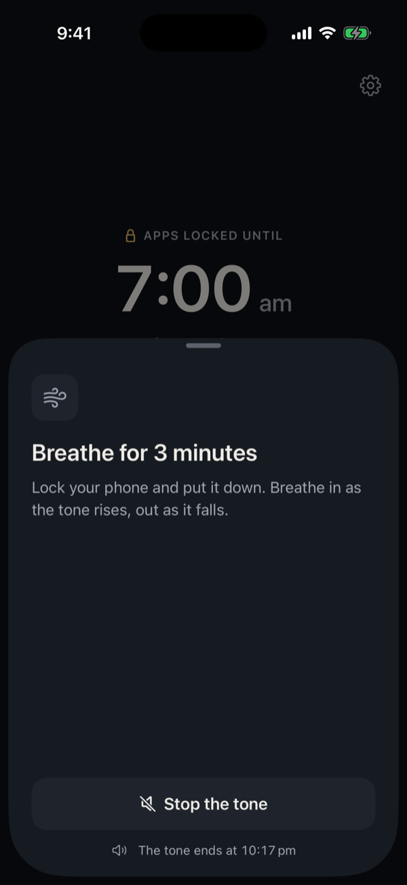 | 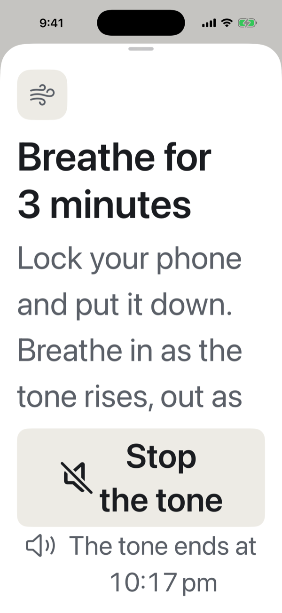 | 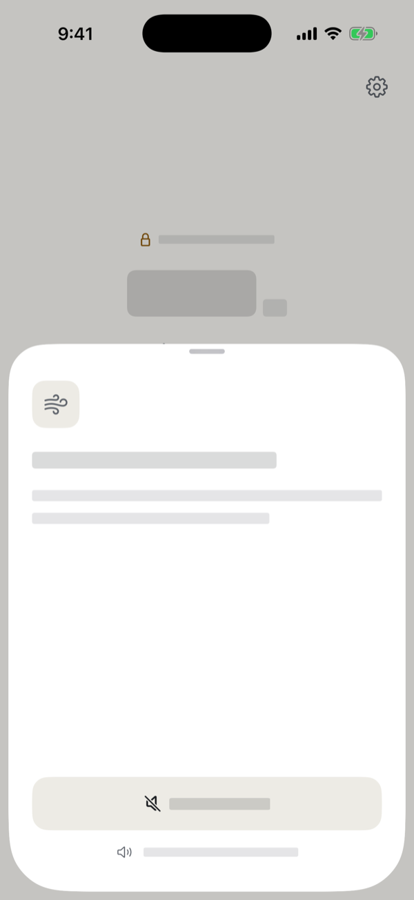 |
| `before-bed-list` |  |  |  |  |
| `welcome` |  |  |  |  |
| `set-home` |  |  |  |  |
| `set-home-off` |  |  |  |  |
