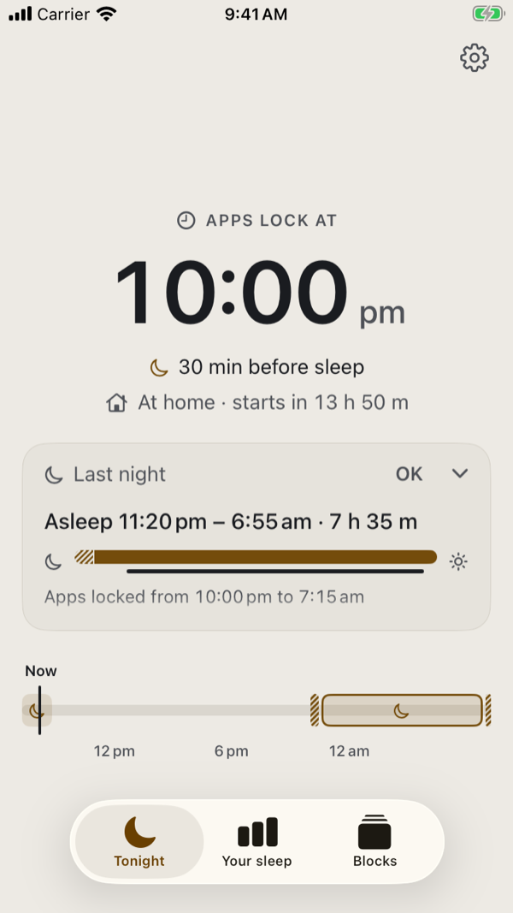
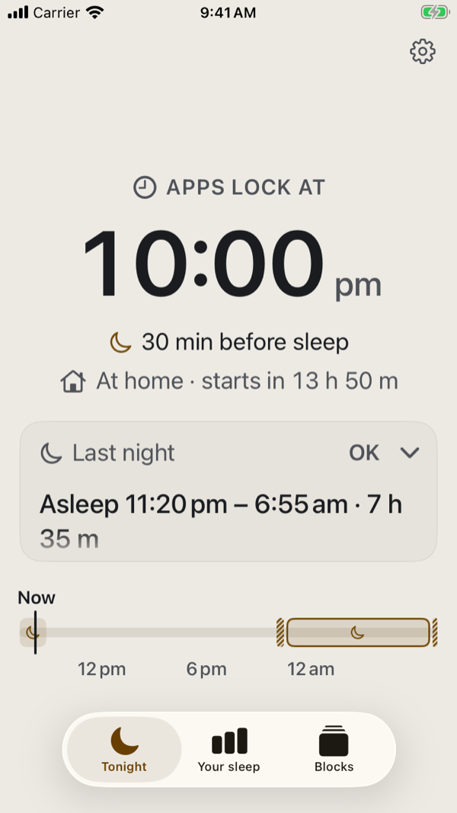
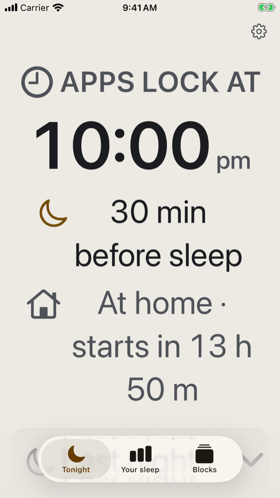
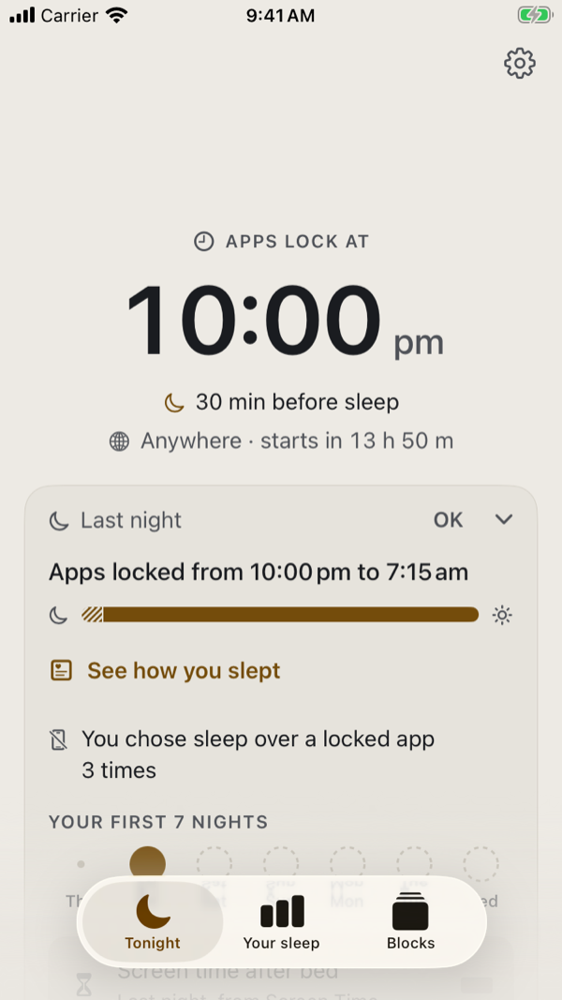
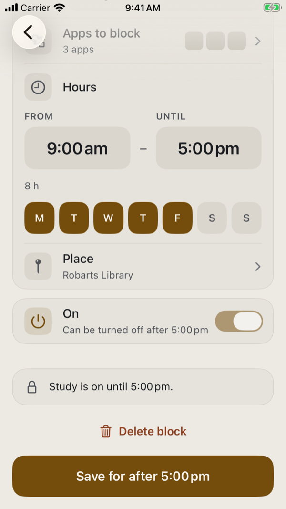
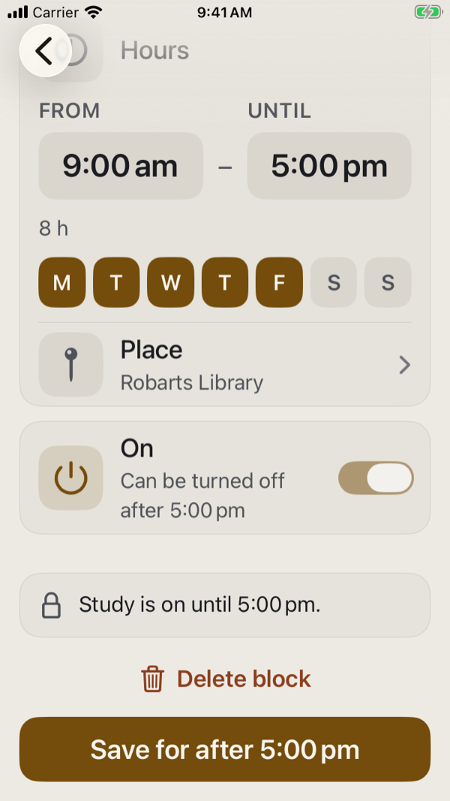
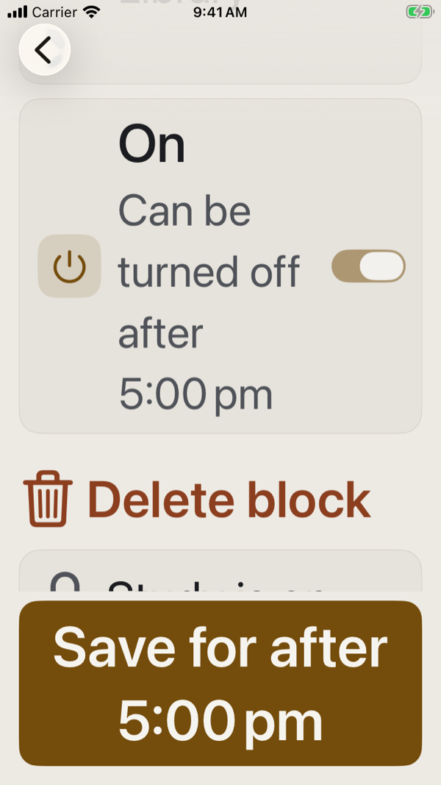
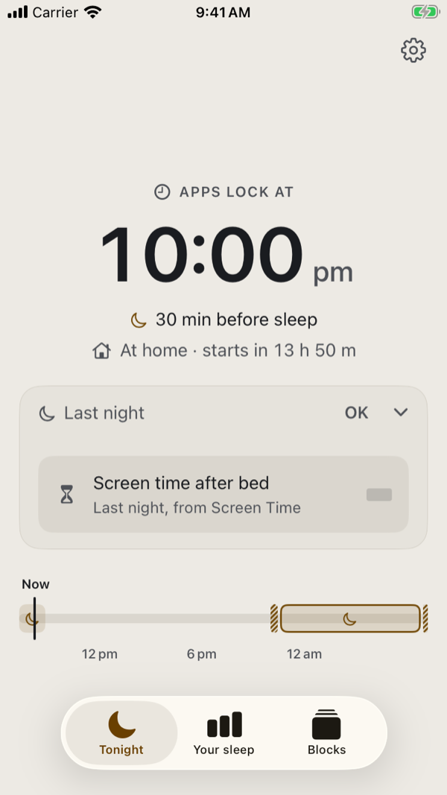
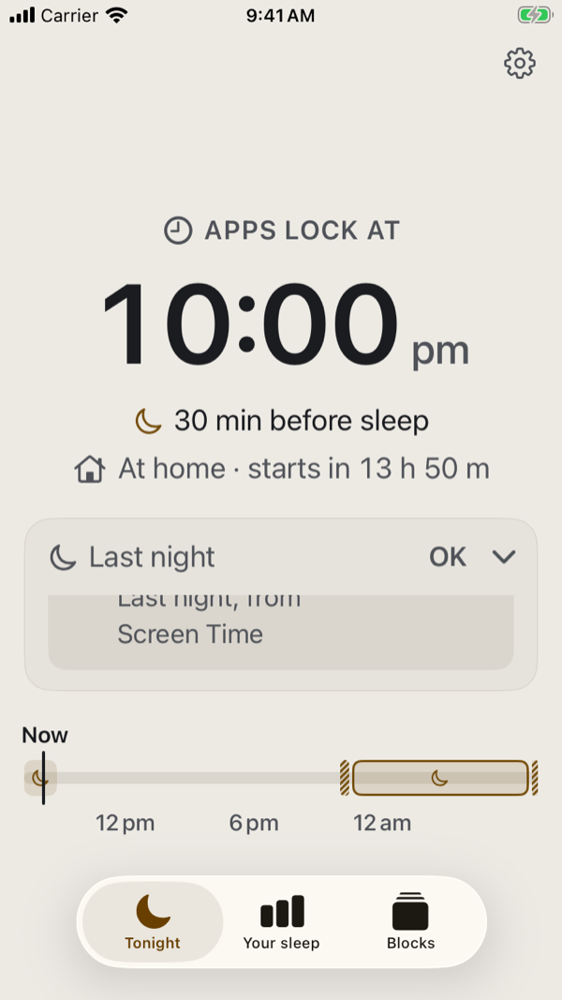
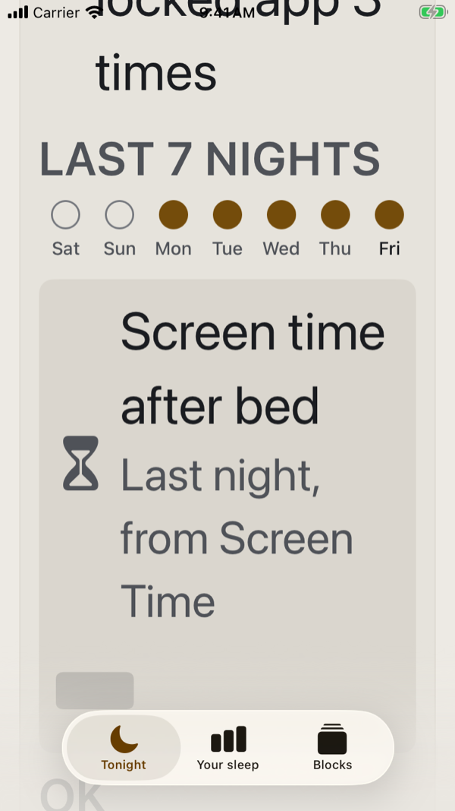

# Renders

Commit `23a4de9` · 2026-11-28 07:59 UTC · Xcode 26.6 · iPhone-SE-3rd-generation iOS-26-5

Each folder holds screen.png, ui.json (accessibility tree), log.txt (app log), launch.txt, and any
crash report. Where the time went: timings.txt.

| Scenario | light | xxxl | ax5 |
|---|---|---|---|
| `home-morning-landmark-open` |  |  |  |
| `home-morning-asleep-open` |  |  |  |
| `home-morning-card-open` |  |  |  |
| `block-edit-on` |  |  |  |
| `block-edit-on: swipe --start-x 187 --start-y 450 --end-x 187 --end-y 100; swipe --start-x 187 --start-y 450 --end-x 187 --end-y 100; swipe --start-x 187 --start-y 450 --end-x 187 --end-y 100; swipe --start-x 187 --start-y 450 --end-x 187 --end-y 100` |  |  |  |
| `home-morning-landmark-open: swipe --start-x 187 --start-y 450 --end-x 187 --end-y 100; swipe --start-x 187 --start-y 450 --end-x 187 --end-y 100; swipe --start-x 187 --start-y 450 --end-x 187 --end-y 100; swipe --start-x 187 --start-y 450 --end-x 187 --end-y 100` |  |  |  |
