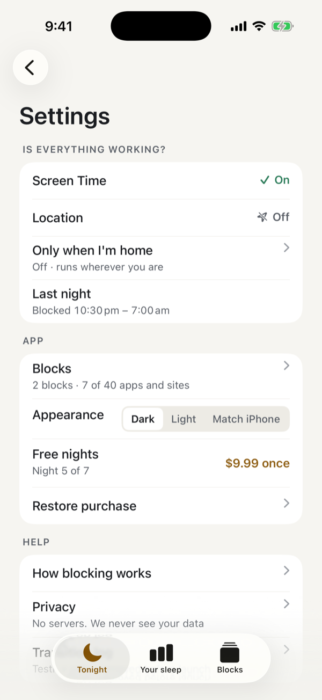
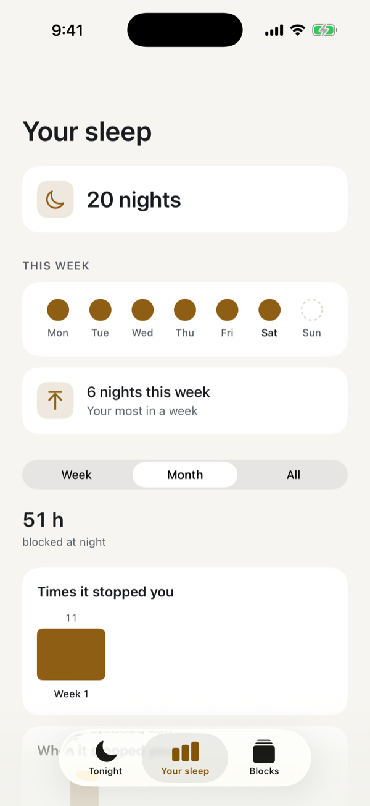
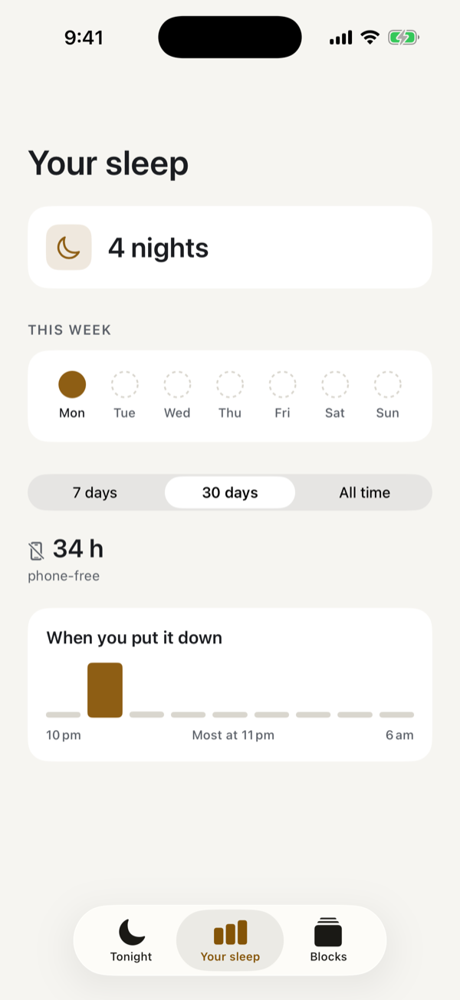
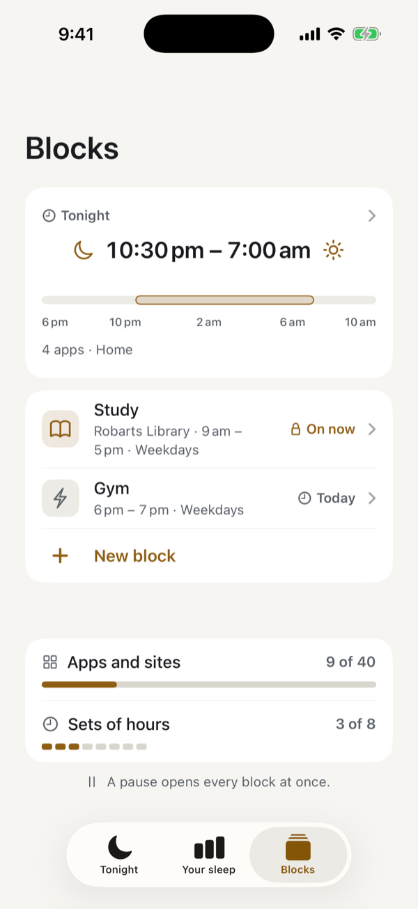

# Renders

Commit `e4a610c` · 2026-11-24 01:08 UTC · Xcode 26.6 · iPhone-17 iOS-26-5

Each folder holds screen.png, ui.json (accessibility tree), log.txt (app log), launch.txt, and any
crash report. Where the time went: timings.txt.

| Scenario | light |
|---|---|
| `welcome` |  |
| `wake` |  |
| `set-home-location` |  |
| `set-home-always` |  |
| `set-home-location-off` |  |
| `set-home-off` |  |
| `home-paused` |  |
| `home-location` |  |
| `home-no-blocks` |  |
| `purchase` |  |
| `settings-anywhere` |  |
| `settings: tap --label "How it works" --wait-timeout 5` |  |
| `sleep-best` |  |
| `insights: gesture scroll-down; gesture scroll-down` |  |
| `blocks` |  |
| `blocks-day` |  |
