# Renders

Commit `d4139b4` · 2026-11-28 18:35 UTC · Xcode 26.6 · iPhone-17 iOS-26-5

Each folder holds screen.png, ui.json (accessibility tree), log.txt (app log), launch.txt, and any
crash report. Where the time went: timings.txt.

| Scenario | light | ax5 | wordless | dark |
|---|---|---|---|---|
| `sleep-learning: gesture scroll-up; gesture scroll-up` | 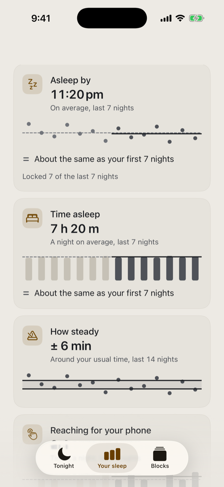 | 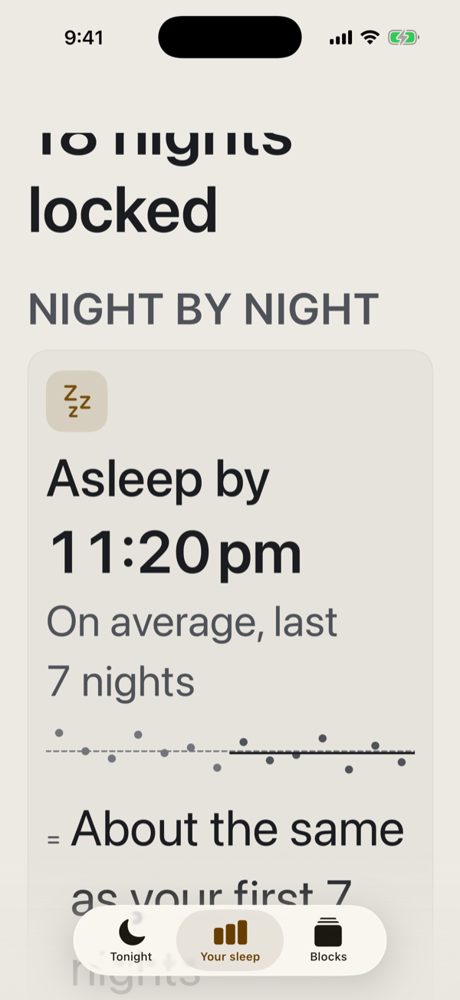 | 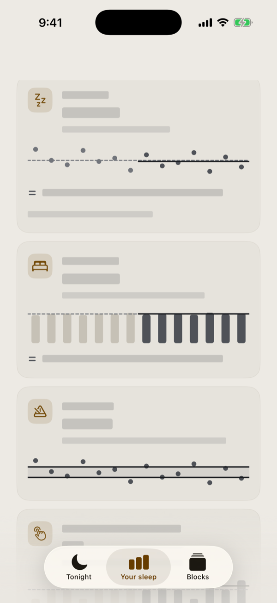 | 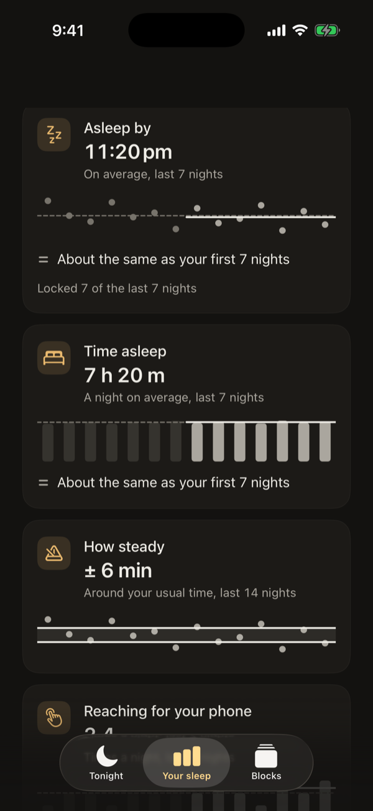 |
| `sleep-insight-sooner: gesture scroll-up` | 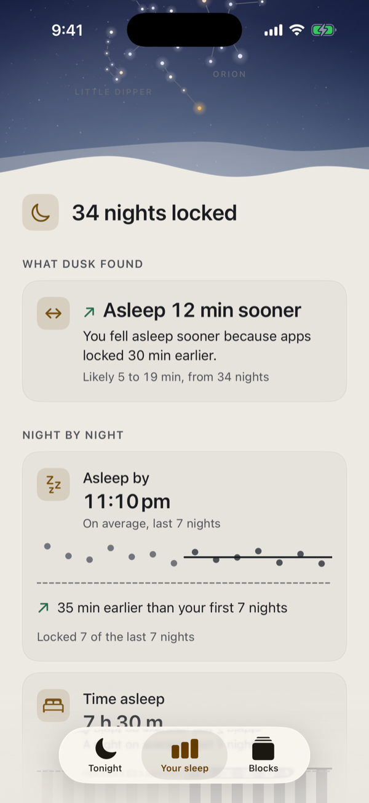 | 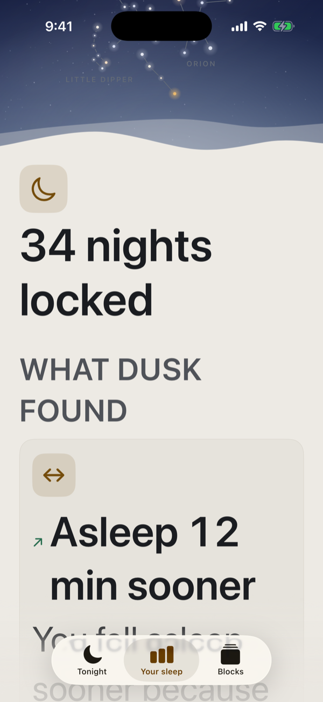 | 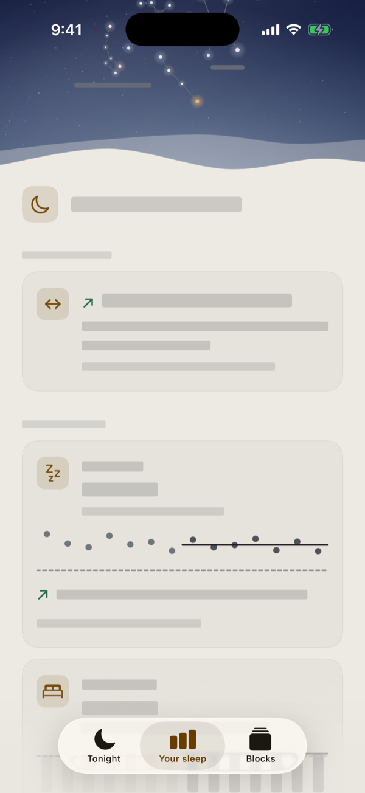 | 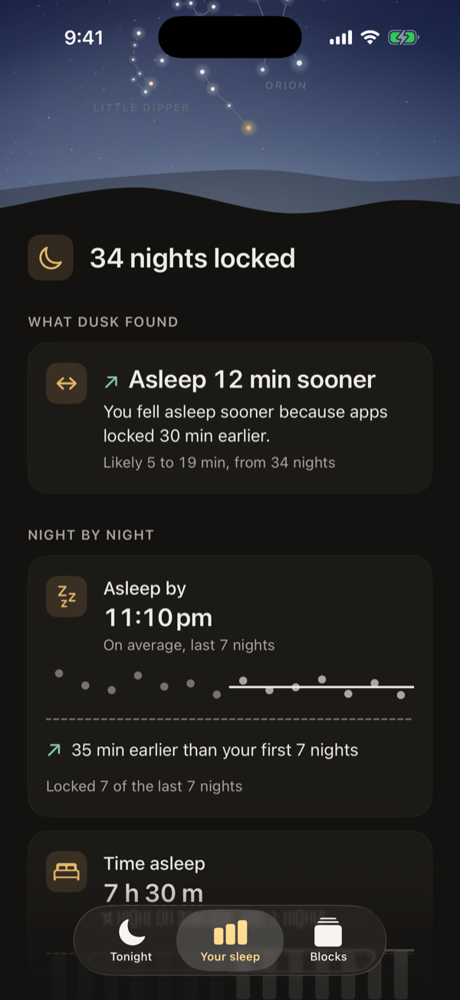 |
| `sleep-learning: swipe --start-x 200 --start-y 760 --end-x 200 --end-y 160 --duration 0.4; swipe --start-x 200 --start-y 760 --end-x 200 --end-y 160 --duration 0.4` | 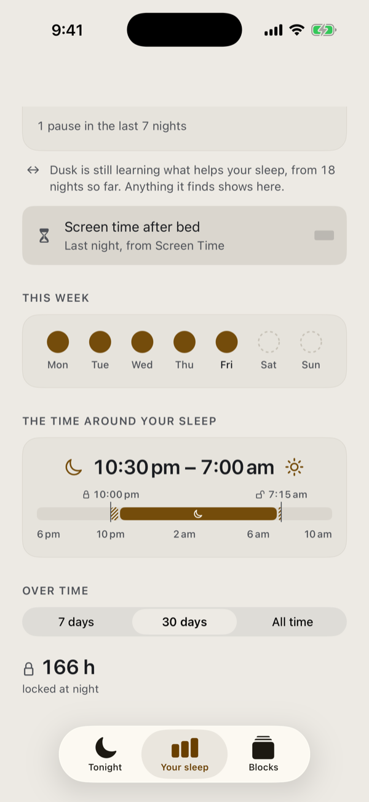 | 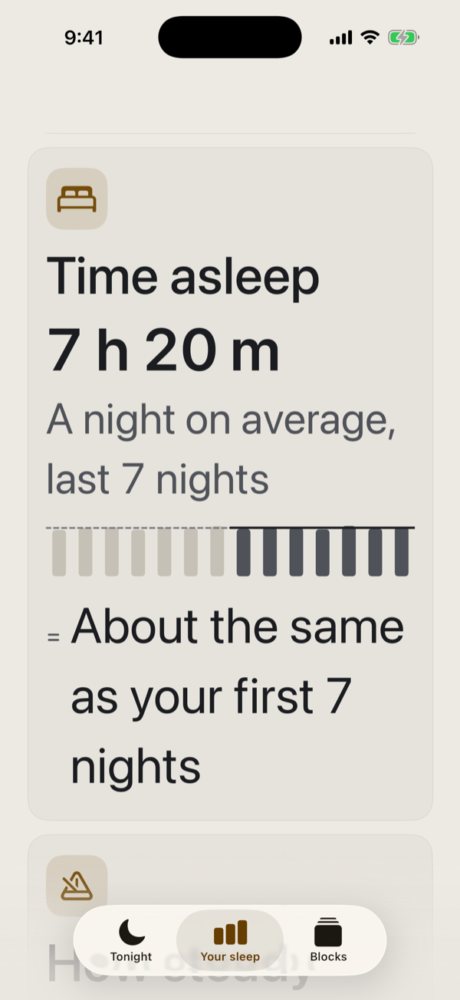 | 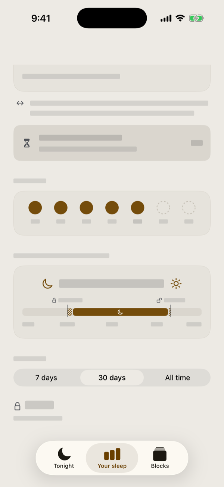 | 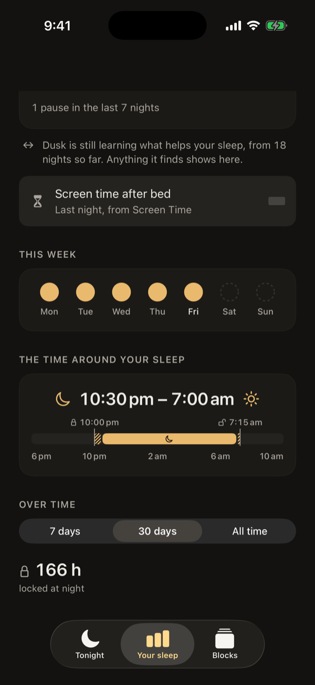 |
