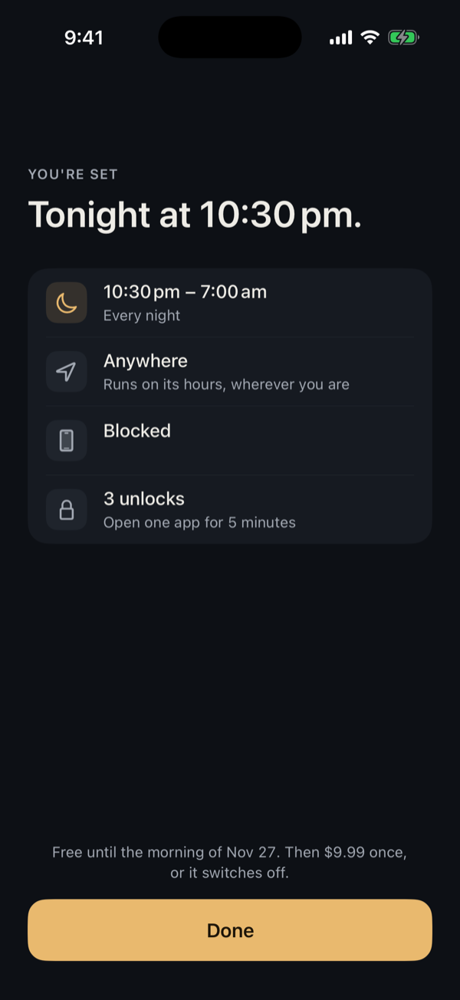

# Renders

Commit `7bc1405` · 2026-11-20 18:15 UTC · Xcode 26.6 · iPhone-17 iOS-26-5

Each folder holds screen.png, ui.json (accessibility tree), log.txt (app log), launch.txt, and any
crash report. Where the time went: timings.txt.

| Scenario | dark |
|---|---|
| `welcome` |  |
| `ready` |  |
| `ready-anywhere` |  |
| `permissions` |  |
