# Renders

Commit `209f8f1` · 2026-11-24 15:03 UTC · Xcode 26.6 · iPhone-17 iOS-26-5

Each folder holds screen.png, ui.json (accessibility tree), log.txt (app log), launch.txt, and any
crash report. Where the time went: timings.txt.

| Scenario | light | dark | ax5 | wordless |
|---|---|---|---|---|
| `sleep-sky-5` | 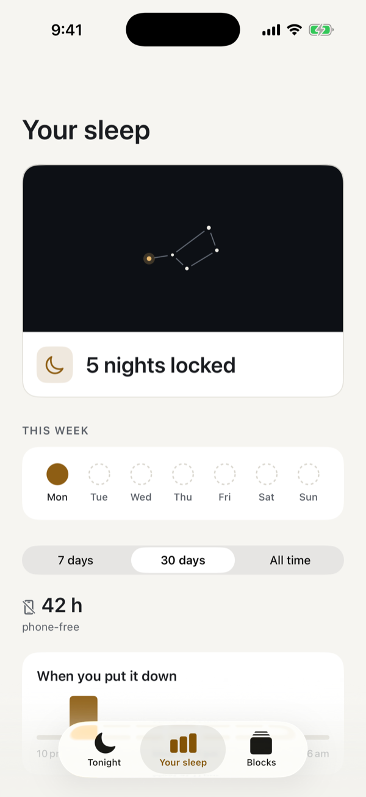 | 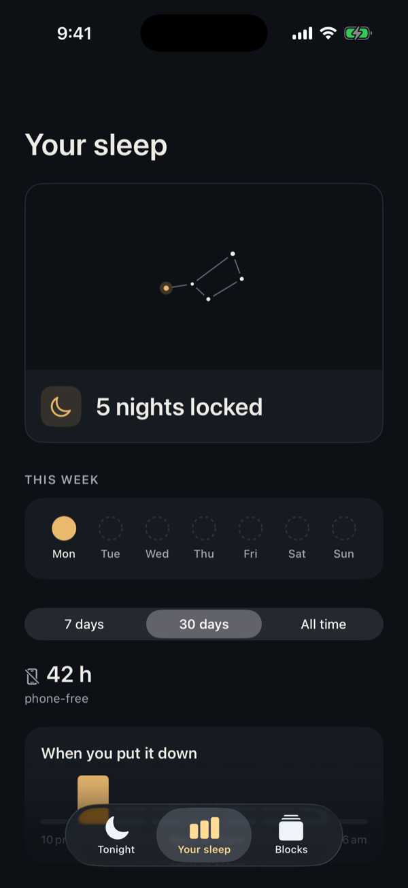 | 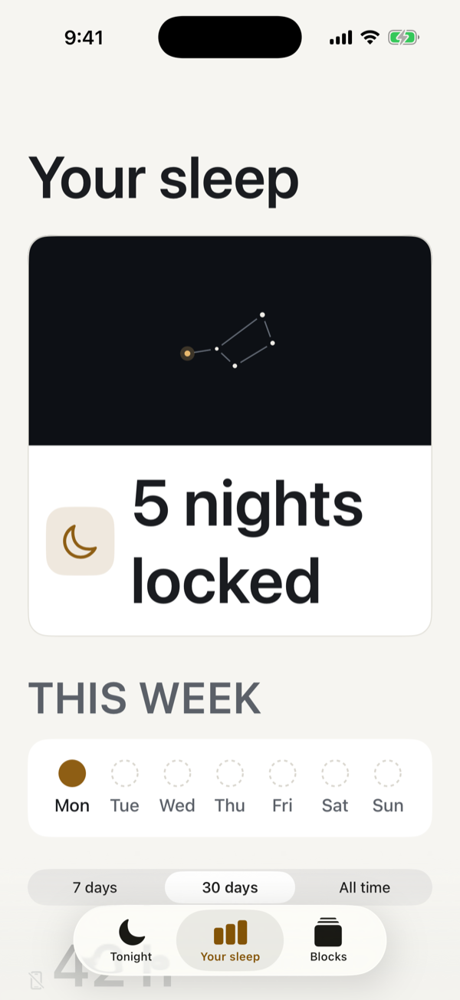 | 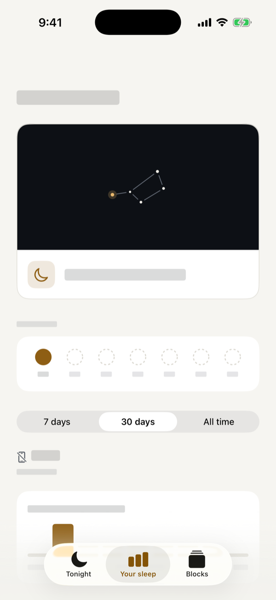 |
| `sleep-sky-30` | 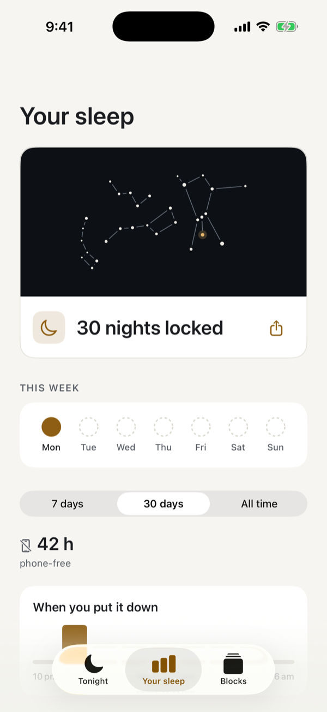 | 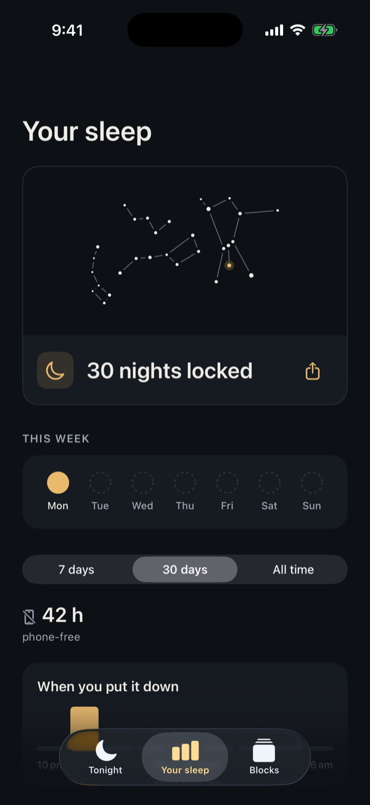 | 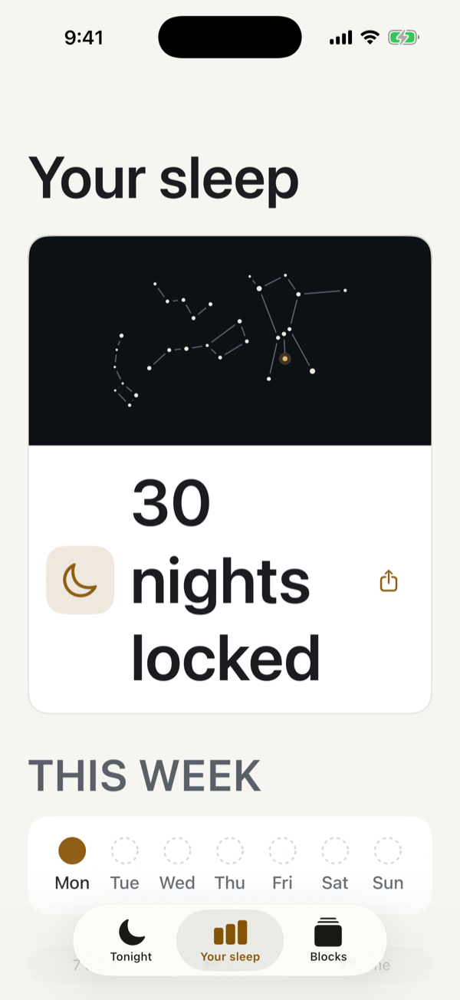 | 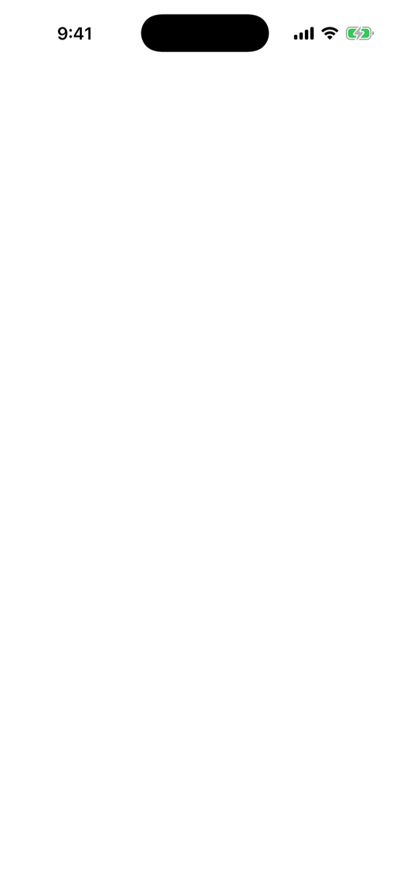 |
| `home-morning-landmark` | 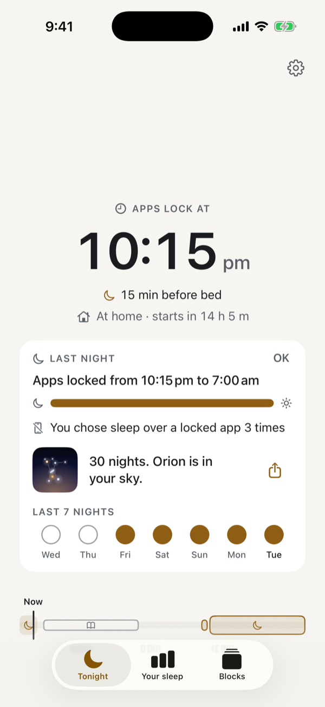 |  |  |  |
| `sky-share` |  |  | 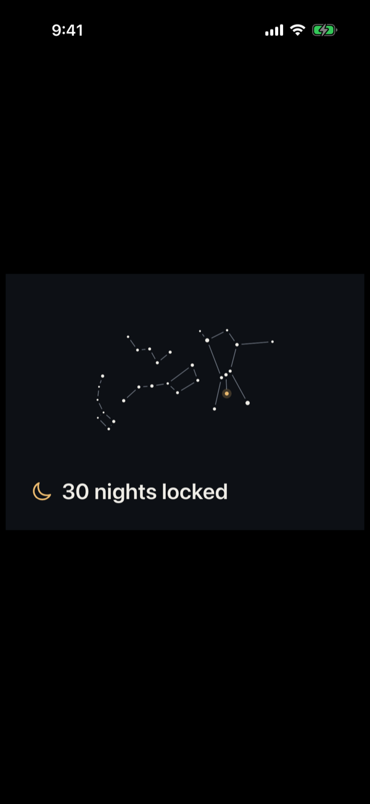 | 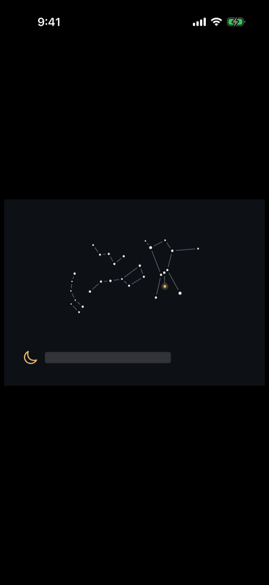 |
