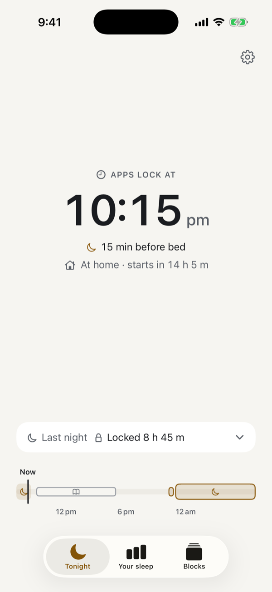
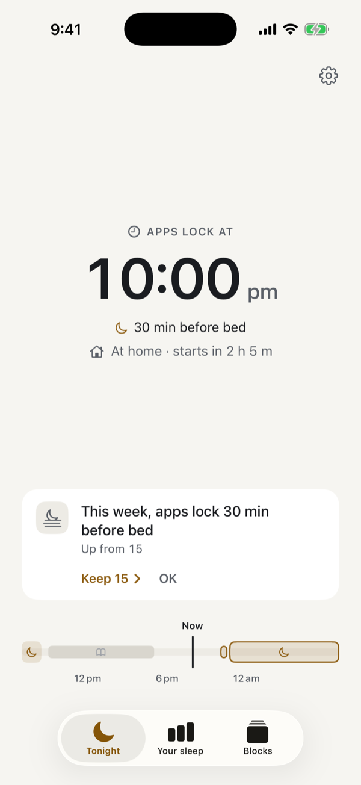
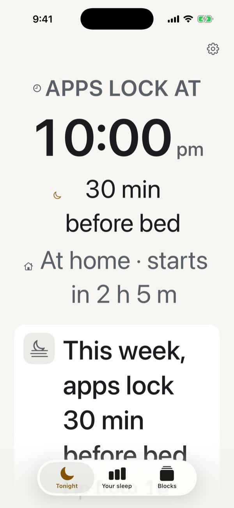
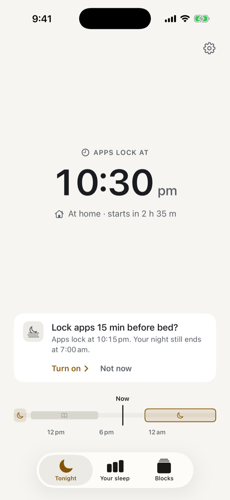
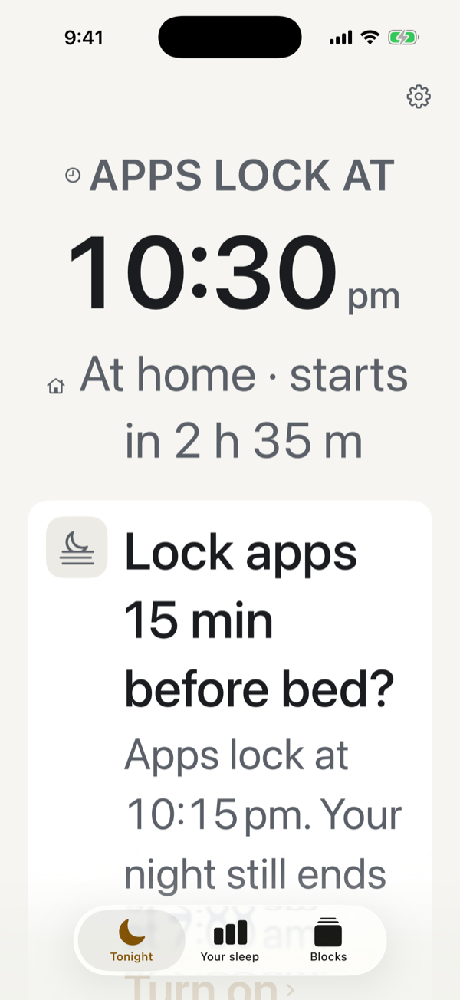
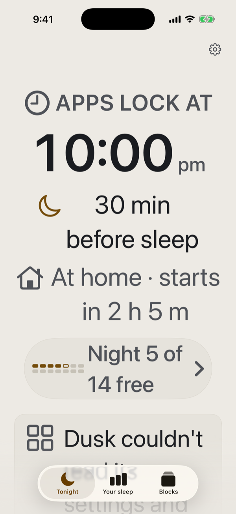
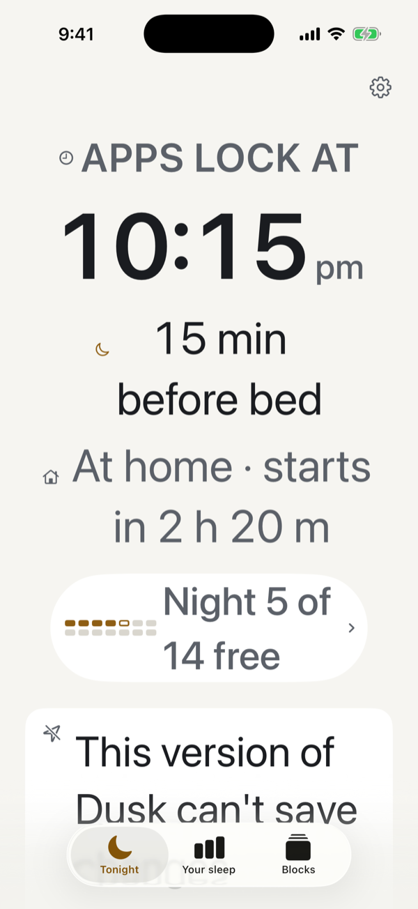
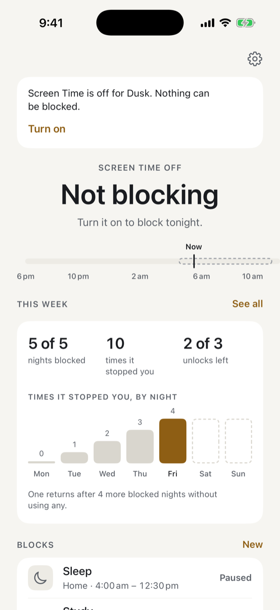
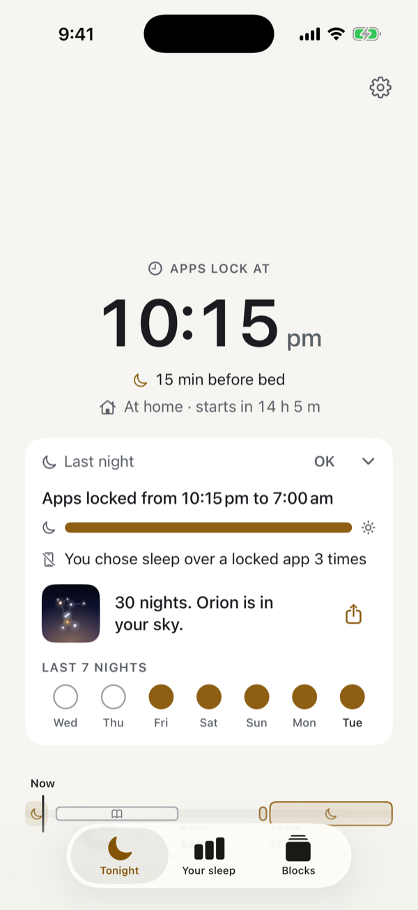

# Renders

Commit `172e317` · 2026-11-25 21:03 UTC · Xcode 26.6 · iPhone-17 iOS-26-5

Each folder holds screen.png, ui.json (accessibility tree), log.txt (app log), launch.txt, and any
crash report. Where the time went: timings.txt.

| Scenario | light | ax5 |
|---|---|---|
| `home-heads-up` |  |  |
| `home-morning-flow` |  |  |
| `home-morning` |  |  |
| `home-gap-week` |  |  |
| `home-gap-offer` |  |  |
| `home-recovered` |  |  |
| `home-read-only` |  |  |
| `home-screen-time-off` |  |  |
| `home-day` |  |  |
| `home-morning-landmark-open` |  |  |
