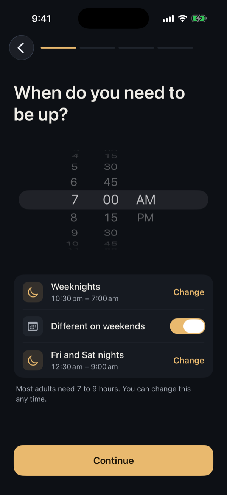
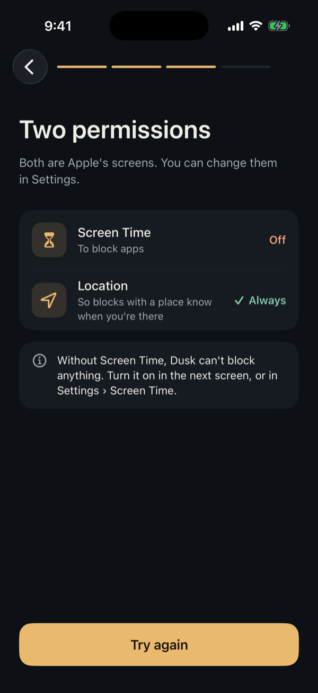
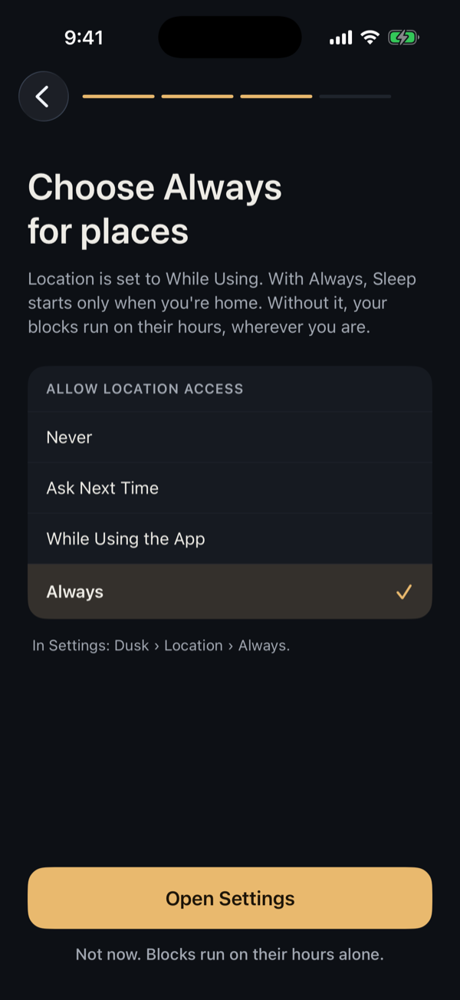
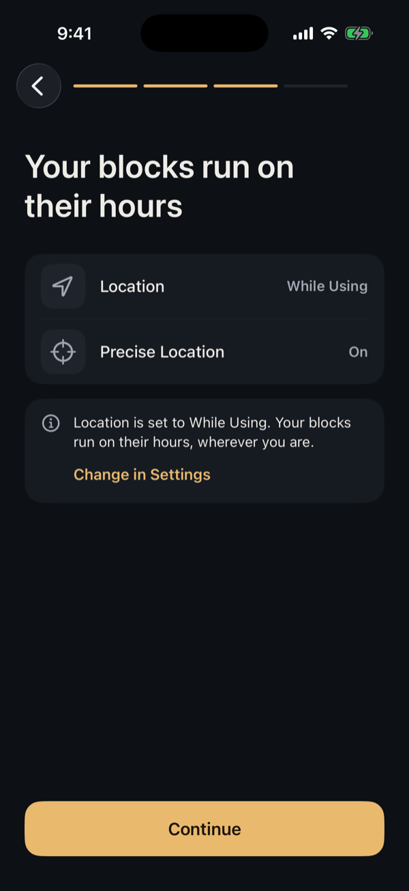
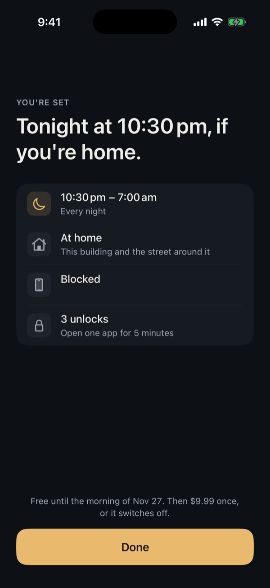

# Renders

Commit `7f8f8c5` · 2026-11-20 00:44 UTC · Xcode 26.6 · iPhone-17 iOS-26-5

Each folder holds screen.png, ui.json (accessibility tree), log.txt (app log), launch.txt, and any
crash report. Where the time went: timings.txt.

| Scenario | dark | light |
|---|---|---|
| `welcome` |  |  |
| `wake` |  |  |
| `wake-weekends` |  |  |
| `home` |  |  |
| `permissions` |  |  |
| `permissions-denied` |  |  |
| `always` |  |  |
| `location-off` |  |  |
| `blocklist` |  |  |
| `ready` |  |  |
| `ready-anywhere` |  |  |
