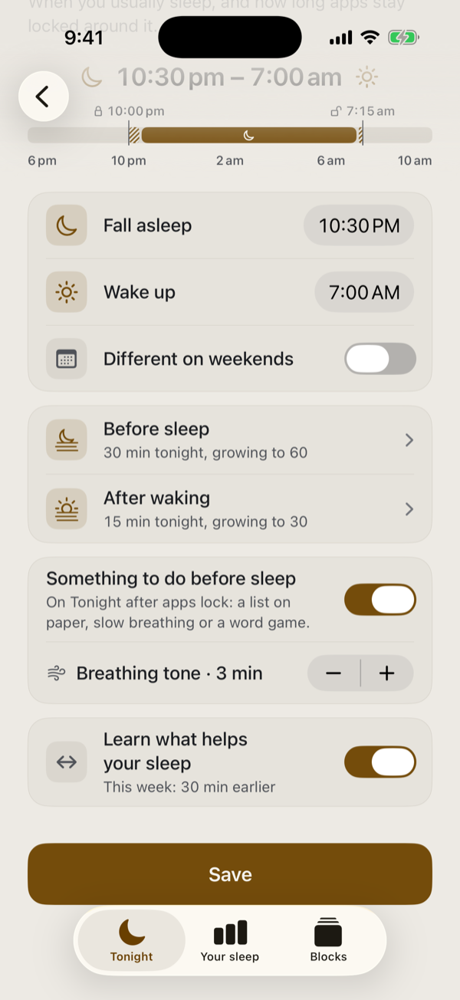
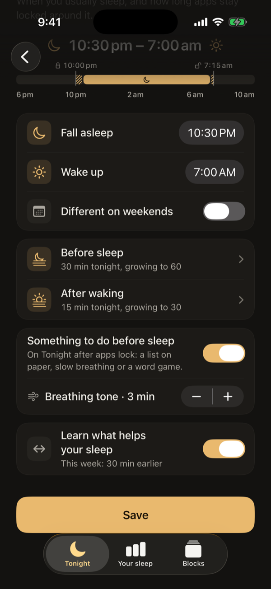
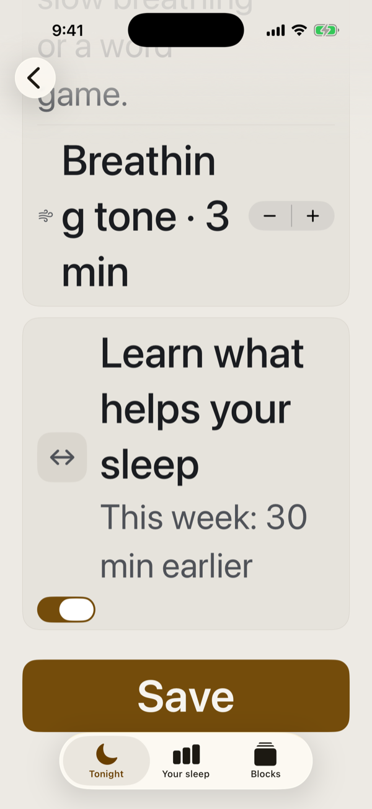
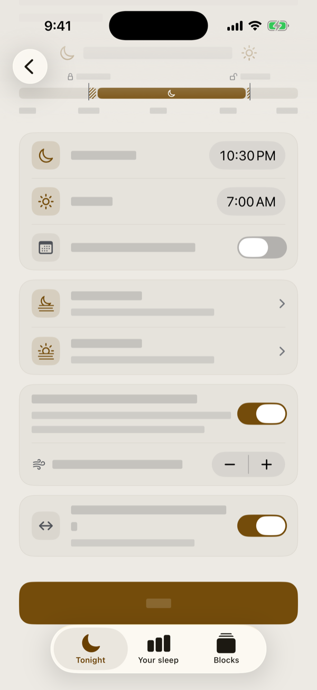
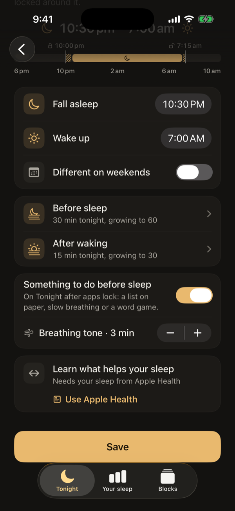
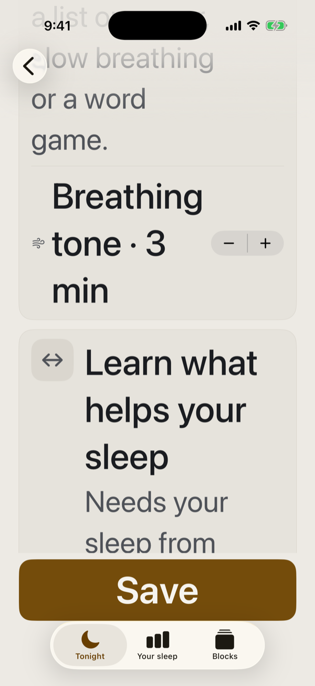
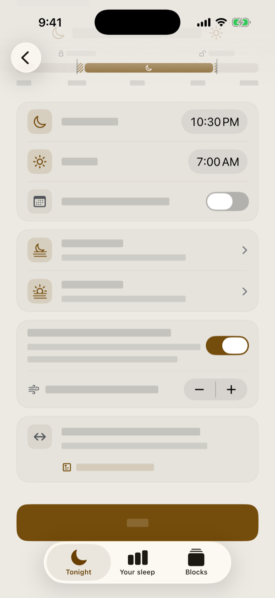

# Renders

Commit `280e9c0` · 2026-11-28 08:02 UTC · Xcode 26.6 · iPhone-17 iOS-26-5

Each folder holds screen.png, ui.json (accessibility tree), log.txt (app log), launch.txt, and any
crash report. Where the time went: timings.txt.

| Scenario | light | dark | ax5 | wordless |
|---|---|---|---|---|
| `settings-sleep-timing-on: swipe --start-x 200 --start-y 650 --end-x 200 --end-y 150; swipe --start-x 200 --start-y 650 --end-x 200 --end-y 150; swipe --start-x 200 --start-y 650 --end-x 200 --end-y 150; swipe --start-x 200 --start-y 650 --end-x 200 --end-y 150` |  |  |  |  |
| `settings-sleep: swipe --start-x 200 --start-y 650 --end-x 200 --end-y 150; swipe --start-x 200 --start-y 650 --end-x 200 --end-y 150; swipe --start-x 200 --start-y 650 --end-x 200 --end-y 150; swipe --start-x 200 --start-y 650 --end-x 200 --end-y 150` |  |  |  |  |
