# Renders

Commit `28e5bb5` · 2026-11-14 00:37 UTC · Xcode 26.6 · iPhone-17 iOS-26-5

Each folder holds screen.png, ui.json (accessibility tree), log.txt (app log), launch.txt, and any
crash report. Where the time went: timings.txt.

| Scenario | light | ax5 |
|---|---|---|
| `welcome` | 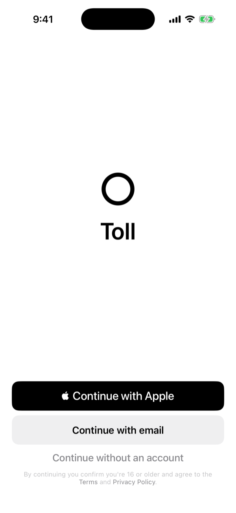 | 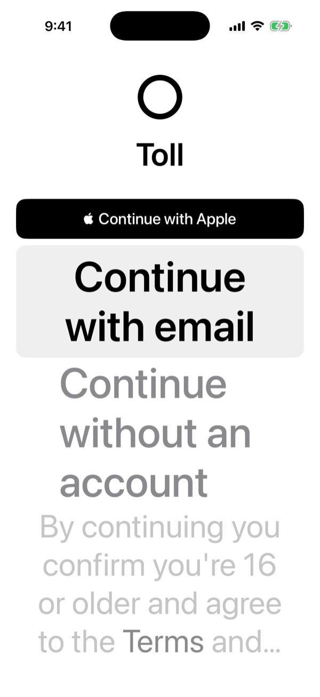 |
| `permissions` | 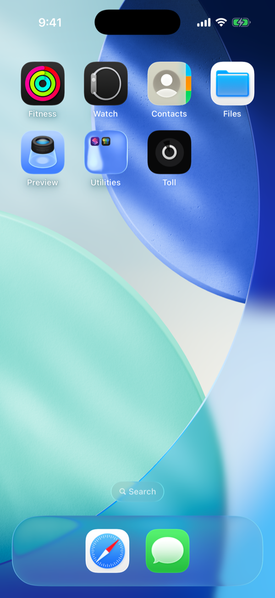 | 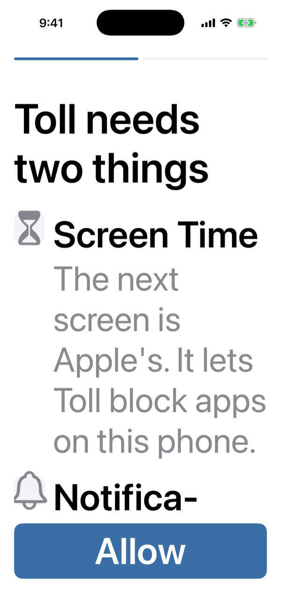 |
| `setup-blocks` | 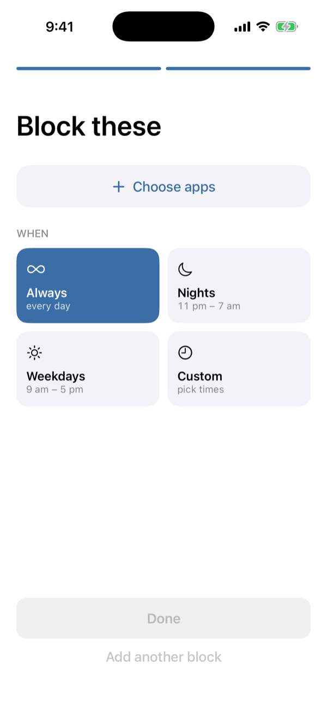 | 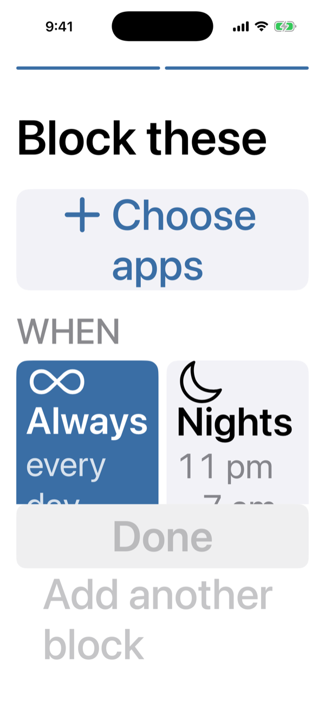 |
| `solo-home` | 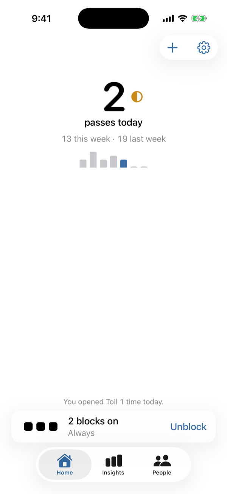 | 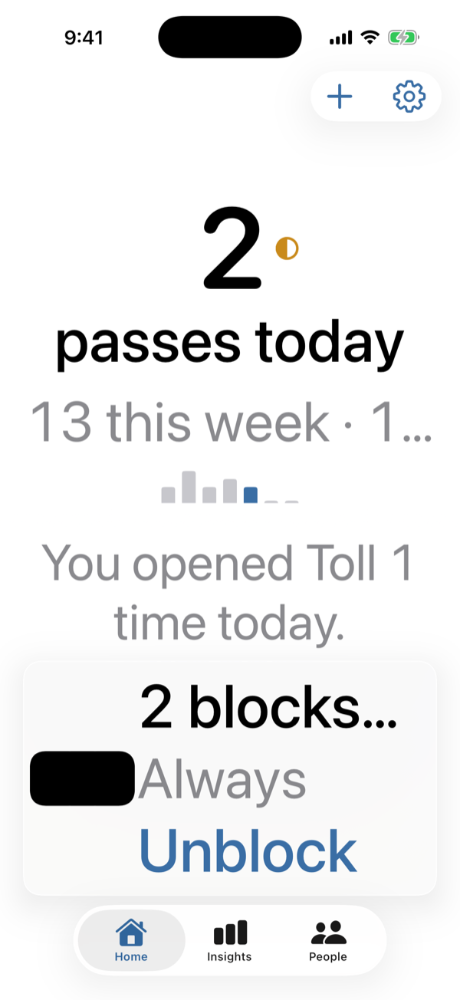 |
| `home` | 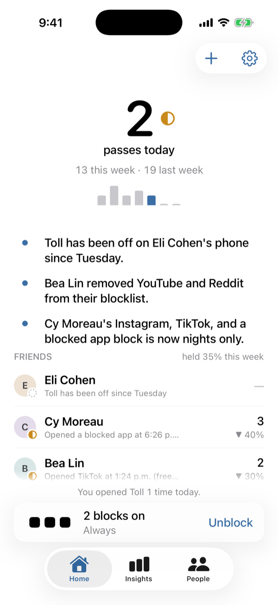 |  |
| `insights` | 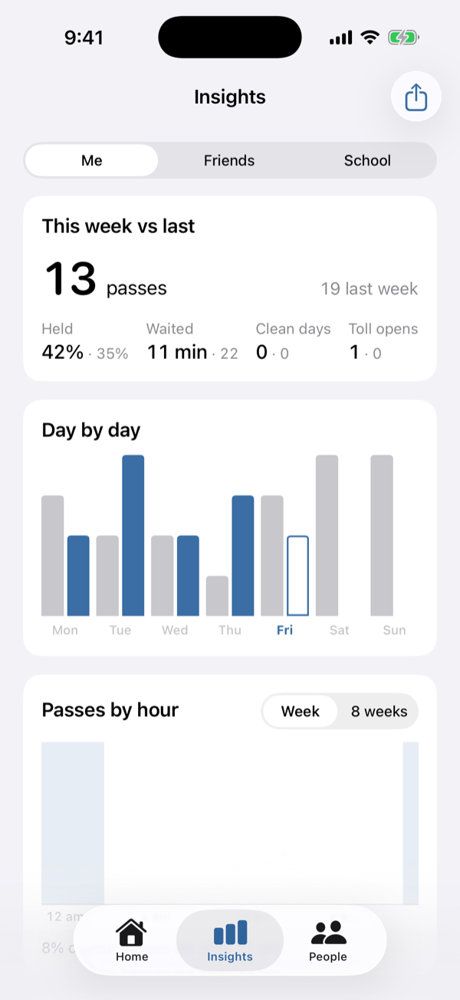 | 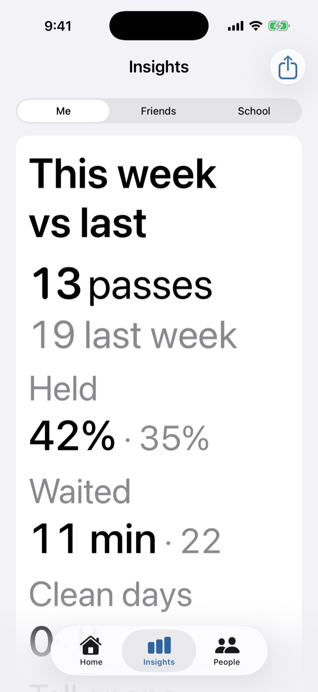 |
| `people` | 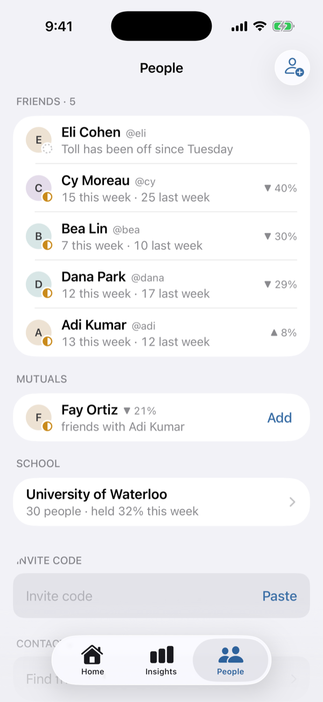 | 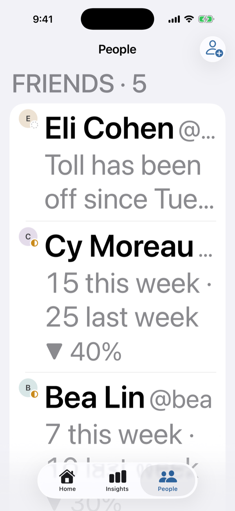 |
| `gate` | 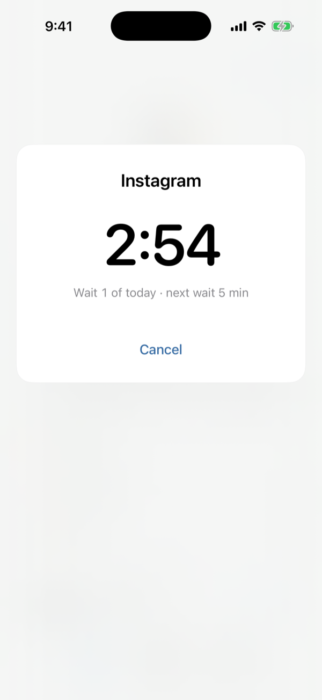 | 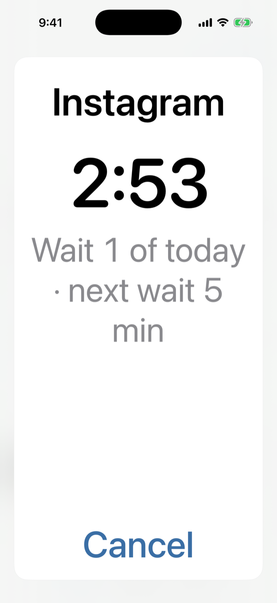 |
| `screen-time-off` | 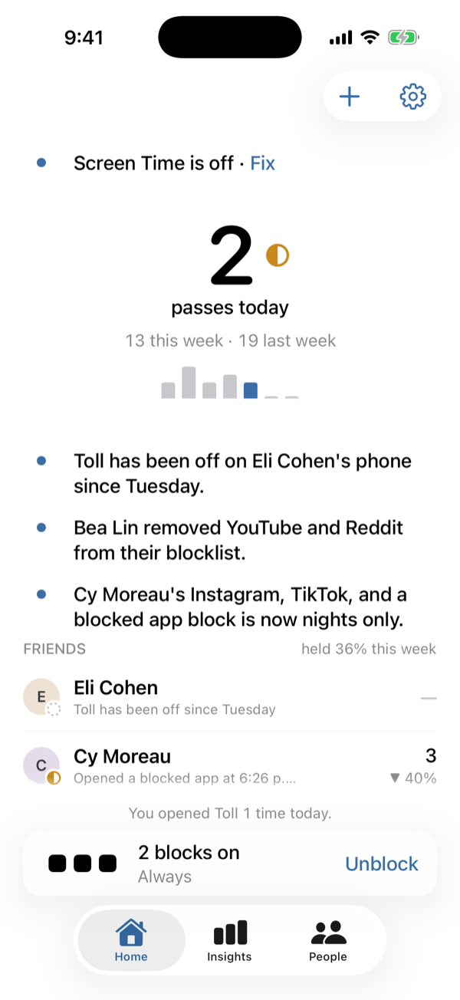 | 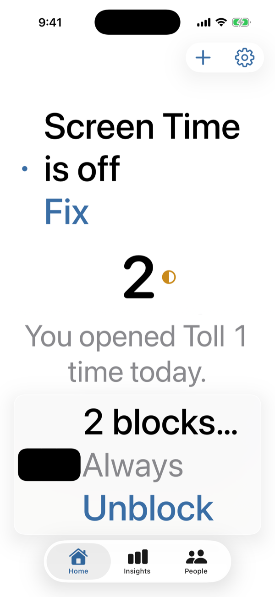 |
