# Renders

Commit `f6ae97f` · 2026-11-28 12:23 UTC · Xcode 26.6 · iPhone-17 iOS-26-5

Each folder holds screen.png, ui.json (accessibility tree), log.txt (app log), launch.txt, and any
crash report. Where the time went: timings.txt.

| Scenario | xxxl | ax5 |
|---|---|---|
| `home-morning-card-open` | 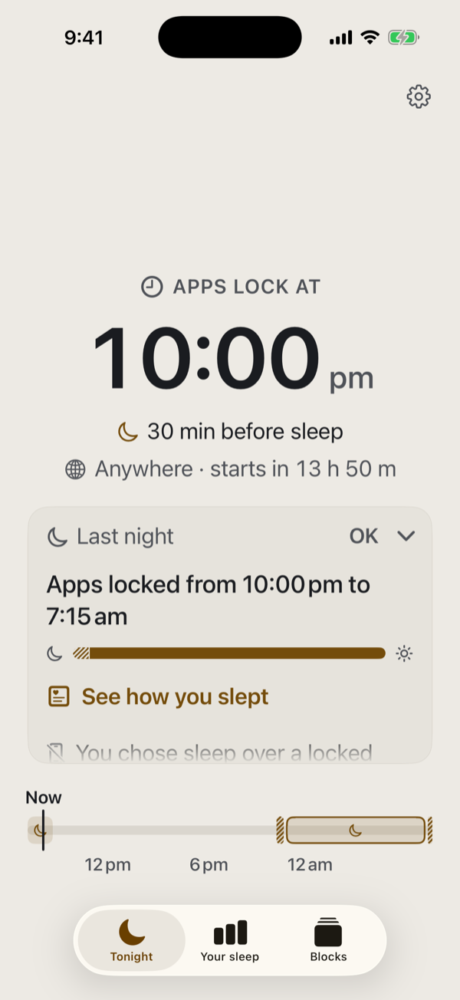 | 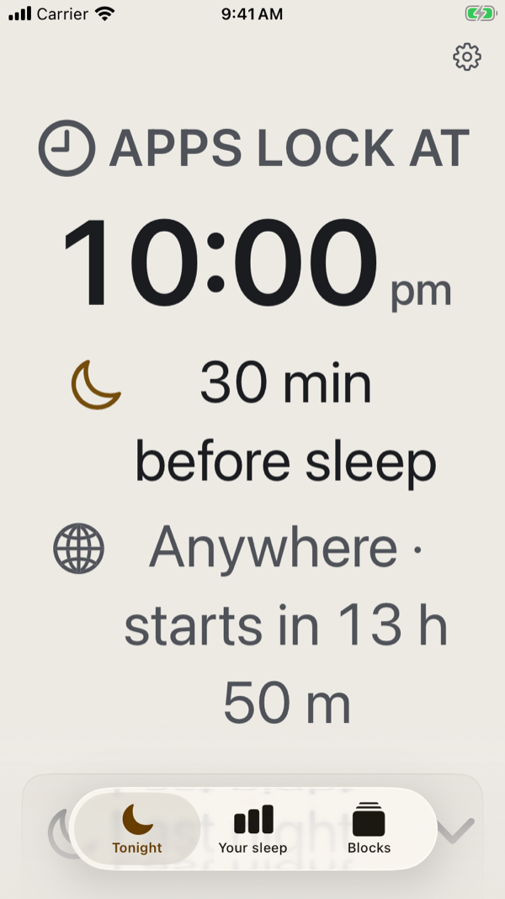 |
| `home-morning-landmark-open` | 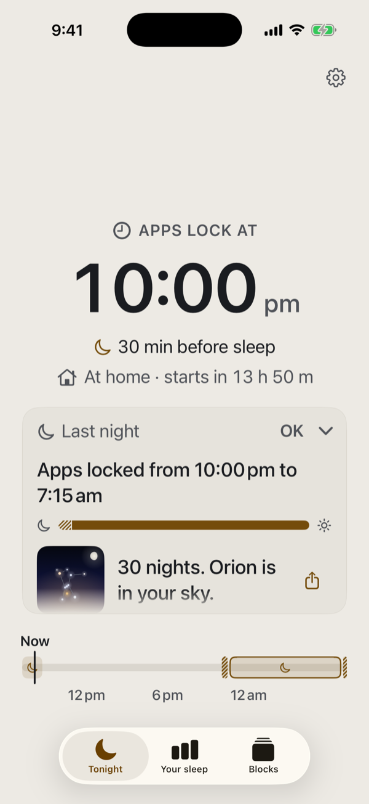 |  |
| `block-edit` | 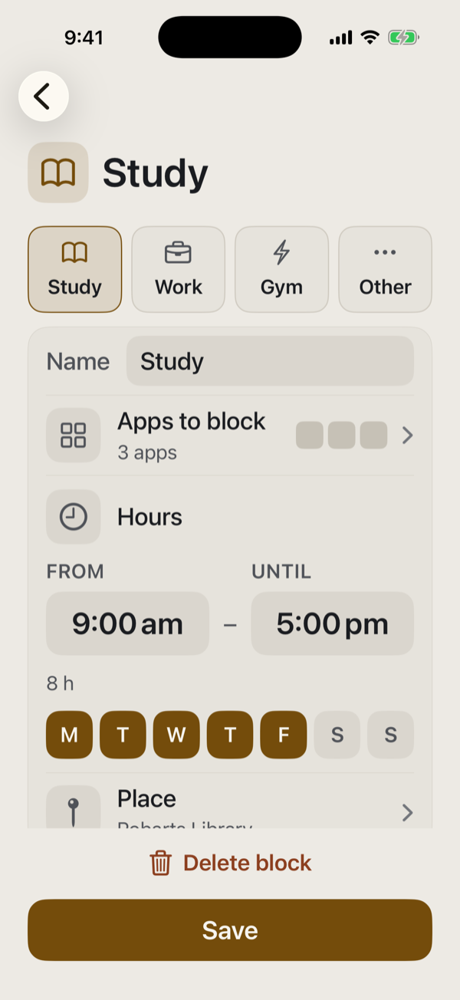 |  |
| `block-edit-on` | 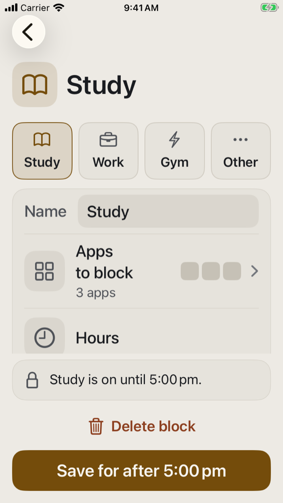 |  |
| `block-edit-on: swipe --start-x 200 --start-y 600 --end-x 200 --end-y 60 --duration 0.15; swipe --start-x 200 --start-y 600 --end-x 200 --end-y 60 --duration 0.15; swipe --start-x 200 --start-y 600 --end-x 200 --end-y 60 --duration 0.15; swipe --start-x 200 --start-y 600 --end-x 200 --end-y 60 --duration 0.15` | 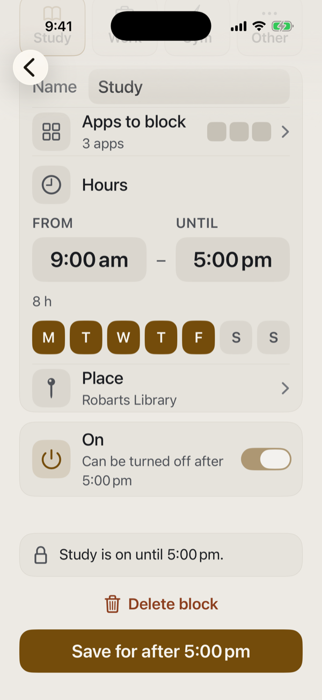 | 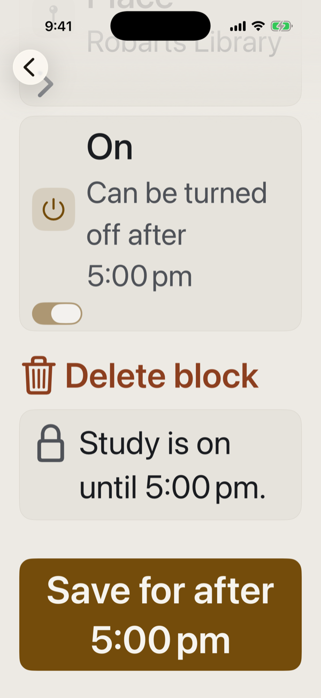 |
| `settings-sleep: swipe --start-x 200 --start-y 600 --end-x 200 --end-y 60 --duration 0.15; swipe --start-x 200 --start-y 600 --end-x 200 --end-y 60 --duration 0.15; swipe --start-x 200 --start-y 600 --end-x 200 --end-y 60 --duration 0.15` | 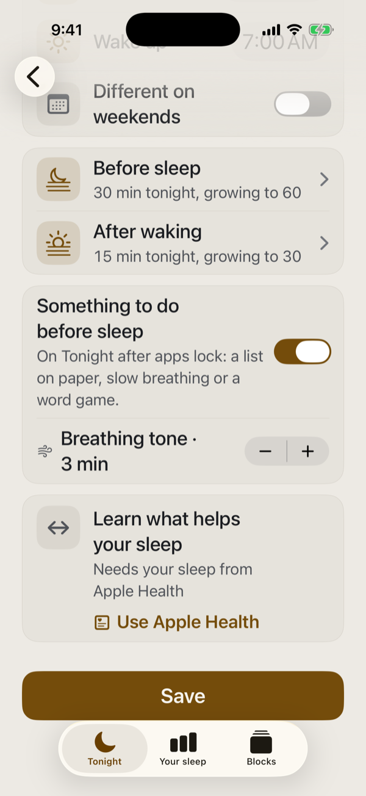 | 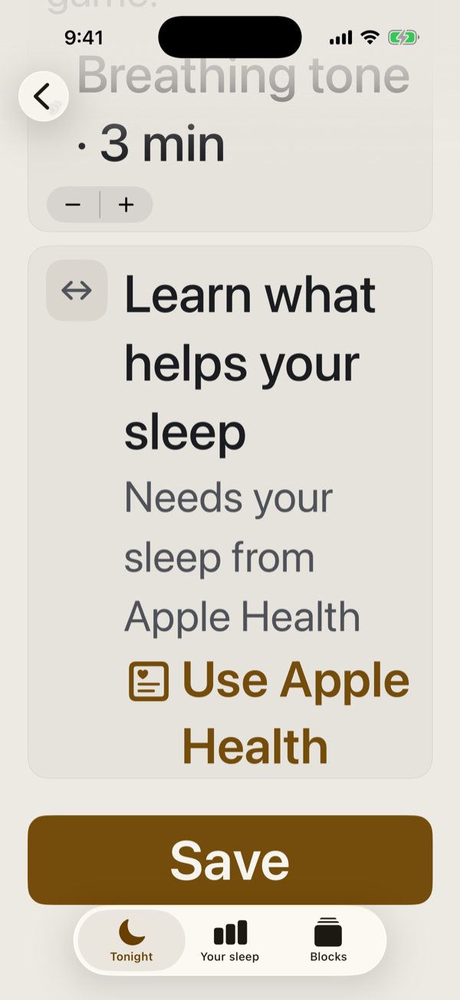 |
| `settings-sleep: swipe --start-y 600 --start-x 200 --end-x 200 --end-y 60 --duration 0.15; swipe --start-x 200 --start-y 600 --end-x 200 --end-y 60 --duration 0.15; swipe --start-x 200 --start-y 600 --end-x 200 --end-y 60 --duration 0.15; swipe --start-x 200 --start-y 600 --end-x 200 --end-y 60 --duration 0.15; swipe --start-x 200 --start-y 600 --end-x 200 --end-y 60 --duration 0.15; swipe --start-x 200 --start-y 600 --end-x 200 --end-y 60 --duration 0.15` |  |  |
| `home-morning-card-open: swipe --start-x 200 --start-y 600 --end-x 200 --end-y 60 --duration 0.15; swipe --start-x 200 --start-y 600 --end-x 200 --end-y 60 --duration 0.15; swipe --start-x 200 --start-y 600 --end-x 200 --end-y 60 --duration 0.15; swipe --start-x 200 --start-y 600 --end-x 200 --end-y 60 --duration 0.15` | 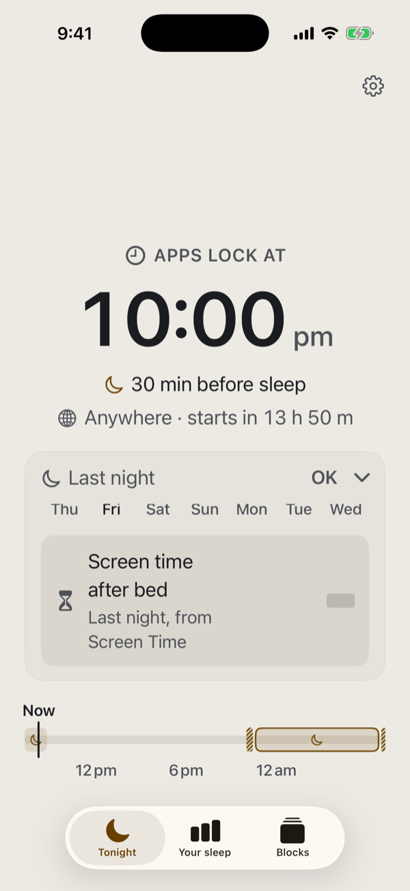 | 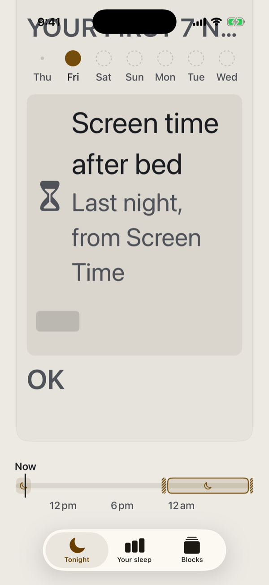 |
