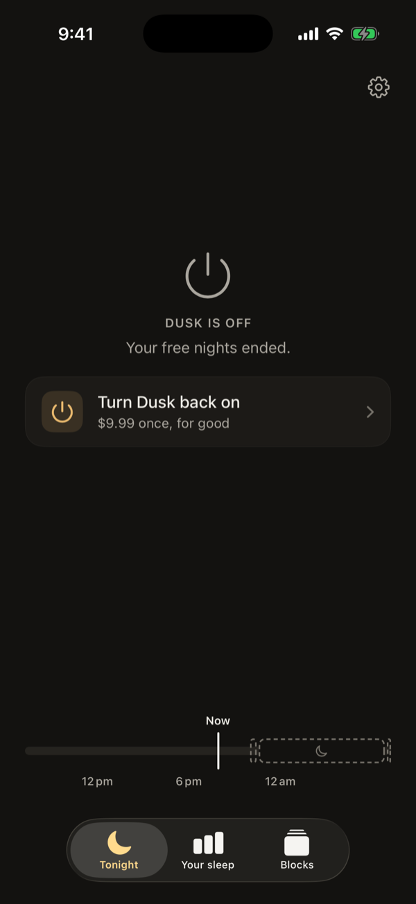
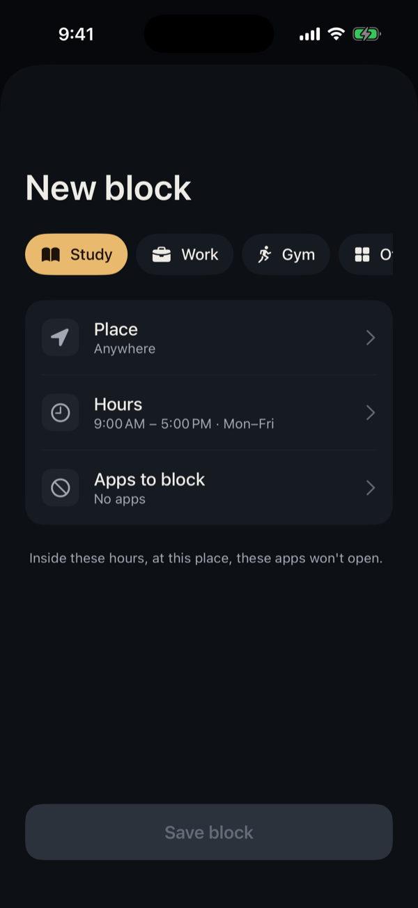

# Renders

Commit `38dee46` · 2026-11-19 18:12 UTC · Xcode 26.6 · iPhone-17 iOS-26-5

Each folder holds screen.png, ui.json (accessibility tree), log.txt (app log), launch.txt, and any
crash report. Where the time went: timings.txt.

| Scenario | dark |
|---|---|
| `welcome` |  |
| `wake` |  |
| `home` |  |
| `blocklist` |  |
| `ready` |  |
| `home-evening` |  |
| `home-blocked` |  |
| `home-paused` |  |
| `door-waiting` |  |
| `door-open` |  |
| `settings` |  |
| `insights` |  |
| `block-new` |  |
