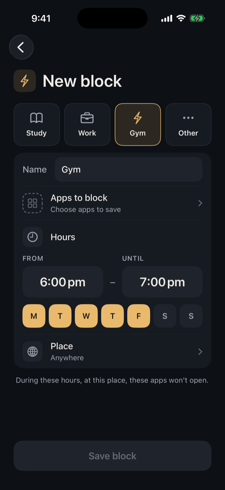
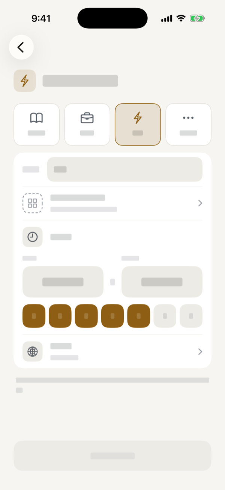
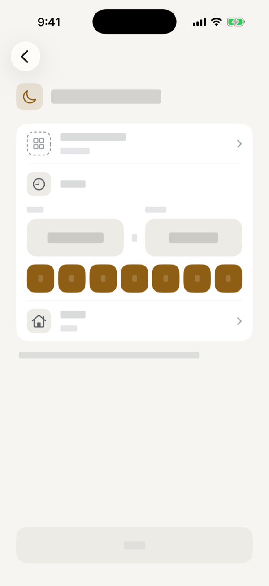
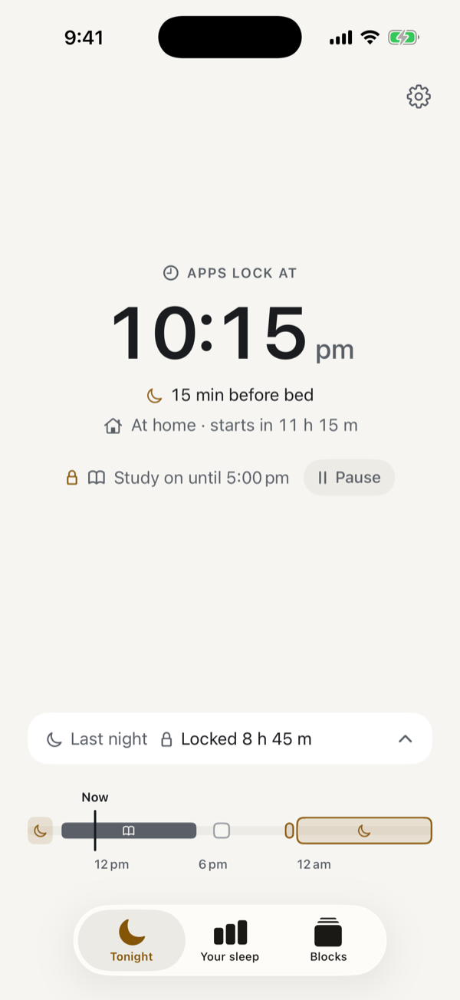
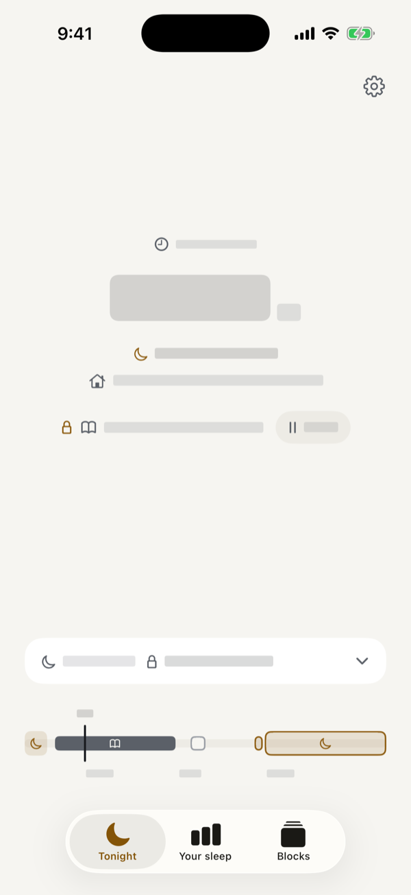
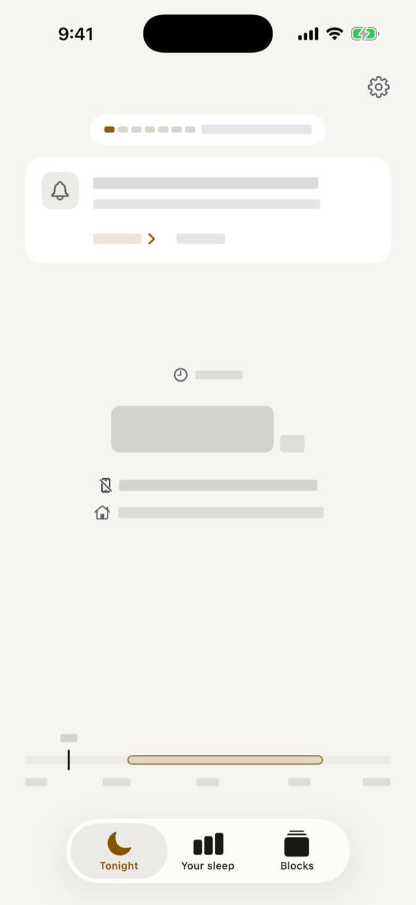
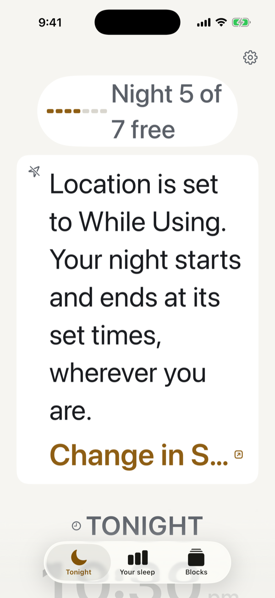
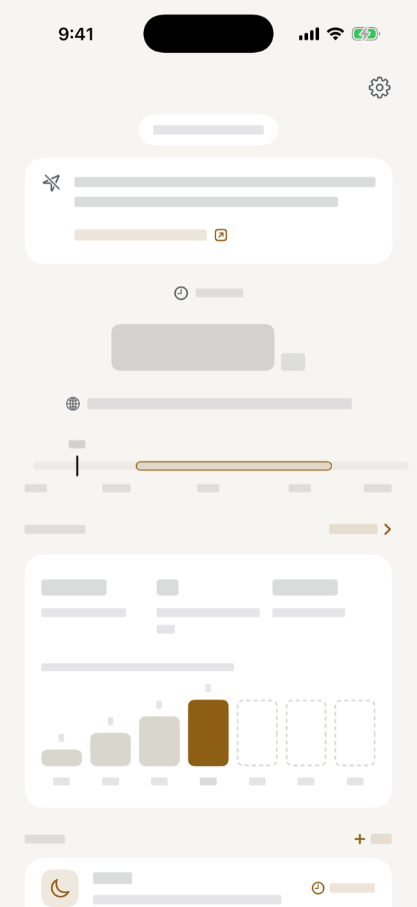

# Renders

Commit `8ec15f5` · 2026-11-23 23:39 UTC · Xcode 26.6 · iPhone-17 iOS-26-5

Each folder holds screen.png, ui.json (accessibility tree), log.txt (app log), launch.txt, and any
crash report. Where the time went: timings.txt.

| Scenario | light | dark | ax5 | wordless |
|---|---|---|---|---|
| `blocks` |  |  |  |  |
| `block-new-gym` |  |  |  |  |
| `block-edit-on` |  |  |  |  |
| `block-night` |  |  |  |  |
| `home-day` |  |  |  |  |
| `home-heads-up` |  |  |  |  |
| `home-location` |  |  |  |  |
