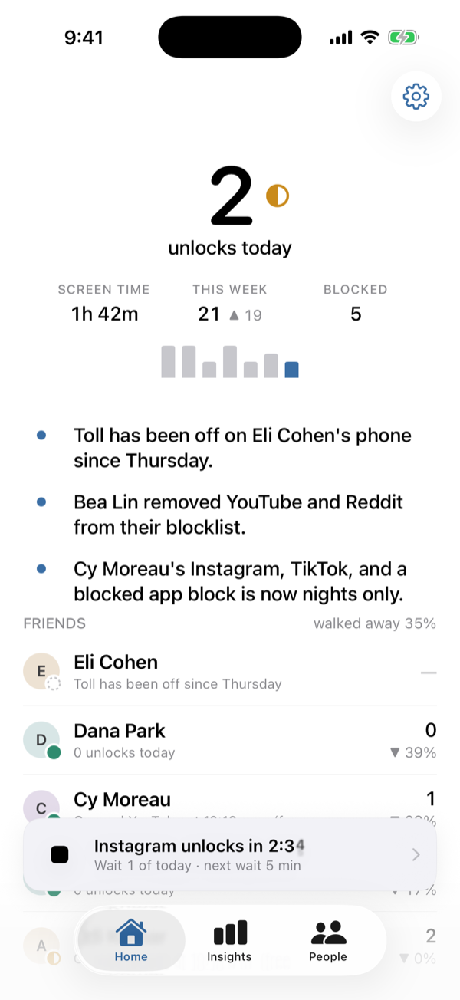
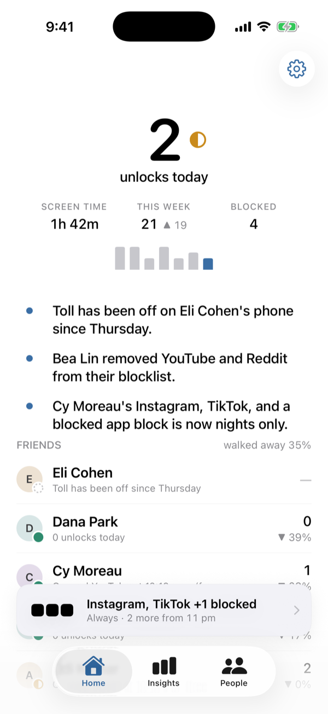

# Renders

Commit `fcce2e9` · 2026-11-15 19:54 UTC · Xcode 26.6 · iPhone-17 iOS-26-5

Each folder holds screen.png, ui.json (accessibility tree), log.txt (app log), launch.txt, and any
crash report. Where the time went: timings.txt.

| Scenario | light |
|---|---|
| `gate: tap -x 195 -y 160` |  |
| `session: tap --id stateBar --wait-timeout 5; tap --label "Lock now" --wait-timeout 5` |  |
