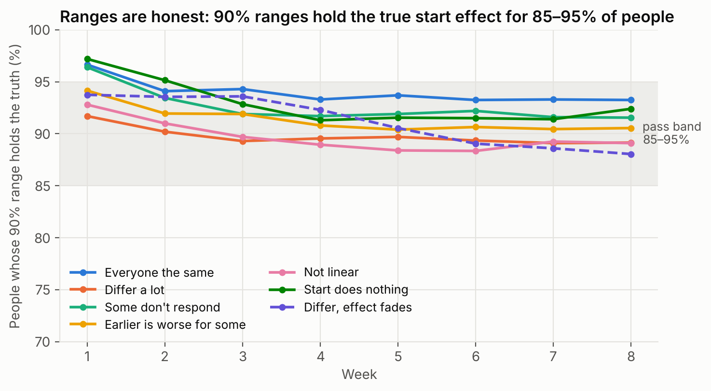
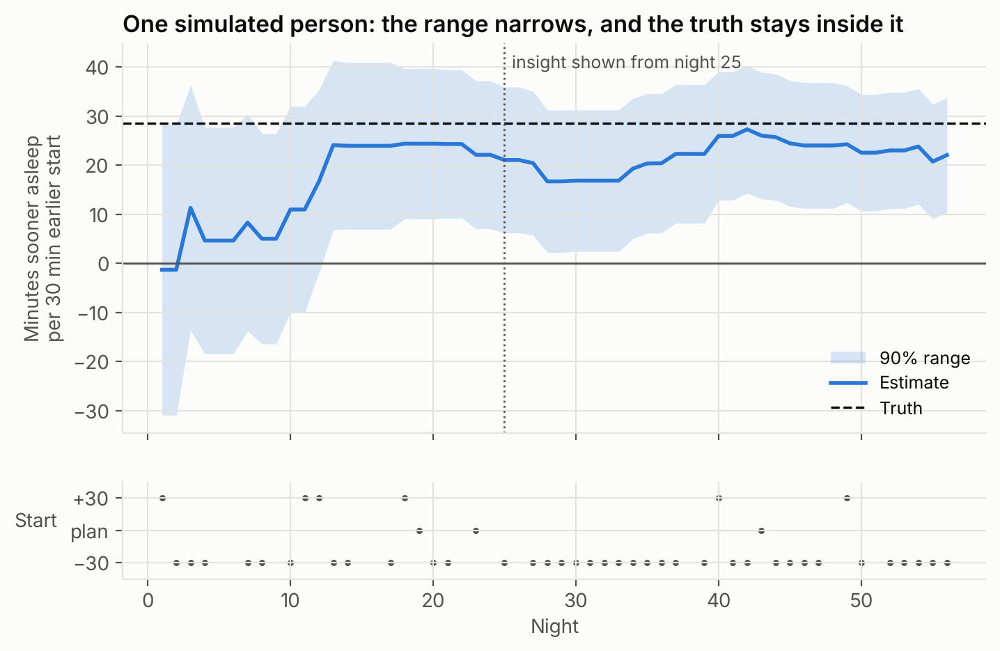
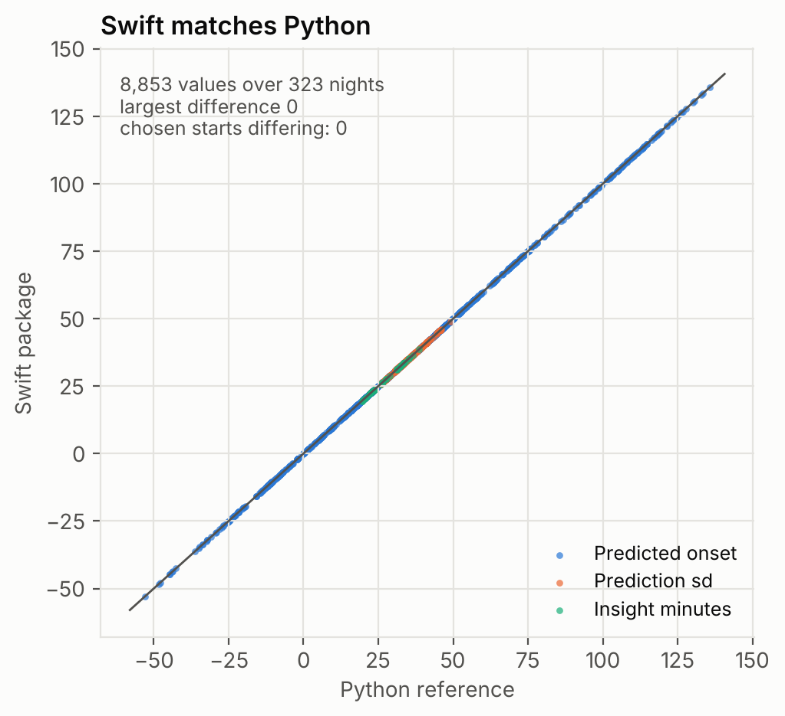
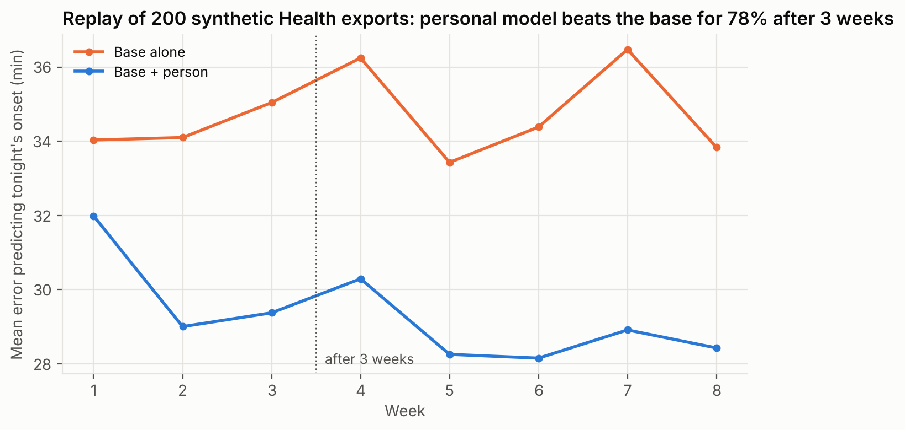

# datascience

Dusk's sleep model, built, fitted and tested in Python, following the founders' model spec ("Dusk internal: sleep model spec"; decisions D47 and D48). The app gets only a small JSON file of numbers (`artifacts/sleep-model.v0.json`) and the pure Swift package `ios/Packages/SleepModel`, which must give the same numbers as the reference here. Nothing in this folder is imported by the app, and nothing here needs the app.

```
dusk_model/   reference implementation: rng, artifact, night records, model, policy, insights
sim/          synthetic people, six scenarios, the pass criteria, tuning, figures
replay/       real nights in (Health export or Dusk's night records), prediction error out
export/       writes the artifact and the parity fixtures; compares the Swift package (parity.py)
artifacts/    every exported version, kept; fixtures.jsonl
reports/      criteria.json, tuning.md, figures/
tests/        pytest
```

## Setup

[uv](https://docs.astral.sh/uv/) with the pinned lockfile; Python 3.13, numpy, matplotlib, pytest.

```bash
cd datascience && uv sync
```

## The model, in one paragraph

For each night the outcome is when the person fell asleep, in minutes from planned bedtime. A frozen base predicts it from 4 features: an intercept, the block's start offset per 30 minutes (−30, 0 or +30), weekend, and a late arrival home. Each person has 4 numbers that correct the base, learned by Bayesian linear regression one night at a time: a 4×4 precision matrix and a vector, one small solve a night. People who opt in get Thompson sampling over the start, with every allowed start kept at a 10% chance or more and the chance logged. The one insight is the start's effect: "When the block started 30 minutes earlier, you were asleep N minutes sooner (range A to B)". It shows after 14 usable nights, when its 90% range is narrower than 30 minutes and a 98% range is clear of zero.

## Commands

| What | Command |
|---|---|
| Unit tests | `uv run pytest` |
| Pass criteria (about 8 min) | `uv run python -m sim.criteria --people 2000 --safety-people 10000` |
| Tuning sweep (about 20 min) | `uv run python -m sim.tune` |
| Export the artifact and fixtures | `uv run python -m export`, then `../ios/scripts/sync-model.sh` |
| Swift against Python | `uv run python -m export.parity` (needs Swift) |
| Figures | `uv run python -m sim.figures` |
| Replay your own Health data | `uv run python -m replay --health path/to/export.xml --bedtime 23:00 --weekend-bedtime 23:30` |
| Replay Dusk's night records | `uv run python -m replay --records nights.jsonl` |

The Health export is from the Health app: Profile › Export All Health Data, then unzip it. Only sleep samples are read, and nothing leaves the laptop. Until the app logs night records, each night is replayed with the block at plan.

## Shipping a new artifact

1. Change the numbers in `export/v0.py` (or add `v1.py` with a new version string).
2. `uv run python -m sim.criteria` must pass, and `reports/tuning.md` says why the numbers changed.
3. `uv run python -m export && ../ios/scripts/sync-model.sh`, then `swift test --package-path ../ios/Packages/SleepModel`.
4. Commit the artifact, fixtures and Swift copies together. The weight change is reviewed as a diff.

CI (`.github/workflows/model.yml`) checks every step: the unit tests, that the committed files are exactly what the code exports, the checksum, that the Swift package holds the same files, the pass criteria, and the Swift tests on Linux. `ios.yml` runs the Swift tests again on macOS.

## Results (sleep-model.v0)

2,000 simulated people per scenario, 8 weeks each; safety over 10,000 (`reports/criteria.json`).

| Check | Pass mark | Result | |
|---|---|---|---|
| Ranges are honest | 90% ranges hold the truth for 85–95%, every scenario | 89.1–93.3% | Pass |
| Helps when people differ | Earlier sleep than always the plan | 5.8 min a night earlier | Pass |
| Little harm when they don't | At most 5 min a night worse | 0.5 min earlier | Pass |
| No false insights | At most 5% shown an effect under the null | 3.7% | Pass |
| Never unsafe | No start outside the allowed ones; wake time never moves | 0 and 0 in 476,209 block nights | Pass |
| Same numbers on the phone | Every fixture passes | 8,853 values over 323 nights, identical on Linux | Pass |
| Learns fast enough (spec) | Median person gets an insight by night 28 | 13% by night 28 | Waived (D48) |
| Learns fast enough (proposed) | Half of people with an effect of 15 min or more, by night 56 | 56% | Pass |
| Better than the base | Lower error after 3 weeks (replay) | Synthetic Health exports: 78% of people; founders' and pilot data pending | Not yet run on real data |








## What the simulator can't tell us

It tests the method, not Dusk: every scenario is an assumption, and the people in it fall asleep the way we wrote them to. The replay harness on the founders' Health exports is the first real test, then the pilot (model spec, section 4).
