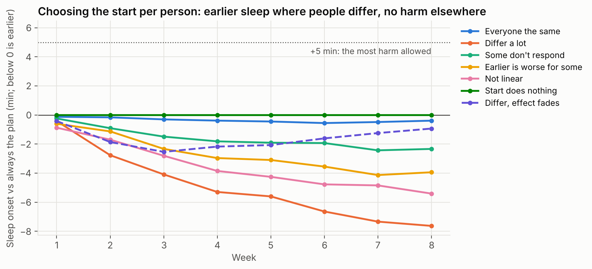
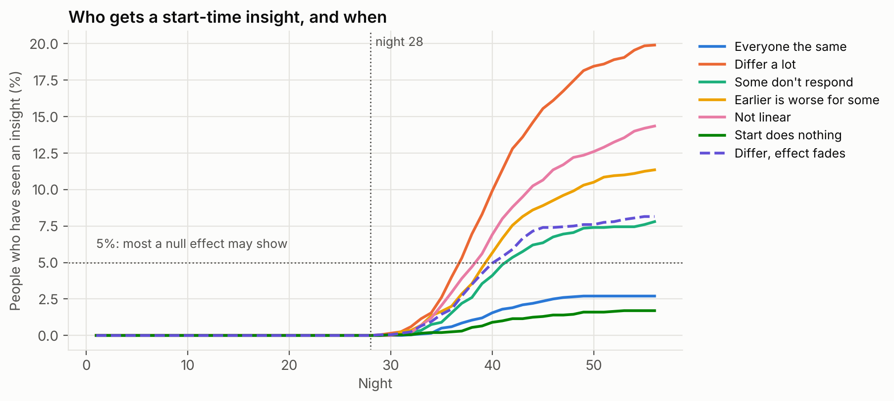
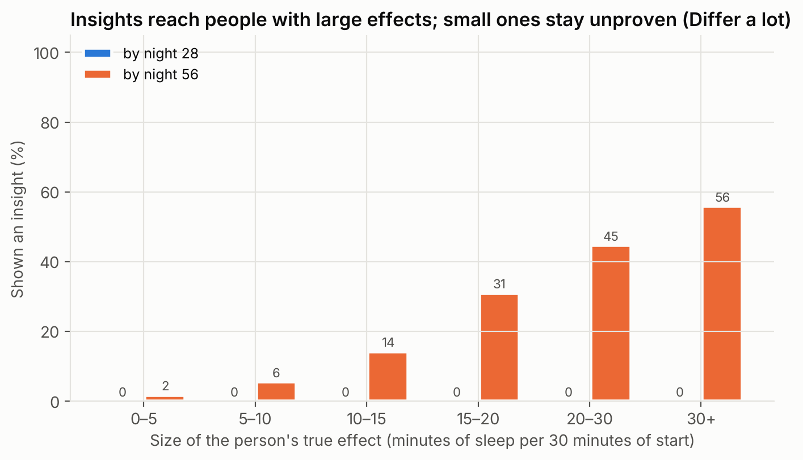
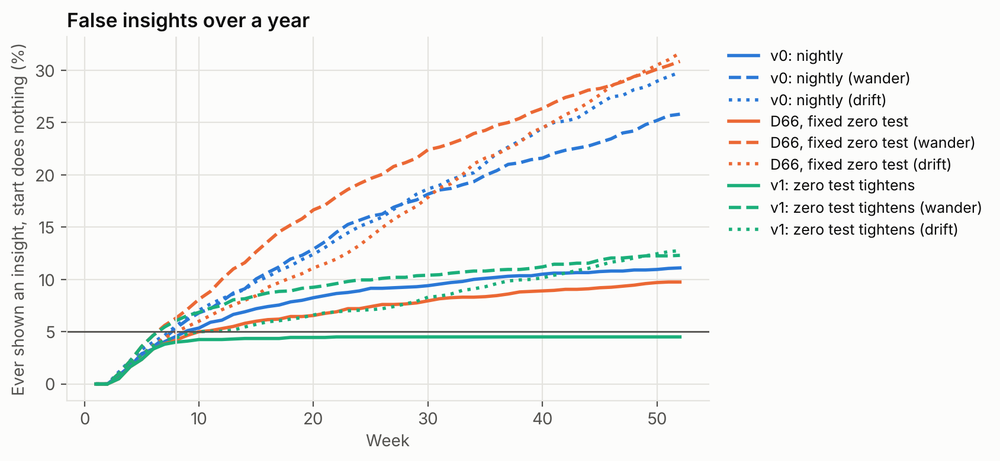

# datascience

Dusk's sleep model, built, fitted and tested in Python, following the founders' model spec ("Dusk internal: sleep model spec"; decisions D52 and D53). The app gets only a small JSON file of numbers (`artifacts/sleep-model.v2.json`; every earlier version is kept beside it) and the pure Swift package `ios/Packages/SleepModel`, which must give the same numbers as the reference here. Nothing in this folder is imported by the app, and nothing here needs the app.

```
dusk_model/   reference implementation: rng, artifact, night records, model, policy, the held week (timing), insights
sim/          synthetic people, six scenarios, background change in the usual time (wander.py, over profiles.py's grid), the pass criteria, tuning, dampened start policies, the growing gap, a year of nights, figures
replay/       real nights in (Health export or Dusk's night records), prediction error out
economy/      the buffer suggestion's reference and fixtures (#145), and the buffer and pause studies (#61)
trends/       Your sleep's trend rule: its reference and fixtures, a noise generator and the study (#165)
export/       writes the artifacts (v0.py, v1.py, v2.py), the parity fixtures and the rebuild fixture; compares the Swift package (parity.py)
artifacts/    every exported version, kept; fixtures.jsonl; rebuild.json (a night log and the state rebuilt from it)
reports/      criteria.json, tuning.md, figures/
tests/        pytest
```

## Setup

[uv](https://docs.astral.sh/uv/) with the pinned lockfile; Python 3.13, numpy, matplotlib, pytest.

```bash
cd datascience && uv sync
```

## The model, in one paragraph

For each night the outcome is when the person fell asleep, in minutes from planned bedtime. A frozen base predicts it from 4 features: an intercept, the block's start offset per 30 minutes (−30, 0 or +30), weekend, and a late arrival home. Each person has 4 numbers that correct the base, learned by Bayesian linear regression one night at a time: a 4×4 precision matrix and a vector, one small solve a night. People who opt in get a start held for a week (D66): on each Monday, Thompson sampling picks −30, 0 or +30, with every allowed start kept at a 10% chance or more, and the start holds to Sunday. Once the insight shows, the start settles on the side it supports; once the 90% range is inside ±15 minutes, it settles at the plan; a settled person draws again about one week in 14, and settling is checked afresh every week. The exact chance of each week's start is logged on each of its nights (`dusk_model/timing.py`). The one insight is the start's effect: "When the block started 30 minutes earlier, you were asleep N minutes sooner (range A to B)". It shows after 28 usable nights (14 before v2), when its 90% range is narrower than 30 minutes and a stricter range is clear of zero: 94.5% up to 30 usable nights (98% before v2), then stricter as the nights add up (its miss chance falls as (30 / nights)²), so false insights stay under 5% for as long as Dusk is used (#117, `reports/longrun.md`). An insight already showing stays while the untightened range is clear of zero, and is withdrawn quietly when it isn't. Since v2 (#154) a person's usual time can move and their nights can be noisier than the base assumes: each night's residual, before the night is learned, is divided by its predicted sd, and the sums of a week (and of a week with the next) give each person a noise scale κ², which widens every range by κ; the zero tests are a Student t's, with the weeks the scale rests on as degrees of freedom. The model can also let its intercept wander between weeks (a Kalman step); v2 leaves that off, since the scale does the job for less learning (`reports/longrun.md`, section 7).

## Commands

| What | Command |
|---|---|
| Unit tests | `uv run pytest` |
| Pass criteria (about 8 min; includes a year of null nights, alone and with the usual time moving) | `uv run python -m sim.criteria --people 2000 --safety-people 10000` |
| Tuning sweep (about 20 min) | `uv run python -m sim.tune` |
| Dampened start policies (about 5 min; `reports/dampening.md`) | `uv run python -m sim.dampen_sweep` |
| The growing gap with personal timing (about 3 min; `reports/gap.md`) | `uv run python -m sim.gap_sweep marks --out reports/gap-sweep.json` |
| A year of nights: false insights and learning (about 20 min; `reports/longrun.md` lists every run) | `uv run python -m sim.longrun --people 1000 --out reports/longrun-sweep.json` |
| Export the artifact and fixtures | `uv run python -m export`, then `../ios/scripts/sync-model.sh` |
| Swift against Python | `uv run python -m export.parity` (needs Swift) |
| Figures | `uv run python -m sim.figures` |
| Replay your own Health data | `uv run python -m replay --health path/to/export.xml --bedtime 23:00 --weekend-bedtime 23:30` |
| Replay Dusk's night records | `uv run python -m replay --records nights.jsonl` |
| The buffer suggestion's fixtures for TollCore (#145) | `uv run python -m economy.fixtures` |
| The buffer suggestion in the simulator (`reports/buffers.md`) | `uv run python -m economy.buffers --people 2000 --out reports/buffers-final.json` |
| The pause economy (`reports/pauses.md`, #61) | `uv run python -m economy.pauses grid --out reports/pauses-grid.json` |
| Your sleep's trend rule's fixtures for TollCore (#165) | `uv run python -m trends.fixtures` |
| The trend rule's false changes and power (about 15 min; `reports/trends.md`) | `uv run python -m trends.study final --people 3000 --out reports/trends-final.json` |
| The same on your own export's noise, kept off the repo | `uv run python -m trends.noise calibrate --aggregates mine.json --out profiles.json`, then `trends.study final --profiles profiles.json` |

The Health export is from the Health app: Profile › Export All Health Data, then unzip it. Only sleep samples are read, and nothing leaves the laptop. Until the app logs night records, each night is replayed with the block at plan.

## Shipping a new artifact

1. Add `export/vN.py` with a new version string and list it in `export/versions.py`; the last one listed is the one the app carries. Never change a version that has shipped.
2. `uv run python -m sim.criteria` must pass, and `reports/tuning.md` says why the numbers changed.
3. `uv run python -m export && ../ios/scripts/sync-model.sh`, then `swift test --package-path ../ios/Packages/SleepModel`.
4. Commit the artifact, fixtures and Swift copies together. The weight change is reviewed as a diff.

CI (`.github/workflows/model.yml`) checks every step: the unit tests, that the committed files are exactly what the code exports, the checksum, that the Swift package holds the same files, the pass criteria, and the Swift tests on Linux. `ios.yml` runs the Swift tests again on macOS.

## Results (sleep-model.v2)

2,000 simulated people per scenario, 8 weeks each; safety over 10,000; the null for a year over 2,000, alone and with the usual time moving (`reports/criteria.json`). v1's results, from the same command when it shipped, are beside them.

| Check | Pass mark | v2 | v1 | |
|---|---|---|---|---|
| Ranges are honest | 90% ranges hold the truth for 85–95%, every scenario | 90.2–92.3% | 89.8–93.5% | Pass |
| Helps when people differ | Earlier sleep than always the plan | 5.0 min a night earlier (6.8 in weeks 5–8) | 5.4 min (7.6) | Pass |
| Little harm when they don't | At most 5 min a night worse | 0.4 min earlier | 0.3 min earlier | Pass |
| No false insights | At most 5% shown an effect under the null, by night 56 | 1.7% | 3.2% | Pass |
| No false insights over a year (#117) | The same, by night 364 | 2.0% (four other runs: 1.8–3.0%) | 3.9% | Pass |
| No false insights while the usual time moves (#154) | The same, by night 364, with the wander, the drift and each of nine invented profiles (`sim/profiles.py`) | wander 2.4%, drift 2.8%, the profiles 0.3–4.0% | 12.3%, 12.8%, 11–96% (`longrun.md`, section 7) | Pass |
| Learns fast enough (D66, lowered to 40% for v2) | 40% of people with an effect of 15 min or more get an insight by night 56 (half before v2) | 41.7% (six other runs: 38.4–43.1%) | 52.6% | Pass |
| Learns fast enough (spec) | Median person gets an insight by night 28 | None by night 28 (no insight before 28 usable nights) | 16% | Waived (D53, D66) |
| Calm | D66: the start changes about once in two weeks | 0.51 changes a week (differ) | 0.49 | |
| Never unsafe | No start outside the allowed ones; wake time never moves | 0 and 0 in 476,209 block nights | 0 and 0 | Pass |
| Same numbers on the phone | Every fixture passes | 28,122 values over 848 nights in 15 cases, identical on Linux | 17,422 over 638 | Pass |
| Better than the base | Lower error after 3 weeks (replay) | Synthetic Health exports: 77.5% of people; founders' and pilot data pending | 78% | Not yet run on real data |









## What the simulator can't tell us

It tests the method, not Dusk: every scenario is an assumption, and the people in it fall asleep the way we wrote them to. The replay harness on the founders' Health exports is the first real test, then the pilot (model spec, section 4).
