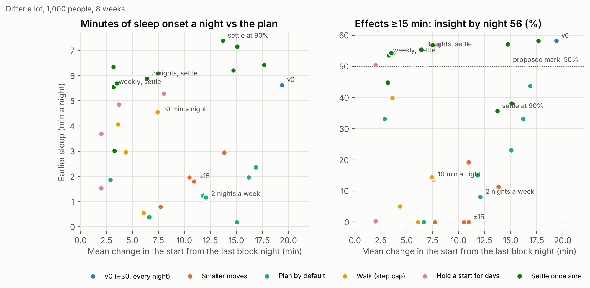

# Dampening the start's moves

v0 moves tonight's block start among −30, 0 and +30 minutes by Thompson sampling with a 0.10 floor. With the start's effect modelled as a straight line, the plan wins only about 22% of nights (D53), so most people who opt in see their start jump by 30 minutes on most nights. The founder wants smaller, rarer, calmer moves (D65). This report tries the ways to get there and what each one costs, in sleep and in how fast the model learns. It is exploration in the simulator, not a new artifact. `artifacts/`, `export/v0.py` and the Swift package are unchanged.

```
uv run python -m sim.dampen_sweep --people 1000 --out reports/dampening-sweep.json            # every policy, about 5 min
uv run python -m sim.dampen_sweep --people 2000 --seed 20261120 --stress \
  --only v0,weekly,weekly-settle,weekly-settle-plan15,dwell3-settle-plan15 --out reports/dampening-final.json
uv run python -m sim.dampen_figure
```

The policies are in `sim/dampen.py`. The model, its nightly update and the insight rule are v0's. Only how the start is chosen changes, and every choice is logged with its exact chance. The simulated people, their nights and their limits are the same as in `sim.criteria`. The sweep uses 1,000 people per scenario, 300 posterior draws and seed 7, and includes the stress scenarios. The finalists were rerun on 2,000 people with a different seed.

## How to read the tables

- **Δ** is the change in sleep onset against always using the plan, in minutes a night (below zero means asleep earlier), for differ / same / nonlinear. Under the null it is 0.0 for every policy by construction, because the start does nothing there.
- **Coverage** is the lowest and highest share, over the six scenarios, of people whose 90% range holds their true effect at night 56. The pass band is 85–95%.
- **Null** is the share of people in the null scenario ever shown an insight. The mark is at most 5%.
- **By 28 / by 56 / ≥15** are "differ" people with an insight by night 28 and by night 56, and those whose true effect is 15 minutes or more with one by night 56. The proposed criterion (D53) is at least 50% for that last group.
- **Churn** is measured in "differ". "Moved" is the number of nights a week the start differs from the plan. |off| is the mean distance of the start from the plan. |chg| is the mean change from the last block night, in minutes. "Changes" is the number of nights a week the start differs from the night before.

## Every policy tried (1,000 people per scenario)

| Tried | Δ differ / same / nonlinear | Coverage (%) | Null (%) | By 28 / by 56 / ≥15 (%) | Moved · \|off\| · \|chg\| · changes |
|---|---|---|---|---|---|
| **v0**: ±30, Thompson every night, floor 0.10 | −5.6 / −0.4 / −3.9 | 88–94 | 2.9 | 15 / 29 / 58 | 4.7 · 24 · 19.4 · 2.7 |
| *1. Smaller moves* | | | | | |
| ±15 | −1.8 / −0.1 / −1.2 | 91–96 | 0.0 | **0 / 0 / 0** | 4.7 · 12 · 10.9 · 3.0 |
| ±15, effect stated per 15 min (prior sd 40 per 30) | −2.0 / −0.1 / −1.3 | 91–94 | 0.0 | **0 / 0 / 0** | 4.7 · 12 · 10.5 · 2.8 |
| ±15, range allowed up to 30 min per 15 | −1.8 / −0.1 / −1.2 | 91–96 | 1.4 | 3 / 8 / **19** | 4.7 · 12 · 10.9 · 3.0 |
| −20, −10, 0, 10, 20 (floor 0.06) | −2.9 / −0.2 / −1.9 | 90–95 | 0.2 | 0 / 5 / **11** | 4.9 · 15 · 13.8 · 3.2 |
| −10, −5, 0, 5, 10 (floor 0.06) | −0.8 / −0.1 / −0.5 | 92–**98** | 0.0 | **0 / 0 / 0** | 4.9 · 8 · 7.7 · 3.5 |
| *2. The plan by default* | | | | | |
| Explore 1 night a week, plan otherwise | −0.4 / −0.0 / −0.2 | 92–**97** | 0.0 | **0 / 0 / 0** | 0.7 · 3 · 6.6 · 1.3 |
| Explore 2 nights a week | −1.1 / −0.1 / −0.7 | 90–96 | 0.2 | 0 / 4 / **8** | 1.3 · 7 · 12.1 · 2.3 |
| Explore 3 nights a week | −2.0 / −0.1 / −1.2 | 89–96 | 1.8 | 0 / 16 / **33** | 2.0 · 10 · 16.2 · 3.0 |
| 2 nights a week, −30 or +30 at random | −0.2 / −0.1 / −0.1 | 91–95 | 0.5 | 0 / 10 / **23** | 1.7 · 9 · 15.0 · 2.9 |
| Plan's chance at least 0.5 | −2.4 / −0.2 / −1.6 | 90–94 | 1.7 | 2 / 19 / **44** | 2.4 · 12 · 16.9 · 3.0 |
| Plan's chance at least 0.7 | −1.2 / −0.1 / −0.7 | 91–96 | 0.2 | 0 / 6 / **15** | 1.4 · 7 · 11.8 · 2.2 |
| *3. Smoothness: walk toward the draw* | | | | | |
| 5-min grid, at most 5 min from last night | −3.0 / −0.2 / −2.1 | 90–**98** | 0.3 | 0 / 2 / **5** | 5.1 · 13 · 4.3 · 5.2 |
| 5-min grid, at most 10 min | −4.5 / −0.3 / −3.2 | 91–**97** | 0.5 | 0 / 6 / **14** | 5.0 · 16 · 7.5 · 4.6 |
| 10-min grid, at most 10 min | −4.5 / −0.3 / −3.3 | 90–**97** | 0.4 | 0 / 7 / **14** | 4.8 · 16 · 7.5 · 4.5 |
| *Hold one start for several nights* | | | | | |
| Hold 3 nights | −5.3 / −0.4 / −3.4 | 88–94 | 3.7 | 14 / 28 / 57 | 4.7 · 23 · 8.0 · 1.1 |
| Hold a week | −4.9 / −0.4 / −3.3 | 90–94 | 3.8 | 16 / 28 / 54 | 4.7 · 24 · 3.7 · 0.5 |
| Hold two weeks | −3.7 / −0.3 / −2.4 | 90–95 | 3.8 | 12 / 27 / 50 | 4.6 · 23 · 2.0 · 0.3 |
| Hold a week, 10-min grid, at most 10 min a night | −4.1 / −0.3 / −2.9 | 90–96 | 2.7 | 5 / 19 / **40** | 4.9 · 20 · 3.6 · 2.2 |
| Hold a week at ±15 | −1.5 / −0.1 / −1.0 | 90–**97** | 0.0 | **0 / 0 / 0** | 4.7 · 12 · 2.0 · 0.6 |
| Hold a week, plan's chance at least 0.5 | −1.9 / −0.2 / −1.2 | 89–96 | 1.7 | 4 / 15 / **33** | 2.4 · 12 · 2.9 · 0.5 |
| *4. Settle once sure* (then one exploring night or week in 14) | | | | | |
| Nightly, settle at the insight | −6.4 / −0.4 / −4.3 | 88–94 | 2.9 | 15 / 29 / 58 | 4.8 · 24 · 17.7 · 2.4 |
| Nightly, settle at the insight; 10-min grid, at most 10 | −4.6 / −0.3 / −3.3 | 90–**97** | 0.4 | 0 / 7 / **14** | 4.8 · 17 · 7.4 · 4.4 |
| Nightly, settle when one start is best in 90% of draws | −7.4 / −0.5 / −5.2 | 90–95 | 1.4 | 11 / 18 / **36** | 4.9 · 25 · 13.7 · 1.9 |
| Same, 95% of draws | −7.2 / −0.4 / −4.9 | 89–94 | 1.4 | 11 / 19 / **38** | 4.9 · 24 · 15.1 · 2.1 |
| Nightly, settle at the insight, or at the plan once the 90% range is inside ±15 | −6.2 / −0.3 / −4.2 | 88–95 | 2.6 | 15 / 28 / 57 | 4.1 · 20 · 14.7 · 2.1 |
| *5. Combinations* | | | | | |
| 2 nights a week, settle at the insight | −1.2 / −0.1 / −0.7 | 90–96 | 0.2 | 0 / 4 / **8** | 1.4 · 7 · 12.1 · 2.3 |
| 3 nights a week, 10-min grid, at most 10, settle | −0.6 / −0.0 / −0.3 | 91–**98** | 0.0 | **0 / 0 / 0** | 2.2 · 5 · 6.1 · 3.6 |
| Hold a week, settle at the insight | −5.7 / −0.4 / −3.9 | 90–94 | 3.8 | 16 / 28 / 54 | 4.8 · 24 · 3.5 · 0.5 |
| **Hold a week, settle at the insight or at the plan (±15)** | −5.6 / −0.4 / −3.9 | 90–95 | 3.4 | 16 / 27 / 53 | 4.1 · 21 · 3.2 · 0.5 |
| Same, settled start at most 15 min from the plan | −3.0 / −0.3 / −2.4 | 90–94 | 3.4 | 16 / 27 / 53 | 3.4 · 17 · 3.3 · 0.5 |
| Same, plan once inside ±10 | −5.7 / −0.4 / −3.9 | 90–94 | 3.8 | 16 / 28 / 54 | 4.7 · 24 · 3.5 · 0.5 |
| Hold a week, settle when best in 95% of draws | −6.3 / −0.5 / −4.5 | 90–94 | 2.5 | 15 / 22 / **45** | 4.8 · 24 · 3.2 · 0.5 |
| Hold a week at ±15, settle | −1.5 / −0.1 / −1.0 | 90–**97** | 0.0 | **0 / 0 / 0** | 4.7 · 12 · 2.0 · 0.6 |
| Hold 3 nights, settle at the insight | −6.1 / −0.4 / −3.9 | 88–93 | 3.7 | 14 / 28 / 57 | 4.7 · 24 · 7.5 · 1.0 |
| **Hold 3 nights, settle at the insight or at the plan (±15)** | −5.9 / −0.3 / −3.8 | 88–95 | 3.5 | 14 / 27 / 55 | 4.0 · 20 · 6.4 · 0.9 |

Bold in a cell marks a value outside its pass mark, or an insight rate near zero. Every policy kept every start within the person's limits, and none ever moves the wake time (see Safety). The raw numbers, including nonresponders, worse, and the drift and fade stress scenarios, are in `dampening-sweep.json`.

## The finalists (2,000 people per scenario, a fresh seed)

| | v0 | Hold a week | Hold a week, settle | **Hold a week, settle or plan (±15)** | Hold 3 nights, settle or plan (±15) |
|---|---|---|---|---|---|
| Δ differ / same / nonlinear (min) | −5.9 / −0.4 / −4.2 | −4.9 / −0.4 / −3.3 | −5.8 / −0.4 / −3.9 | **−5.6 / −0.3 / −3.7** | −6.2 / −0.4 / −4.2 |
| Δ differ, weeks 5–8 | −7.0 | −6.6 | −8.1 | **−7.8** | −7.9 |
| Coverage, 6 scenarios / with fade (%) | 90.0–93.0 / 90.5 | 89.8–93.2 / 88.5 | 89.7–93.0 / 88.5 | **89.8–94.9 / 89.5** | 90.1–93.3 / 90.6 |
| False insights: null / null + drift (%) | 4.0 / 4.3 | 3.8 / 4.4 | 3.8 / 4.4 | **3.5 / 4.2** | 3.8 / 4.3 |
| Differ insight by 28 / by 56 (%) | 14 / 30 | 17 / 29 | 17 / 29 | **17 / 29** | 14 / 28 |
| Effects ≥15 min by 56: plain / drift (%) | 58 / 55 | 54 / 55 | 54 / 55 | **52 / 54** | 54 / 52 |
| Nights a week moved off the plan: all 8 weeks / weeks 7–8 (differ) | 4.7 / 4.7 | 4.7 / 4.7 | 4.8 / 4.8 | **4.2 / 3.6** | 4.1 / 3.6 |
| Same, in null (start does nothing) | 4.6 / 4.6 | 4.6 / 4.6 | 4.6 / 4.6 | **3.5 / 2.2** | 3.4 / 2.0 |
| Mean \|offset\| (min) | 23.6 | 23.6 | 24.0 | **21.2** | 20.7 |
| Mean \|change from last block night\| (min) | 19.3 | 3.6 | 3.4 | **3.1** | 6.3 |
| Changes a week: all / weeks 7–8 | 2.66 / 2.41 | 0.52 / 0.42 | 0.48 / 0.34 | **0.47 / 0.27** | 0.93 / 0.60 |
| Settled by night 56: differ / null (at the plan in null) | — | — | 29% / 4% | **54% / 57% (54%)** | 55% / 60% (56%) |
| ≥15-min effects settled at the plan | — | — | 0.3% | **5.3%** | 5.0% |
| Settled on the wrong side | — | — | 0.4% | **0.3%** | 0.2% |
| Starts outside limits / wake moved | 0 / 0 | 0 / 0 | 0 / 0 | **0 / 0** | 0 / 0 |

Each column covers about 856,000 block nights over 9 scenarios: the six, null and differ with drift, and differ with fade. In "null + drift", each person's usual onset wanders as a random walk of 2 minutes a night (about 15 minutes over 8 weeks), the kind of slow change in the background (season, a new job) that a held start could mistake for its own effect.



## What we learned

- **A smaller move costs learning by the square of its size and sleep only in proportion.** A night at ±15 minutes carries a quarter of the information about the start's effect that a night at ±30 does, against the same 30 minutes of night-to-night noise. No "differ" person reaches an insight by night 56 at ±15 or ±10 (0%), and only 5% do on the −20…+20 grid. The benefit falls to about a third (−1.8 min at ±15 against −5.6). Stating the effect per 15 minutes does not help. That is a change of unit, and the only thing it changes is the prior: sd 20 per 15 minutes is sd 40 per 30, a wider belief than v0's (−2.0 min, still 0% insights). Even allowing a range twice as wide relative to the step gets only 8% by night 56. If the founders want smaller moves anyway, keep the feature per 30 minutes, so that nights from different action sets pool and the prior means the same thing, and phrase the insight at the size actually tried ("15 minutes earlier: N/2 minutes sooner"). Never extrapolate to a move that was not tried.
- **Rarer exploration costs both, roughly in proportion to the nights given up.** Keeping the plan and exploring on k nights a week leaves k/7 of the information and k/7 of the benefit. At k = 3, 33% of strong effects get an insight by night 56 (the proposed mark is 50%) and the benefit is −2.0 min. A large floor on the plan behaves the same way (chance at least 0.5: 44%, −2.4 min). Rare exploration does not even look calmer from night to night: the start still changes 2–3 times a week, because each explored night is a jump out and back.
- **A step cap makes each change small but the start never settles.** With at most 5 or 10 minutes from last night, the mean change falls to 4–7 minutes, but the start changes on 4.5–5 nights a week, a constant drift. Learning collapses (6% by night 56 at 10 minutes) because the walk spends its nights near the middle and rarely reaches the ends.
- **Holding one start for a week keeps almost all the learning and removes most of the sway.** The same ±30 starts are tried just as often, but each is held from one Monday to the next. Changes fall from 2.7 to 0.5 a week, and the mean change from 19 to 3.6 minutes. Insights by night 56 are unchanged (29% against 30%), and false insights stay at 3.8%. The cost is about 1 minute of benefit (−4.9 against −5.9), because the model acts on what it learns weekly instead of nightly. Holding for two weeks gives up more (−3.7) for little more calm.
- **Settling once there is an insight wins the benefit back.** When the insight shows, the start goes to the side the insight supports and stays there, with one exploring week in about 14. Held weekly, that gives −5.8 min overall and −8.1 in weeks 5–8, better than v0's −7.0. The insight is the reason the app can give for the move (D65: "when it moves tonight's start, a short reason").
- **Settling at the plan, once the effect is known to be small, is what makes the start calm for most people.** Under the null, or when everyone is alike, more than half of people (54–57%) see a 90% range inside ±15 minutes by night 56 and return to their own time. The nights spent off the plan in weeks 7–8 fall from 4.6 to 2.2 a week. The cost is that 5% of people whose true effect is 15 minutes or more are settled at the plan by mistake (an honest 90% range misses on one side about 5% of the time), and the benefit drops by 0.1 min.
- **Settling on the posterior's confidence alone gives the most benefit and the least learning.** Settling when one start is best in 90% of draws gives −7.4 min, but insights by night 56 fall to 18%, because settled people stop exploring before the stricter 98% test can clear. It also moves people's start with no insight to give as the reason. Not recommended.
- **Drift: a held start was no worse than a nightly one.** A 15-minute wander over 8 weeks raises false insights a little for every policy (v0 4.0% to 4.3%; held weekly 3.8% to 4.4%), all under 5%. Real lives have sharper weekly structure (exam weeks, travel, a sick week) than a random walk. A held week is more exposed to it than a nightly draw, so the pilot should compare the model's estimate on held weeks with off-policy estimates from the logged chances.

## Recommendation

**Hold a week, settle at the insight or at the plan (±15).**
1. Each week, on its first night, Thompson sampling picks the week's start from −30, 0 and +30 minutes (floor 0.10, within the person's limits) and holds it all week. The chance is logged on that night, and 1 on the held nights. Off-policy evaluation weights the week as one decision.
2. When the insight shows, the start settles on the side it supports, as far as the person's limits allow, and the app gives the insight as the reason. When, after at least 14 usable nights, the 90% range lies inside ±15 minutes, the start settles at the plan ("your start time doesn't seem to change much for you").
3. Once settled, one week in about 14 is drawn as in step 1, so the model notices a change. In the simulator, a settled start moves only when the evidence points somewhere else (an insight of the other sign, or the ±15 test). Sending it back to step 1 when the insight no longer holds is proposed here but has not been simulated.

At 2,000 people this gives up 0.3 min a night against v0 in "differ" (−5.6 against −5.9), and does better than v0 from week 5 (−7.8 against −7.0). The same scenario costs nothing extra (−0.3), nonlinear −3.7, null 0.0. Coverage is 89.8–94.9%, false insights 3.5% (4.2% with drift), and 17% / 29% of differ people have an insight by night 28 / 56. The proposed criterion is met at 52% (54% with drift), a thinner margin than v0's 58%. Sway falls from 2.7 changes a week to 0.5 (0.3 by weeks 7–8), and the mean change from 19 to 3 minutes. Across 856,000 block nights, no start was outside a person's limits and the wake time never moved.

The insight's words stay at "30 minutes earlier", because that is the move tried. It can be framed by the week: "In weeks your wind-down started 30 minutes earlier, you fell asleep N minutes sooner." The words are product and design's call under D65.

**Runner-up: the same, holding 3 nights instead of 7.** It has more benefit (−6.2, ahead of v0) and is less exposed to week-long drift, but each change is twice as large on average (6.3 min) and twice as frequent (0.9 a week). Choose it if the pilot shows that held weeks are confounded.

What the phone would need (not done here; it is a new artifact version and a Swift change): the policy keeps the held start and the night its hold began, and whether the person is settled and where, in the person's state. The artifact gains `policy.hold_nights` (7), `policy.settle_plan_within_min` (15) and `policy.settled_explore_share` (0.07). The night record's `policy` names the variant.

## For the founders

1. **Calmer, not smaller.** Moves smaller than 30 minutes all but end learning in 8 weeks (0% of people get an insight at ±15). The recommended policy keeps 30-minute moves but changes the start at most once a week, and stops changing it once the answer is known. Is "one start a week, then settle" the calm you want?
2. **Settle at the plan when the effect is small.** About half of people go back to their own time for good by week 8. That also stops about 5% of people with a real effect of 15 minutes or more. Accept the trade?
3. **How far a settled start may sit from the plan.** Capping it at 15 minutes halves the benefit (−3.0 against −5.6) without making learning any faster.
4. **The learning criterion.** The recommendation meets the proposed "half of effects ≥15 minutes by night 56" with 52–54%. Adopting it as the bar (D53) means a policy calmer than this one would fail it.
