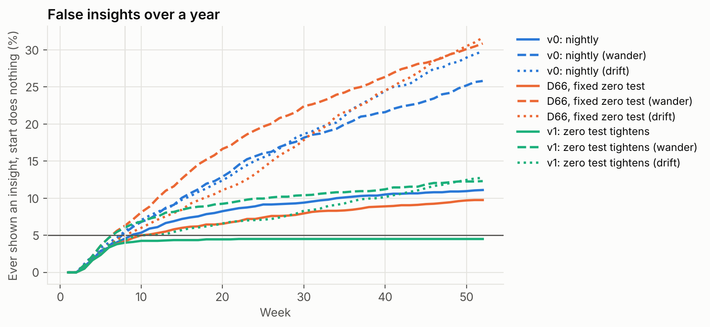

# False insights over a year

The mark "a non-zero effect shown to at most 5% of people when the start does nothing" was set at night 56 (D53, D66). The insight is checked every night for as long as Dusk is used, so the share of people ever told about an effect that isn't there keeps growing after night 56. `gap.md` found D66's policy at 5.0% by week 12, and 6.9% with drift (#117). This report measures it over a year, tunes a fix, and says what the fix costs. The fix ships in `sleep-model.v1`; section 7 is v2's, for a usual time that moves (#154).

```
uv run python -m sim.longrun --people 1000 --out reports/longrun-sweep.json                  # every variant, seed 7
uv run python -m sim.longrun --people 2000 --seed 20261127 --only v0,d66,v1 --out reports/longrun-final.json
for s in 101 202 303 404 505 606; do uv run python -m sim.longrun --people 2000 --seed $s --only v1 \
  --scenarios null,differ --out seed$s.json; done
uv run python -m sim.longrun --pool seed*.json --out reports/longrun-seeds.json
uv run python -m sim.criteria          # the pass criteria, with the null run for a year
```

The runs use the simulator's own loop (`sim.run`) with the policy and the insight rule the phone runs (`dusk_model.timing`, `dusk_model.insights`), so every number here is the reference model's, not a stand-in. Each variant is an artifact: `export/v1.py` with some numbers changed (`sim/longrun.py` lists them). The people and their nights are the same as in `sim.criteria`, run for 52 weeks.

## What is compared

- **v0**: the shipped artifact before this one. A new start every night.
- **D66, fixed zero test**: D66's held, settling week (below), with v0's 98% zero test at every night. This is #117 as found.
- **v1**: the same policy, and a zero test that tightens after 30 usable nights.

D66's policy, as built in `dusk_model/timing.py`: on a week's first night the start is drawn by Thompson sampling with the 0.10 floor and held to Sunday; a person is settled if the insight shows (the start goes to the side it supports) or, after 14 usable nights, if the 90% range lies inside ±15 minutes (the plan); a settled person draws again in 7% of weeks. Two choices differ from `sim/dampen.py`, where `dampening.md`'s numbers come from. Settling is checked only on a week's first night, so the start never moves mid-week. And it is checked afresh every week, so a person whose insight no longer holds draws again, which `dampening.md` proposed but did not simulate.

## Scenarios

The six scenarios of `sim.criteria` and two kinds of background change in each person's usual time to fall asleep:
- **drift**: `dampening.md`'s random walk, 2 minutes a night. Over 8 weeks it wanders about 15 minutes; over a year about 38, which carries the 8-week stress past where it means much.
- **wander**: new here, for a year. The usual time wanders by about 15 minutes and comes back, with a memory of about 4 weeks (an AR(1) process with sd 15 and correlation e^(−1/28) a night). It stands for seasons, a new job, a hard month.

## 1. #117 measured: false insights by week

2,000 people per scenario, seed 20261127 (`longrun-final.json`). The share of people ever shown an insight by week 8 / 12 / 26 / 52.

| Start does nothing | v0 | D66, fixed zero test | **v1** |
|---|---|---|---|
| null | 4.5 / 6.1 / 9.2 / 11.1 | 4.2 / 5.3 / 7.6 / 9.8 | **4.0 / 4.2 / 4.5 / 4.5** |
| null + wander | 5.3 / 7.9 / 16.2 / 25.8 | 6.3 / 10.0 / 20.1 / 30.9 | 6.0 / 7.5 / 10.1 / 12.3 |
| null + drift | 5.5 / 8.2 / 16.0 / 29.8 | 5.0 / 7.1 / 14.9 / 31.6 | 4.4 / 5.1 / 7.2 / 12.8 |



With one fixed test, nothing stops the share from growing: v0 reaches 11% in a year and D66's policy 10%. The held week isn't the cause. D66 is slightly lower than v0 under the null, because about three quarters of null people settle at their own time and then explore only one week in 14.

## 2. The fixes tried

1,000 people per scenario, seed 7 (`longrun-sweep.json`). Ever shown under the null by week 8 / 12 / 26 / 52; with drift at week 52; then "differ": people with an effect of 15 minutes or more who get an insight by night 56 (the D66 mark, at least 50%), and everyone ever shown one in a year.

| Tried | Null | Null + drift, a year | ≥15 by night 56 | Differ, a year |
|---|---|---|---|---|
| v0 | 3.4 / 4.8 / 7.4 / 9.6 | 27.7 | 50.4 | 64.8 |
| D66, fixed 98% zero test | 3.0 / 4.3 / 6.0 / 9.0 | 30.5 | 47.6 | 61.9 |
| *A stricter fixed test* | | | | |
| 99% | 1.4 / 2.1 / 3.0 / 4.3 | 23.2 | **44.4** | 55.3 |
| 99.5% | 0.9 / 1.2 / 1.6 / 2.1 | 16.8 | **40.6** | 48.8 |
| *98%, tightening after n usable nights as (n / nights)^k* | | | | |
| n 28, k 1 | 2.8 / 3.4 / 4.1 / 4.5 | 18.9 | 47.1 | 49.5 |
| n 28, k 1.5 | 2.6 / 3.1 / 3.3 / 3.4 | 15.7 | 46.4 | 46.1 |
| n 40, k 1 | 3.0 / 3.8 / 4.6 / 5.0 | 21.3 | 47.6 | 51.3 |
| n 40, k 1.5 | 3.0 / 3.8 / 4.3 / 4.5 | 18.6 | 47.4 | 48.0 |
| n 40, k 2 | 3.0 / 3.8 / 4.1 / 4.1 | 16.3 | 47.4 | 46.3 |
| n 56, k 1.5 | 3.0 / 4.1 / 5.1 / 5.5 | 21.4 | 47.6 | 51.3 |
| n 56, k 2 | 3.0 / 4.1 / 5.1 / 5.3 | 19.5 | 47.6 | 49.4 |

Seed 7 is an unlucky draw for learning: v0 gets 50% here and 54–58% elsewhere. Compare within the table. The sweep ran before v1 kept a showing insight on the 98% test (section 4); that changes nothing in this table.

The finalists were rerun on six more seeds of 2,000 people (null and differ only; a year under the null, the D66 mark at night 56):

| n, k | Null, a year: mean (lowest–highest) | ≥15 by night 56: mean (lowest–highest) |
|---|---|---|
| 40, 2 | 4.5 (3.5–5.9) | 53.8 (51.8–56.1) |
| 34, 2 | 4.1 (3.2–5.5) | 53.1 (51.0–55.3) |
| 28, 1.5 | 4.0 (3.2–5.2) | 52.3 (50.1–54.4) |
| 28, 2 | 3.6 (2.9–4.9) | 51.7 (49.5–53.6) |
| **30, 2 (v1)** | **3.8 (3.1–5.0)** | **52.2 (49.9–54.4)** |

The v1 row is `longrun-seeds.json`; the others are the same seeds run before v1 was chosen.

## 3. What we learned

- **A fixed test can't hold a mark for an open-ended time.** Each night is one more look, and with forgetting (a night's weight halves in about 10 weeks) the estimate keeps moving, so new chances to cross never stop. Any fixed test only moves the year's number, and a test strict enough for a year (99.5%) costs 7 points of the D66 learning mark at night 56.
- **Most false insights come before week 8, and those can't be removed without losing learning.** Under the null, v1 has 3.1% by week 8 on average and 3.8% by week 52. The 98% test before night 56 is what the D66 learning mark is tuned on, so the tightening has to start late. Starting it at 56 usable nights (about 11 weeks) lets too much through in weeks 8 to 26: 5.1% by week 26 and 5.3–5.5% in a year. Starting at 28–34 nights (about 6 to 7 weeks) costs one or two points of the learning mark and keeps a year near 4%.
- **The power sets the long tail.** With k = 1 the share still grows by about half a point after week 26. With k = 2 almost nothing is added: v1 adds 0.0–0.1 points from week 26 to 52.
- **Chosen: tighten after 30 usable nights, with k = 2.** It keeps the null under 5% for a year in five of six runs and at 5.0% in the sixth (3.9% in the pass criteria's own run), and the D66 mark at 52% on average (49.9–54.4%, 52.6% in the pass criteria). Both marks sit close to their lines; neither can move without the other.
- **The cost is later insights for real effects.** Among "differ" people, 43% get an insight within a year under v1, against 62% under D66's fixed test; for effects of 15 minutes or more, 77% against 95%. Insights by night 56 barely change (27.0% against 27.9%). The sleep benefit doesn't depend on the insight: −8.4 min a night over the year in "differ", against −8.6 for D66 and −7.9 for v0.
- **Wrong-side insights fall.** Shown with the wrong sign within a year, in "differ": 0.2% under v1, 0.4% under D66, 0.5% under v0; with the wander, 1.2%, 3.8% and 2.4%.

## 4. A showing insight keeps the 98% test

With a test that tightens with the nights, an insight that showed at night 40 had to pass a stricter test at night 200 to keep showing. With a settled start, the estimate of the start's effect slowly widens (forgetting, and few nights at other starts), so most insights were taken away again only because time passed: in "differ", 12% of people still saw one at the end of the year, against 27% under D66.

v1 keeps a showing insight while the 98% range is clear of zero, and withdraws it quietly when it isn't. The stricter test applies only to an insight that isn't showing. The person's state carries whether it showed after the last night (`shown`), so a rebuild from the night log gives it back. This never changes who sees an insight first, so every false-insight number above is the same. At the end of the year 19% of "differ" people see an insight, the sleep benefit is −8.4 min a night against −8.1 without it, and the start changes 0.28 times a week against 0.30.

## 5. What it doesn't fix: background change

A stricter test doesn't fix background change. With the wander, false insights reach 6.0% by week 8 and 12.3% in a year; with the random walk, 12.8%. v1 is much better than v0 or D66 here (26–32%), but well above 5%.

The cause is the model, not the test. The model treats each night's noise as independent and lets the usual time move only through forgetting. When the usual time wanders for weeks, nights close together share an error, the posterior is too sure, and a held week's start lines up with a week's wander. Under the wander, coverage at night 56 is 85.9% in "differ" (85.7% at a year), at the bottom of the band.

The fix would be to let the model's intercept wander too (a little process noise on the usual time each night, a Kalman step). That is a change to the model's update, so to the Swift package's arithmetic, and it will cost learning, because a held week's contrast is exactly what a wandering intercept explains away. It needs its own ticket, and how much real people's usual time wanders is something the pilot's night records can measure. It got one (#154): section 7, `sleep-model.v2`.

## 6. What the policy does over a year (v1)

From `longrun-final.json`, "differ" unless named:
- **Calm:** the start changes 0.28 times a week over the year (D66 0.27, v0 2.28).
- **Settled at the end of the year:** 49% of "differ" people, 28% at the plan; 75% of null people (72% at the plan).
- **Coverage** of the 90% range: 89.4% at night 56 and 94.0% at night 364.
- **Safety:** in the pass criteria's 10,000 people, no start outside a person's limits and no wake time moved, over 476,209 block nights. The smallest logged chance is 0.007 (a settled person's exploring week, 0.07 × 0.10).

## 7. The usual time moves (#154, `sleep-model.v2`)

```
s=null,null+wander,null+drift,differ,differ+wander,differ+drift,same,null+wide,null+slow,differ+wide,differ+slow
uv run python -m sim.longrun --people 2000 --seed 20261127 --only v1,v2 --scenarios $s --out reports/longrun-wander.json
six=null,null+wander,null+drift,null+wide,null+slow,differ
uv run python -m sim.longrun --people 1000 --scenarios $six --out reports/longrun-wander-sweep.json --only \
  v1,w5-k0,w10-k0,w0-k7-z98,v2,w5-k7-z95,w0-k14-z95,w0-k7-z94,w0-k7-z96,w0-k7-z95-n42,w0-k7-z95,w0-k5-z98,w0-k5-z96
for s in 101 202 303 404; do uv run python -m sim.longrun --people 2000 --seed $s --only v2 --scenarios $six \
  --out wseed$s.json; done
uv run python -m sim.longrun --pool wseed*.json --out reports/longrun-wander-seeds.json
```

A variant's name says what it changes on v1 (`sim.longrun.wander_variant`): `w` the intercept's wander a week, in minutes; `k` the nights of κ = 1 the noise's scale starts from; `z` the base zero test, in percent; `n` the usable night the test starts to tighten after.

### How much a usual time moves

Section 5's wander (sd 15 minutes, a memory of about 4 weeks) and drift were guesses. `sim/wander.py` adds two profiles at the two ends of what real people's usual time does. Their size was checked against a real Health export (n=1, private); the numbers in the code are the simulator's, rounded, not that person's. In both, the usual time is set week by week, Monday to Sunday, so a week's level lines up with a held week's start: the hard case.
- **wide:** the week's level has sd 60 minutes and a short memory (0.35 from one week to the next), and the nights are heavy-tailed: 70% normal with sd 25 around the week's level, 30% with sd 200, so about one night in six lands more than 90 minutes from its week's median.
- **slow:** the week's level has sd 30 minutes and a long memory (0.9 from one week to the next, so months), with the simulator's own nightly noise.

2,000 null people per scenario, seed 20261127 (`longrun-wander.json`), the share ever shown an insight by week 8 / 12 / 26 / 52:

| Start does nothing | v1 | **v2** |
|---|---|---|
| null | 4.0 / 4.2 / 4.5 / 4.5 | **2.5 / 2.6 / 2.8 / 2.8** |
| null + wander (section 5) | 6.0 / 7.5 / 10.1 / 12.3 | **2.3 / 2.6 / 2.6 / 2.6** |
| null + drift | 4.4 / 5.1 / 7.2 / 12.8 | **2.8 / 3.2 / 3.2 / 3.2** |
| null + wide | 44.6 / 55.9 / 73.0 / 85.8 | **4.1 / 4.3 / 4.3 / 4.3** |
| null + slow | 9.4 / 13.6 / 23.8 / 35.4 | **3.7 / 4.0 / 4.0 / 4.0** |
| same (an effect of 3 minutes) | 4.4 / 4.9 / 5.1 / 5.2 | 3.3 / 3.5 / 3.6 / 3.6 |

At night 56, v1's 90% range held the truth for 46% of wide null people and 83% of slow ones; v2's for 87% and 92%.

### What was tried

1,000 people per scenario, seed 7 (`longrun-wander-sweep.json`). Ever shown within a year under the null; then "differ": people with an effect of 15 minutes or more who get an insight by night 56 (the D66 mark), and everyone ever shown one in a year.

| Tried | Null | + wander | + drift | + wide | + slow | ≥15 by night 56 | Differ, a year |
|---|---|---|---|---|---|---|---|
| v1 | 3.0 | 12.7 | 13.4 | 84.3 | 38.4 | 48.5 | 42.1 |
| *The intercept wanders (a Kalman step), sd a week* | | | | | | | |
| 5 min (`w5-k0`) | 1.8 | 4.5 | 3.5 | 67.4 | 9.7 | 44.6 | 36.9 |
| 10 min (`w10-k0`) | 0.7 | 1.9 | 2.6 | 54.1 | 4.4 | 33.4 | 29.9 |
| *A noise scale from week sums; zero tests a t's* | | | | | | | |
| 98% zero test (`w0-k7-z98`) | 0.2 | 0.5 | 0.3 | 1.9 | 1.0 | 22.8 | 22.6 |
| 96% (`w0-k7-z96`) | 1.6 | 2.5 | 1.7 | 3.8 | 3.1 | 36.9 | 30.1 |
| 95% (`w0-k7-z95`) | 2.6 | 3.2 | 2.5 | 4.2 | 4.5 | 42.2 | 31.9 |
| 94% (`w0-k7-z94`) | 3.6 | 3.6 | 3.4 | 5.3 | 5.7 | 44.3 | 34.8 |
| 95%, tightening after night 42 (`w0-k7-z95-n42`) | 3.3 | 4.3 | 4.2 | 4.7 | 5.5 | 45.6 | 39.0 |
| 95%, scale from 14 nights (`w0-k14-z95`) | 3.2 | 3.2 | 2.9 | 6.7 | 5.5 | 42.7 | 33.4 |
| 95%, and the intercept wanders 5 min (`w5-k7-z95`) | 2.1 | 2.2 | 1.9 | 3.5 | 3.1 | 36.9 | 31.9 |
| 96%, scale from 5 nights (`w0-k5-z96`) | 1.7 | 2.4 | 1.6 | 3.4 | 2.9 | 35.8 | 29.6 |
| **95%, scale from 5 nights (v2)** | **2.5** | **3.2** | **2.4** | **4.1** | **4.2** | **41.4** | **32.2** |

v2 on four more seeds of 2,000 people (`longrun-wander-seeds.json`), ever shown within a year, mean (lowest–highest): null 2.6 (2.2–3.0), wander 3.2 (3.1–3.3), drift 3.1 (2.9–3.6), wide 4.2 (3.5–5.0), slow 3.0 (2.8–3.3). The D66 mark: 41.3% (37.9–44.2%).

### What we learned

- **A wandering intercept is the textbook fix, and a costly one.** A held week's contrast is exactly what a moving usual time explains away, so the wander costs learning in everyone, including people whose time holds still: 10 minutes a week holds the slow profile but takes the D66 mark from 48.5% to 33.4%. And no one size fits: what the wide profile needs would leave almost nobody learning anything.
- **The fix has to be per person, and the residuals show who needs it.** If the model is right, each night's residual divided by its predicted sd is independent with variance 1, so a week's sum of them, squared, averages the week's count of nights. When a person's nights are noisier, or their usual time moves for days or weeks, a week's residuals share a sign and the sums grow; with a slow wander, so do the products of one week's sum and the next's. Their ratio to the nights (a long-run variance with one week's lag, as Newey and West weigh it) is the person's noise scale κ². Every range is drawn from κ²Σ, so a week that moves together counts as fewer nights, and a person whose time holds still keeps about v1's ranges.
- **The scale rests on weeks, not nights.** Each week's sum is one look at κ², so in the first weeks it is a guess. In earlier runs of this sweep that didn't allow for it (not kept), the wide profile reached 7–9%, mostly in weeks 3 to 6. The zero tests are a Student t's, with the scale's weeks (its prior included) as degrees of freedom. The 90% range shown stays a normal's, so it stays a 90% range when the scale is right: every scenario's range holds the truth for 90–93% at night 56 (`criteria.json`), inside the 85–95% band.
- **Holding κ² at 1 or more was worse** (also in those earlier runs): ranges too wide for calm people (null coverage above 95%, outside the band) and less learning, for little gain in safety.
- **With honest ranges, the 98% test was stricter than the mark needs.** 95% wins back learning; 94% lets the slow and wide profiles through. A scale that starts from 5 nights adapts a little sooner than 7 or 14, which the wide profile needs, at no cost to learning.
- **Chosen (v2): no intercept wander, κ² from 5 nights of 1, a 95% zero test, tightening after 30 usable nights as before.** The wander stays in the artifact (`intercept_week_sd`) and both models, at 0.

### What it costs

From `longrun-wander.json`, 2,000 people, "differ" unless named:

| | v1 | v2 |
|---|---|---|
| Effect of 15 min or more: insight by night 56 (D66 mark) | 49.7% | 40.6% |
| The same, within a year | 76.7% | 65.2% |
| Ever shown an insight within a year | 42.7% | 31.9% |
| Shown with the wrong sign within a year | 0.2% | 0.2% |
| Sleep benefit over the year, min a night | −8.4 | −8.0 |
| Start changes a week | 0.28 | 0.31 |
| With the wander: D66 mark; wrong sign within a year | 49.2%; 1.2% | 34.8%; 0.5% |
| With the slow profile: D66 mark; wrong sign within a year | 47.3%; 5.9% | 27.7%; 0.4% |
| With the wide profile: D66 mark; wrong sign within a year | 48.8%; 32.0% | 4.1%; 1.5% |

- **The D66 learning mark is no longer met:** 42.9% in the pass criteria's own run (v1 52.6%), 41.3% on average over four more seeds. The pass criteria report it and no longer fail on it, until the founders set a new mark.
- **Where the usual time moves, many of v1's insights were noise.** With the wide profile v1 showed an insight to 88% of people within a year, and 32% saw one with the wrong sign; v2 shows one to 5%, which is about what that much movement allows. A person whose time swings like that gets no insight, and is told nothing false.
- **The start moves more for people whose time moves.** Fewer of them settle (0.4% of wide null people at the end of the year, against 64% under v1), so their start keeps exploring: 0.42–0.49 changes a week, against D66's 0.5. Calm people are unchanged (0.33).
- **The sleep benefit barely moves:** −8.0 against −8.4 min a night in "differ", and −5.1 against −5.4 over 8 weeks in the pass criteria. It doesn't depend on the insight.

### What it doesn't settle

- The profiles are two ends, not a population. How many people move like either is for the pilot's night records (D92's records carry Health's sleep since D97); a new profile is one line in `sim/wander.py`.
- The scale is one number for the whole posterior. A person whose usual time drifts but whose start effect is clean is treated as noisier than they are. The intercept's wander is the targeted tool if the pilot shows most of the movement is slow drift.
