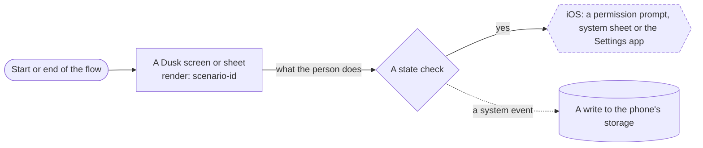

# Flows

Every user flow in Dusk, as built on `main`, drawn as a Mermaid flowchart. A UX audit pairs each chart with the renders its nodes name (`docs/renders.md`), and a change to a flow changes its chart in the same pull request. `data.md` lists everything the app keeps on the phone, which a change of format or of the sleep model has to carry forward.

## The charts

| Chart | What it covers | Decisions |
|---|---|---|
| [onboarding.md](onboarding.md) | First launch to the first locked night: Welcome, Fit Dusk to your sleep (Apple Health), your sleep, the time around it, Screen Time, the apps, Ready | D68, D71, D76, D78, D82, #144 |
| [once-fit-sleep.md](once-fit-sleep.md) | One-time flow #1 for people set up before #144: Tonight's card and its sheet of sleep and both buffers | D86, D91, D92, #144 |
| [set-home.md](set-home.md) | "Only when I'm home": the map, the location prompts, Always, and "Use anywhere" | D68, D71, D84 |
| [heads-up.md](heads-up.md) | The heads-up before the night: Tonight's offer, iOS's prompt, Settings' switch | D68, D72 |
| [before-bed.md](before-bed.md) | The gap before bed (Monday's card, the offer to older installs, Settings) and the helpers in the gap | D76, D80, D83, D85 |
| [tonight.md](tonight.md) | Tonight through a day: what the state shows and when, the card slot's order, the strip | D69, D73, D75, D86 |
| [pause.md](pause.md) | The pause: from Tonight or the block screen, the wait, the open pause, Lock again | D67, D70, D84 |
| [purchase.md](purchase.md) | The free nights, their end, buying, Ask to Buy, restore, refunds | D33, D78, D82, D84 |
| [settings.md](settings.md) | Settings and every sheet or screen it opens, Settings › Sleep included | D72, D83, D84, D85, #144 |
| [permissions.md](permissions.md) | Losing and getting back Screen Time, location and notifications | D8, D10, D37, D48, D72 |
| [your-sleep.md](your-sleep.md) | Your sleep: the sky, a star's night, the week, the ranges, landmarks and sharing | D69, D79, D81, D84, D88 |
| [blocks.md](blocks.md) | The Blocks tab and the block editor: new, edit, delete, the night's editor | D29, D45, D73, D84, D87 |
| [data.md](data.md) | Every piece of data that persists: where, its format, who writes and reads it, what a format change does | D11, D62, D78, #140 |

## Conventions

Each chart is a `flowchart`. Shapes say what a node is, so a chart reads the same in light and dark and without colour:

- **Screens** are rectangles. The first line names the screen as people see it; the second is `render: <scenario>`, the id in `docs/renders.md` that shows it, or `render: none` when no scenario does. A tap that a render can reach from a scenario is written `render: <scenario> + tap`.
- **Edges** carry what the person does (solid, the button's words in quotes where it has them) or what the system does (dotted: a time passing, a region event, iOS answering, an extension waking).
- **Diamonds** are checks on state, phrased as the code checks them. Where the order of checks matters (Tonight's card slot, the state), the chart keeps the code's order.
- **Hexagons** with a dashed border are iOS's own UI: permission prompts, Apple's apps picker, the payment sheet, the share sheet, the Settings app.
- **Cylinders** mark the moments a flow writes to storage (`data.md` says where).
- Each file starts with what the flow is for and the decisions it implements, and ends with **Doubts**: anything the code left unclear, or that differs from a decision's text.
- Labels are quoted, since many contain parentheses or colons. Node ids avoid `end` and never start with `o` or `x` after an edge, which Mermaid reads as an edge type.

## Keeping the charts current

There is no CI check. A pull request that changes a flow updates its chart, and the reviewer checks it against this table: if the diff touches a folder on the left, the charts on the right are read again.

| Source folder | Charts |
|---|---|
| `ios/Packages/TollFeatures/Sources/TollFeatures/Setup/` (`SetupFlow`, `SetupModel`, `FitView`, `SleepTimesView`, `AroundView`, `ScreenTimeView`, `BlocklistView`, `ReadyView`, `NightPictureView`) | onboarding |
| `…/TollFeatures/Setup/` (`FitDraft`, `FitFlowSheet`, `FitView`, `SleepTimesView`, `AroundView`) | onboarding, once-fit-sleep, settings |
| `…/TollFeatures/Setup/` (`SetHomeFlow`, `SetHomeModel`, `HomeMapView`, `PermissionsView`) | set-home, permissions |
| `…/TollFeatures/Home/` | tonight, pause, heads-up, before-bed, set-home |
| `…/TollFeatures/BeforeBed/` | before-bed |
| `…/TollFeatures/Door/` | pause |
| `…/TollFeatures/Purchase/` | purchase |
| `…/TollFeatures/Settings/` | settings, heads-up, before-bed, permissions |
| `…/TollFeatures/Insights/` | your-sleep |
| `…/TollFeatures/Blocks/` | blocks |
| `…/TollFeatures/App/` (`RootView`, `DuskTabs`, `AppModel*`) | every chart; read the one whose flow the change touches |
| `…/TollFeatures/Demo/` | the `render:` ids in every chart |
| `ios/Packages/TollCore/Sources/TollCore/App/` (`HomeSnapshot`, `TonightCard`, `Morning`, `HeadsUp`, `GapRules`, `GapSnapshot`, `DoorRules`, `Engine*`) | tonight, pause, heads-up, before-bed, set-home, purchase |
| `…/TollCore/App/` (`YourSleep`, `InsightsSnapshot`, `Sky*`, `PastNight`, `NightFacts`) | your-sleep, data |
| `…/TollCore/Domain/` (`Trial`, `TrialStart`, `Door`, `Gap`) | purchase, pause, before-bed |
| `…/TollCore/Domain/` (`SleepNights`, `SleepEstimate`), `…/TollCore/App/Fit.swift` | onboarding, once-fit-sleep |
| `…/TollCore/Persist/`, `…/TollCore/App/DuskState.swift`, `…/TollCore/App/Flows.swift`, `…/TollCore/Domain/` (any `Codable` type) | data, and each `once-*` chart |
| `ios/Packages/TollCore/Sources/TollScreenTime/`, `ios/Monitor/`, `ios/ShieldAction/`, `ios/ShieldConfig/` | pause, permissions, data |
| `ios/Packages/TollData/` | purchase, set-home, heads-up, permissions, data; `Health/` onboarding, once-fit-sleep |
| `ios/Packages/SleepModel/`, `datascience/export/` | data |

When a flow is added, add its chart, a row in the first table and its folders in this one.

## One-time flows

Some changes need the person: a build starts keeping something people already using Dusk have never been asked for (the onboarding redesign's sleep interval and buffers, say), and there's no server to fill it in for them. A one-time flow asks them once, in the app, at a calm moment. The registry is `Flows` in `TollCore/App/Flows.swift`. It holds one flow: #1, `fit-sleep`, "Fit Dusk to your sleep" (#144, [once-fit-sleep.md](once-fit-sleep.md)).

**Add a flow only when a person must decide.** If a safe value can be worked out from what's stored, a migration step does it (`docs/architecture.md`, "Data and its evolution") and nobody is asked.

To add one:

1. **The stored field first.** Add the field it fills, with its migration step and fixture, as any stored change. Choose the field's value for people who never answer: it must keep everything as it was for them.
2. **The entry.** Add a `OneTimeFlow` to `Flows.registry`, in the order flows should win:
   - `id`: a stable string, never reused (`confirm-night`).
   - `version`: 1. Raise it only when everyone who answered must be asked again.
   - `applies`: a pure predicate over `DuskState`: who needs it (set up before the build that added the field, no answer yet). Never "everyone".
   - `defaults`: the commands applied when it's put off for good, chosen so nothing changes for the person.
3. **What the app does.** At each foreground `AppModel` reads `Flows.due` into `dueFlow`. The screen that shows it sends `.flow(id:version:.shown)` when it appears, then `.answered` with the person's commands, or `.notNow`. The third "Not now" (`flows.offers`) records `.defaulted` and applies `defaults`. Every outcome goes into `state.flows`, so it's asked once per version.
4. **When it may show** (`Flows.calm`, tested): after setup; never during a night or its gap, a pause, or while any block is on; never in the last `flows.quietBeforeLockMinutes` (20) before the lock; at most one flow on any day. It shows in Tonight's card slot, after warnings and before offers, and opens a sheet; no takeover (D86).
5. **Tests** in `FlowTests`: its `applies` for an install from each past fixture that needs it and one that doesn't, its defaults leaving the person's night as it was, and its record.
6. **Its chart:** `docs/flows/once-<id>.md`, with `applies`, the moments it may show, every outcome and what each writes, and the defaults. Add a row to the first table.
