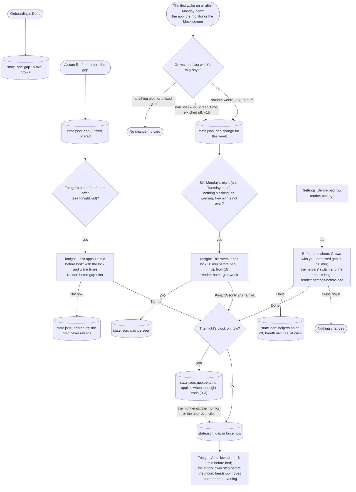
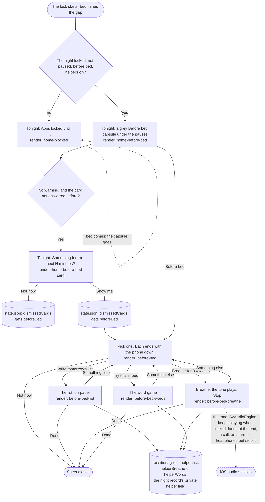

# Before bed: the gap and its helpers

**What it's for:** the apps lock a little before bed, and that gap grows with the person, week by week, unless they fix it. During the gap Tonight offers three small helpers for the minutes until bed. This chart covers how the gap is set (a new install, the one offer to an install from before it, Monday's card, Settings) and the helpers.

**Implements:** D76, D77 and D83 (the gap, its weekly rule, Monday's card, the offer to older installs), D80 and D85 (the helpers, their card and capsule, Settings' switch), B-3 (a gap changed during the night waits until it ends; the helpers' switch applies at once).

**Code:** `TollCore/App/GapRules.swift`, `GapSnapshot.swift`, `Domain/Gap.swift`, `TonightCard` (`gapWeek`, `gapOffer`, `beforeBed`), `HomeSnapshot.untilBed`; `TollFeatures/App/AppModel+Gap.swift`, `AppModel+Helpers.swift`, `Settings/BeforeBedRow.swift`, `BeforeBed/HelpersSheet.swift`, `TollData/Audio/BreathTone.swift`.

## The gap

## The helpers in the gap

## Doubts
- **Monday's card can be missed.** It shows only between Monday noon and Tuesday noon, and only while nothing blocks, so a person who opens Dusk only inside a long Study block that day never sees it; the change still applies. That matches D76's "this week's gap" but isn't stated anywhere.
- **The offer to older installs** has no "seen" flag beyond `offered`; "Turn on" and "Not now" both clear it (`GapRules.set` clears it too), so changing the gap in Settings also removes the offer. Matches the code; D83 doesn't say.
- **Settings' Done sends the gap even when unchanged.** `setBeforeBed` always sends `.gap(...)`; during the night that stores a pending gap equal to the current one. Harmless, but it makes Settings say a change is waiting when nothing changed (worth a check on device).
- **A pause in the gap** shows "Paused until"; the capsule hides while paused (`untilBed` needs the blocked hero) and returns if the pause ends before bed.
