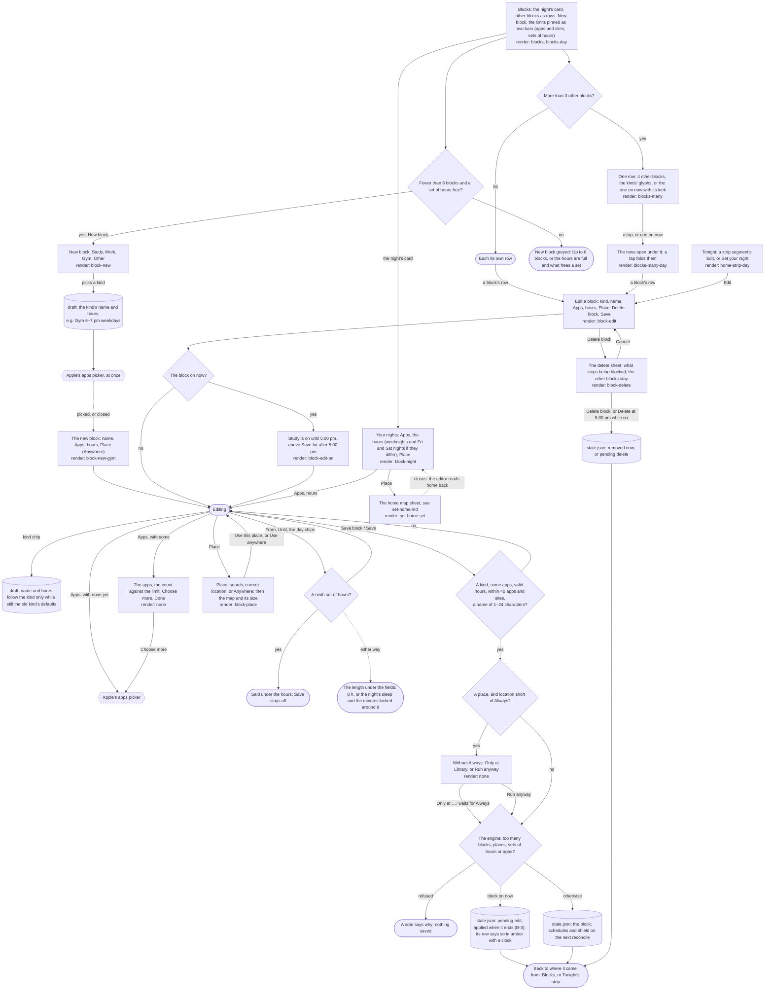

# Blocks and the block editor

**What it's for:** every block in one place. The night leads as its own card; other blocks (Study, Work, Gym, Other) are compact rows, and adding one is a kind, the apps and Save. Editing changes the name, kind, apps, hours and place in place. A change to a block that is on waits until it ends. The night's editor is "Your nights": no name, no kind, no Delete, and its place is home, set with the same map as Tonight and Settings.

**Implements:** D29 (blocks), D39, D40 and D45 (the limits: 40 apps and sites, 8 sets of hours, 8 blocks), D63 and D64 (the tab, the limits pinned at the bottom), D68 and D73 (quieter blocks, adding in three taps, kinds bring names and hours), D37 and #63 (a place without Always: run anyway or wait), D84 (the night's Place opens the home map), #110 (lines as glyphed facts, apps as icons, the folded group), D87 (the note for a block that's on sits above Save and never moves the page), B-3 (edits to an active block wait).

**Code:** `TollFeatures/Blocks/` (`BlocksView`, `OtherBlocks`, `AppsRow`, `BlockEditorView`, `BlockEditorModel`, `BlockEditorParts`, `HoursInline`, `BlockAppsView`, `PlacePicker`); `TollCore/App/BlocksSnapshot.swift`, `BlockRows.swift`, `BlockFacts.swift`, `BlockGroup.swift`, `BlockDraft.swift`, `BlockLimits.swift`; `Engine.apply(.saveBlock, .deleteBlock, .savePlace)`, `Engine.validate`.

The tab bar hides on the editor so Save can sit at the bottom. Saving a place moves it for every block that uses it (`savePlace` keeps its id); a move of a place an active block uses waits like an edit.

## Doubts
- **Block.isOn has no switch.** Blocks store whether they're on and the engine respects it, but no screen turns a block off; only Delete removes one.
- **The folded group forgets a tap** when Blocks leaves memory: it follows whether a block is on again.
- **No render reaches the apps list or the Without Always question.** The simulator has no app tokens, so the apps list is empty there anyway.
- **The night can't be left without apps:** removing every app in the picker keeps Save off (`canSave`), with no note saying why beyond the Apps row's "Choose apps to save".
