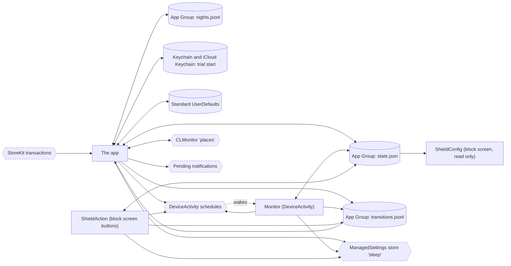

# What Dusk keeps on the phone

**What it's for:** every piece of data that outlives a launch, where it lives, its format and version, who writes and reads it, and what happens today when its format changes. There is no server: any change of format, any backfill and any new model has to happen on the phone, from what is listed here. This is the ground for that work; the decisions it rests on are D11 (one coordinated state file), D28 (Toll's leftovers), D52 and D62 (the model and the night records), D78 and D82 (the free nights' start in the Keychain and iCloud Keychain).

**Code:** `TollCore/Persist/` (`AppGroup`, `DuskStore`, `Migration`, `TransitionLog`, `NightRecords`, `NightHistory`), `TollCore/App/DuskState.swift`, the `Codable` types in `TollCore/Domain/`, `TollScreenTime/` (`ShieldAdapter`, `ScheduleAdapter`, `Names`, `TollLeftovers`), `TollData/` (`Keychain`, `Purchase`, `PlaceMonitor`, `NotificationAdapter`), `TollFeatures/App/Appearance.swift`, `Setup/SetHomeModel.swift`, `Insights/SkyHeader.swift` (`SkySeen`), `SleepModel/ModelArtifact.swift`.

## Who touches what

All four targets ship in one bundle, so they always run the same build; the skew that matters is between a file on disk and the code reading it.

## The inventory

| Data | Where | Format and version | Writes | Reads | If its format changes today |
|---|---|---|---|---|---|
| **State** `state.json`: blocks (name, kind, schedule, apps, place, on), places (name, centre, radius), presence, location mode, held edits (`pending`, `pendingPlaces`), the pause (`door`, `doorAskedAt`), the week's pauses (`unlocks`), `trial` (start, purchased, entitled), `setupFinishedAt`, `screenTimeAllowed`, `dismissedCards`, `headsUp`, the gap (minutes, mode, pending, weekly tally, change, history, offered), `helpers`, `runtime` (active blocks, last ends, clock anchor, scheduled windows, scheduled pause) | App Group container, one file, `NSFileCoordinator` around every read and read-modify-write, written atomically | JSON, ISO 8601 dates, sorted keys. `"schema": 2` (1 was step 2's single-block file, migrated on read by `Migration.fromV1`, tested). Fields added since schema 2 (`gap`, `helpers`, `dismissedCards`, `headsUp`, `screenTimeAllowed`) did not raise it | App, Monitor, ShieldAction: every wake runs `Coordinator.run`, one coordinated read-modify-write | App (also every 20 s for what extensions wrote), Monitor, ShieldAction, ShieldConfig (`DuskStore().load()`, never writes) | Decoded on every read by any process. Missing keys take defaults (`Migration.swift`'s decoders for `DuskState`, `TrialState`, `RuntimeState`, `UnlockSupply`, `Block`, `Gap`, `Gap.Tally`; `helpers` and parts of `Gap` with `try?`). **Anything else that fails** (an unknown `Block.Kind`, `LocationMode`, `Gap.Mode`, `Weekday` or `PendingEdit`; a missing key in a type with synthesized decoding: `Place`, `Presence`, `Door`, `WeeklySchedule.Rule`, `TimeWindow`, `ClockAnchor`; a bad `"HH:mm"`; no `schema`) **silently becomes an empty state**, and the next wake of any process writes it over the file. `schema >= 2` is accepted with no upper bound, so a newer file is read and its unknown keys dropped at the next write |
| **Transition log** `transitions.jsonl`: one line per wake that changed something or wasn't a launch or foreground (when, why, blocks on, door phase, home, in window, entitled, Screen Time) | App Group, appended under coordination | JSON lines, no version. Optional fields added over time (`active`, `screenTime`, `door`) | App, Monitor, ShieldAction (append); the app trims it to the last 2,000 lines at launch, in the background | App: Tonight's morning card, the week, the night records, Your sleep, the activity log | Each line decodes alone; a line that fails (an unknown `cause` or `door` value, from a newer build or a removed case) is **dropped silently** from every reader, and with it that night's facts if it isn't recorded yet |
| **Night records** `nights.jsonl`: one line per ended night of the night's block (D62) | App Group, appended under coordination, never rewritten | JSON lines in the sleep model's contract 1 shape (`SleepModel.NightRecord`, `datascience/dusk_model/night.py`), plus Dusk's own under `dusk`. **No record version**: `model_version` is `"sleep-model.v0"` and `policy` `"fixed"`, hardcoded in `NightRecordLine`. Fields added: `bed`, `gap_min` (D83), `helper` (D85), `dusk.locked_min`, `dusk.taps` (D84) | App only, on foreground (`recordNights`), from the transition log; each night once, keyed by `"night"` (`yyyy-MM-dd`) | App (`NightLog.past`: Your sleep, the sky, Settings' Last night); `SleepModel.NightRecord` (tests only; the app doesn't link the package yet); data science, when the person shares the file from the activity log | Old lines keep their old shape forever; readers must accept every past shape. Today both do: missing `gap_min` reads as 0, `helper` as none, `locked_min` falls back to block end minus start. A line `NightLog.past` can't parse is skipped (that night drops out of the counts and the sky). Changing `"night"`'s format would break the once-per-night check and duplicate nights |
| **Free nights' start, this phone** | Keychain, service `com.advan.toll`, account `trialStart`, `AfterFirstUnlockThisDeviceOnly`; survives deleting the app | A string: seconds since 2001-01-01, as `Double`. No version | App: `TrialClock.begin` at setup's Done; `settle` at every launch and foreground (both copies to the earliest) | App (`TrialClock`, Welcome's and Ready's offer); everyone else reads `trial.start` from the state file | An unreadable value reads as **no start**, so the phone is offered 14 new nights, and the next `settle` writes the iCloud copy's date over it if there is one |
| **Free nights' start, iCloud** | iCloud Keychain item, same account, `kSecAttrSynchronizable`, `AfterFirstUnlock`; follows the Apple ID to other phones | Same string | App, as above, on every phone of that Apple ID | App, on every phone of that Apple ID | As above; and **an older build on another phone** that can't read a new format reads nil and, on its next `settle`, writes its own date over the new item |
| **Purchase** | StoreKit's transaction store (Apple's) | Non-consumable `com.advan.toll.full` | App Store | App only (`Purchase.isPurchased` on foreground and on `Transaction.updates`), mirrored to `state.json`'s `trial.purchased` for the extensions | Apple's format. A changed product id would make every purchase read as not bought |
| **Appearance** `appearance` | Standard UserDefaults (the app's own) | `Appearance` raw value: `dark`, `light`, `system` | App (Settings) | App | An unknown value falls back to dark (`@AppStorage`'s default) |
| **Always asked** `askedAlways` | Standard UserDefaults | Bool | App, when it asks iOS for Always | App (`SetHomeModel`) | Lost with the app; iOS's own record decides whether the prompt shows again |
| **Stars seen** `dusk.sky.seen` | Standard UserDefaults | Int: nights the sky showed last time | App (Your sleep) | App (Your sleep: whether the newest star arrives) | A reset replays the newest star's arrival once; nothing else |
| **App Group defaults** | none | | | | D11 chose a coordinated file over App Group defaults |
| **The shield** | ManagedSettings store named `sleep` | Apple's; the union of active blocks' tokens | App, Monitor, ShieldAction (`ShieldAdapter.apply`, the whole shield every wake) | iOS; ShieldConfig is asked by iOS for each shielded app | A renamed store leaves the old one shielding for good unless something clears it (`TollLeftovers` clears Toll's `blocks` store this way) |
| **Block schedules** | DeviceActivity schedules | Activity names carry their meaning: `w.HHMM-HHMM` (a window), `s.HHMM-HHMM` (its sweep), `door`; the name format is the version | App, Monitor, ShieldAction (`ScheduleAdapter`), only when the windows differ from `runtime.scheduledWindows` | Monitor (`Activity(name)`) | A name the monitor can't parse is `.unknown` and is **stopped** when it fires. A new naming scheme would stop the old names but register the new ones only when `scheduledWindows` changes, so a migration must clear it |
| **A block's apps** | Inside `state.json`, `Block.apps` | `FamilyActivitySelection` encoded with `JSONEncoder` (Apple's opaque format, not versioned by Dusk); `appCount`, `categoryCount` beside it | App (setup, the editor) | Every `ShieldAdapter` (app, Monitor, ShieldAction), ShieldConfig (which block names an app), the editor | A selection that no longer decodes becomes **empty**: that block shields nothing, silently, and its counts go stale |
| **Watched places** | CLMonitor named `places` (iOS keeps its conditions across launches) | Identifier = `PlaceID` string; a circular condition | App only (`PlaceMonitor.sync` after every change) | App (events; `current()` on foreground), mirrored to `state.json`'s `presence` | `sync` removes identifiers it doesn't want, so a change of id format re-adds every place and loses the last event until iOS reports again |
| **Heads-ups** | iOS pending notification requests | `headsUp-<epoch seconds>`, title and body as text | App only, replacing all pending each time the plan changes | iOS | Replaced wholesale, so a format change needs nothing |
| **Sleep model artifact** `sleep-model.v0.json` | Inside the `SleepModel` package (a bundle resource); copied from `datascience/artifacts/` by `ios/scripts/sync-model.sh` | JSON, `"schema": 1`, `"version": "sleep-model.v0"`, `sha256`; checked by `check-model-artifact.sh` in CI | Data science, through a pull request | `SleepModel` (tests and the replay tool). **The app doesn't link the package yet** (D52) | `validate()` refuses any schema but 1, and `bundled()` then falls back to the built-in v0 numbers silently |
| **The person's model state** (`PersonState`: precision, b, nights) | **Not stored anywhere today.** `SleepModel(artifact:nights:)` rebuilds it from night records | | | | Nothing to migrate yet; the night records are its only source |
| **The sky and landmarks** | **Not stored.** Worked out each time from the nights that ran (`NightsRan`: night records, transition log and state) and the fixed order in `SkyCatalogue` | | | App | Changing the catalogue's order, or the rule for a night that ran, redraws every person's sky and moves which star is which night |
| **Toll's leftovers** | App Group `gate-state.json`, `spool.jsonl`, `tokens.json`; Application Support `toll.sqlite*`; Keychain `sessionToken`, `deviceId`; ManagedSettings store `blocks`; DeviceActivity names that aren't Dusk's | Toll's | Nothing now | Nothing | Deleted or stopped at every app launch (D28) |

## Risks, ranked

1. **An unreadable state file resets the person, silently and for good.** One unknown enum value or one missing required key anywhere in `state.json` makes `DuskStore.decode` return an empty state; the app shows onboarding, and the first wake of any process (the app's own launch, or the monitor at the next window) overwrites the file. Blocks, home, the gap and its history, the week's pauses and every held edit are gone. The free nights' start survives (Keychain) and so do the night records, so past nights can still be counted once setup is done again; the night's hours, home and every other choice must be set again. A TestFlight downgrade after a build that adds a block kind, a location mode or a gap mode triggers it, as does adding a field without a default to `Place`, `Presence`, `Door`, `TimeWindow` or a schedule rule.
2. **No version gate and no step migrations for the state file.** The schema number has stayed at 2 through five additions, each handled by a default in a decoder. Defaults carry product decisions (`gap` missing means "an install from before D76", which offers the gap), so changing a default later silently re-reads old files. A newer file is accepted by an older build and its new keys are dropped on write.
3. **Night records depend on the transition log and on foregrounds.** A night is recorded only when the app comes to the foreground, from the log; the log is trimmed to 2,000 lines at launch, in the background, and the trim can finish before the first foreground reads the log, so a night trimmed before Dusk is opened is never recorded (with a few windows a day, that takes months, so it's rare). A record is written once and never corrected: it uses the block's hours as stored at that moment (the gap from its history), so hours changed between the night and the next open are recorded as the new hours.
4. **Night records have no version of their own.** `model_version` names the model that chose the start, not the record's shape, and it's hardcoded in TollCore separately from the artifact. Every reader must handle every past shape forever. Names already disagree with meanings: `unlocks_used` counts pauses (D70) and `dusk.paused` means the free nights had ended (Off, D74), not a pause.
5. **The free nights' start has no format guard across phones.** An unreadable value means "no start", which grants new free nights, and an older build on another phone of the same Apple ID overwrites a newer-format iCloud item with its own date.
6. **Transition lines from another build vanish.** An unknown `cause` or `door` value drops the line from every reader, and the morning card, the week and unrecorded nights with it.
7. **Platform names are formats.** The ManagedSettings store name, the DeviceActivity activity names and the CLMonitor name and ids all persist in iOS. Renaming any of them strands the old ones (a shield that never lifts, schedules that never fire, regions still watched) unless a migration clears them, as `TollLeftovers` does for Toll.
8. **A block's apps are Apple's opaque encoding.** If a future iOS can't decode an older `FamilyActivitySelection`, that block shields nothing and nothing says so.
9. **The sky is derived.** No stored order or mapping protects a person's sky from a change to `SkyCatalogue` or to what counts as a night that ran.
10. **The model has nothing to migrate yet, which is the moment to decide how.** The artifact falls back silently on a schema it doesn't know, the person's state isn't stored, and the app doesn't link the package.
