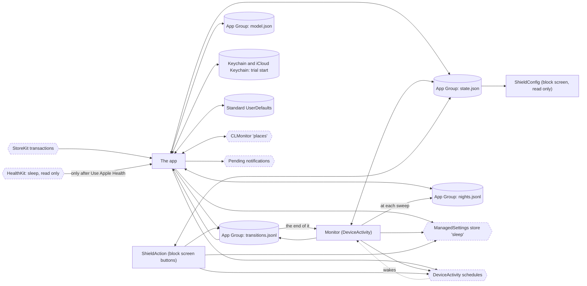

# What Dusk keeps on the phone

**What it's for:** every piece of data that outlives a launch, where it lives, its format and version, who writes and reads it, and what happens when its format changes. There is no server: any change of format, any backfill and any new model has to happen on the phone, from what is listed here. The rules every change follows are in `docs/architecture.md`, "Data and its evolution". The decisions it rests on are D11 (one coordinated state file), D28 (Toll's leftovers), D52 and D62 (the model and the night records), D78 and D82 (the free nights' start in the Keychain and iCloud Keychain), and #140 (data safety).

**Code:** `TollCore/Persist/` (`AppGroup`, `DuskStore`, `Lossy`, `Decoding`, `Migration`, `Recovery`, `TransitionLog`, `NightRecords`, `NightHistory`, `NightKeeper`, `ModelFile`, `BundledModel`), `TollCore/App/DuskState.swift`, `TollCore/App/Flows.swift`, the `Codable` types in `TollCore/Domain/`, `TollScreenTime/` (`ShieldAdapter`, `ScheduleAdapter`, `Names`, `TollLeftovers`), `TollData/` (`Keychain`, `Purchase`, `ModelStore`, `PlaceMonitor`, `NotificationAdapter`, `Health/SleepSource`), `TollCore/Persist/HealthCorrection.swift`, `TollFeatures/App/Appearance.swift`, `Setup/SetHomeModel.swift`, `Insights/SkyHeader.swift` (`SkySeen`), `SleepModel/` (`ModelArtifact`, `ModelCache`).

## Who touches what

All four targets ship in one bundle, so they always run the same build; the skew that matters is between a file on disk and the code reading it.

## The inventory

| Data | Where | Format and version | Writes | Reads | If its format changes today |
|---|---|---|---|---|---|
| **State** `state.json`: blocks (name, kind, schedule, apps, place, on), places (name, centre, radius), presence, location mode, held edits (`pending`, `pendingPlaces`), the pause (`door`, `doorAskedAt`), the week's pauses (`unlocks`), `trial` (start, purchased, entitled), `setupFinishedAt`, `screenTimeAllowed`, `dismissedCards`, `lastNightSeen` (the night whose card was put away, D91), `headsUp`, the gap before sleep (minutes, mode, target, pending, weekly tally, change, history, offered), `after`, the buffer after waking (the same fields, #144; `offered` marks one-time flow #1 as owed), `health` (the person chose Apple Health), `helpers`, `flows` (how each one-time flow last went), `recoveredAt` (when the night came back from a record), `runtime` (active blocks, last ends, clock anchor, scheduled windows, scheduled pause) | App Group container, one file, `NSFileCoordinator` around every read and read-modify-write, written atomically (a temporary file, then moved over) | JSON, ISO 8601 dates, sorted keys. `"schema": 4`, `"minReader": 4`, `"writtenBy"` (the build). 1 was step 2's single-block file (`Migration.fromV1`); 2 the blocks, with fields added later without a raise (the last, `lastNightSeen`, D91, by v0.2.33); 3 added `minReader`, `writtenBy`, `flows` and `recoveredAt` (#140), and holds every field 2 ended with; 4 (#144) added `gap.target`, `after` and `health`, and the night's stored hours now mean sleep (bed to wake) with the lock a buffer either side. Step 3 → 4 keeps a person's night exactly as it was (target 60, no buffer after, `after.offered`). `minReader` is 4: a build before #144 would drop `after` and end the night at wake. Migrated on read by `Migration.steps`, on the JSON as written. A sample of every past format is in `Tests/TollCoreTests/Fixtures/state/` | App, Monitor, ShieldAction: every wake runs `Coordinator.run`, one coordinated read-modify-write | App (also every 20 s for what extensions wrote), Monitor, ShieldAction, ShieldConfig (`DuskStore().load()`, never writes) | Decoded lossily on every read by any process: a missing key takes its default, an unknown enum value its safe fallback, an element that can't be read is dropped alone. A file that can't be parsed is kept as `state.unreadable-<time>.json` and the night comes back from the latest night record; one read in part is kept as `state.partial-<time>.json`, one at another schema as `state.v<n>.json`, before the first write over it (the newest 3 of each timed kind). A file that's there but can't be opened is never written and no effect runs. A file without `minReader` was written by a build from before #140, which keeps whatever `schema` it read, so it's read as schema 2 whatever its label. A build below the file's `minReader` reads it and never writes it: it applies no command, follows the file for the shield, logs nothing, and Tonight says changes can't be saved |
| **Transition log** `transitions.jsonl`: one line per wake that changed something or wasn't a launch or foreground (when, why, blocks on, door phase, home, in window, entitled, Screen Time) | App Group, appended under coordination | JSON lines, no version. Optional fields added over time (`active`, `screenTime`, `door`); causes added: `weekTurn` (#127, the monitor's daily noon wake: a build before it drops those lines, which are at noon and almost never a night's change) | App, Monitor, ShieldAction (append); the app trims it to the last 2,000 lines on opening, in the background, only after recording the nights in it (`NightKeeper`) | App: Tonight's last-night card, the week, the night records, Your sleep, the activity log; Monitor: its last 64 KB at each sweep, to record the night | Each line decodes alone; a line that fails (an unknown `cause` or `door` value, from a newer build or a removed case) is **dropped silently** from every reader, and with it that night's facts if it isn't recorded yet |
| **Night records** `nights.jsonl`: one line per ended night of the night's block (D62) | App Group, appended under coordination, never rewritten | JSON lines in the sleep model's contract 1 shape (`SleepModel.NightRecord`, `datascience/dusk_model/night.py`), plus Dusk's own under `dusk`. `"record": 3` and `"rev"`; 2 added both (#140), 3 `after_min` and Health's sleep (#144); a line without them is record 1, rev 1. `planned_bedtime`, `bed` and `planned_wake` are the planned sleep; the lock was bed minus `gap_min` to wake plus `after_min`. Health's sleep (`sleep_onset`, `wake`, `asleep_min`, `awake_min`, `sleep_source` `watch`, `phone` or `other`) arrives as a correction, a new line with the next `rev`, written by the app on a later foreground for people who chose Health (`NightLog.correct`). `model_version` is the bundled artifact's, `policy` `"fixed"` until a model chooses the start. With personal timing (sleep-model.v1, D66), `policy` is `"held"` and the line adds `hold_start` (the hold's first night) and `settled`; `action_offset_min` and `action_prob` are the hold's on every one of its nights, and the latest line gives the hold back after a rebuild (`Hold.latest`). `dusk.by` says who wrote it. Fields added: `bed`, `gap_min` (D83), `helper` (D85), `dusk.locked_min`, `dusk.taps` (D84), `record`, `rev`, `dusk.by` (#140), `after_min` (#144), `hold_start`, `settled` (#98; read by both model readers, not yet written by the app). A sample of every past shape is in `Tests/TollCoreTests/Fixtures/nights/` | Monitor at each sweep, from the end of the transition log, for the nights that ended in the last 36 hours and that it can see from noon; App on opening (`NightKeeper.keep`), from the whole log, before the trim, which waits if any night couldn't be written. Each night once, keyed by `"night"` (`yyyy-MM-dd`); a correction is a new line with a higher `rev` | App (`NightLog.past`: Your sleep, the sky, Settings' Last night; `ModelStore`: the model state); data science, when the person shares the file from the activity log | Old lines keep their old shape forever; readers accept every past shape (missing `gap_min` and `after_min` read as 0, `helper` as none, `locked_min` falls back to block end minus start). Every reader takes the highest `rev` per night, the first written of equals (`NightLog.current`, `ModelCache.current`, `latest` in Python). Changing `"night"`'s format would break the once-per-night check |
| **Free nights' start, this phone** | Keychain, service `com.advan.toll`, account `trialStart`, `AfterFirstUnlockThisDeviceOnly`; survives deleting the app | A string: seconds since 2001-01-01, as `Double`. No version | App: `TrialClock.begin` at setup's Done; `settle` at every launch and foreground (both copies to the earliest) | App (`TrialClock`, Welcome's and Ready's offer); everyone else reads `trial.start` from the state file | **The format never changes** (#140). A value that isn't it reads as unreadable, never as no start: it counts as a start no later than when the item was written, so no new free nights, and neither `settle` nor `begin` writes over it. Only "not found" means no start; any other Keychain answer (locked, busy) is unknown, and nothing is written that pass. Anything more goes in a new account beside it |
| **Free nights' start, iCloud** | iCloud Keychain item, same account, `kSecAttrSynchronizable`, `AfterFirstUnlock`; follows the Apple ID to other phones | Same string | App, as above, on every phone of that Apple ID | App, on every phone of that Apple ID | As above. Builds before #140 read an unreadable value as no start and write over it, which is why the format is frozen |
| **Purchase** | StoreKit's transaction store (Apple's) | Non-consumable `com.advan.toll.full` | App Store | App only (`Purchase.isPurchased` on foreground and on `Transaction.updates`), mirrored to `state.json`'s `trial.purchased` for the extensions | Apple's format. A changed product id would make every purchase read as not bought |
| **Apple Health's sleep** (read only) | HealthKit's store on the phone (Apple's); Dusk keeps nothing of it apart from the night's hours the person saves and the night log's corrections | `HKCategoryType(.sleepAnalysis)`: in bed, asleep (any stage), awake, with the writing source | Never Dusk: a watch or another sleep app | App only (`TollData/Health/SleepSource`): onboarding's and the one-time flow's "Use Apple Health" (the last 28 days, `SleepEstimate`), and each foreground for the last 7 days' corrections, only while `health` is true | Apple's format. A new sleep stage reads as nothing (`@unknown default`); a refusal reads as no nights, which iOS doesn't tell apart |
| **Appearance** `appearance` | Standard UserDefaults (the app's own) | `Appearance` raw value: `dark`, `light`, `system` | App (Settings) | App | An unknown value falls back to dark (`@AppStorage`'s default) |
| **Always asked** `askedAlways` | Standard UserDefaults | Bool | App, when it asks iOS for Always | App (`SetHomeModel`) | Lost with the app; iOS's own record decides whether the prompt shows again |
| **Stars seen** `dusk.sky.seen` | Standard UserDefaults | Int: nights the sky showed last time | App (Your sleep) | App (Your sleep: whether the newest star arrives) | A reset replays the newest star's arrival once; nothing else |
| **App Group defaults** | none | | | | D11 chose a coordinated file over App Group defaults |
| **The shield** | ManagedSettings store named `sleep` | Apple's; the union of active blocks' tokens | App, Monitor, ShieldAction (`ShieldAdapter.apply`, the whole shield every wake) | iOS; ShieldConfig is asked by iOS for each shielded app | A renamed store leaves the old one shielding for good unless something clears it (`TollLeftovers` clears Toll's `blocks` store this way) |
| **Block schedules** | DeviceActivity schedules | Activity names carry their meaning: `w.HHMM-HHMM` (a window), `s.HHMM-HHMM` (its sweep), `t.HHMM-HHMM` (the week's turn, daily from 12:01, #127), `door`; the name format is the version | App, Monitor, ShieldAction (`ScheduleAdapter`): windows only when they differ from `runtime.scheduledWindows`; the turn at every saved reconcile, started only when DeviceActivity doesn't have it, stopped when both buffers are fixed | Monitor (`Activity(name)`) | A name the monitor can't parse is `.unknown` and is **stopped** when it fires. A new naming scheme would stop the old names but register the new ones only when `scheduledWindows` changes, so a migration must clear it |
| **A block's apps** | Inside `state.json`, `Block.apps` | `FamilyActivitySelection` encoded with `JSONEncoder` (Apple's opaque format, not versioned by Dusk); `appCount`, `categoryCount` beside it | App (setup, the editor) | Every `ShieldAdapter` (app, Monitor, ShieldAction), ShieldConfig (which block names an app), the editor | A selection that no longer decodes becomes **empty**: that block shields nothing, silently, and its counts go stale |
| **Watched places** | CLMonitor named `places` (iOS keeps its conditions across launches) | Identifier = `PlaceID` string; a circular condition | App only (`PlaceMonitor.sync` after every change) | App (events; `current()` on foreground), mirrored to `state.json`'s `presence` | `sync` removes identifiers it doesn't want, so a change of id format re-adds every place and loses the last event until iOS reports again |
| **Heads-ups** | iOS pending notification requests | `headsUp-<epoch seconds>`, title and body as text | App only, replacing all pending each time the plan changes | iOS | Replaced wholesale, so a format change needs nothing |
| **Sleep model artifact** `sleep-model.v1.json` | Inside the `SleepModel` package (a bundle resource); copied from `datascience/artifacts/` by `ios/scripts/sync-model.sh`, which keeps every version | JSON, `"schema": 2`, `"version": "sleep-model.v1"`, `sha256`; checked by `check-model-artifact.sh` in CI. Schema 2 added the held start (`policy.hold_nights`, `settle_at_insight`, `settle_plan_within_min`, `settled_explore_share`, D66) and the zero test's spending (`insight.zero_test_spend_after`, `zero_test_spend_power`, #117) | Data science, through a pull request | `SleepModel`: the app (through `TollData`'s `ModelStore`), the tests and the replay tool. The extensions never link it | `validate()` reads schemas 1 (v0, which draws nightly and never settles) and 2, refuses any other, and `bundled()` then falls back to the built-in v1 numbers silently. A new version changes the checksum, so every `model.json` is rebuilt |
| **The person's model state** `model.json`: `PersonState` (precision, b, nights), the artifact's version and checksum, the policy, and which nights it has seen | App Group, coordinated, written atomically | JSON, `"schema": 1` (`SleepModel.ModelCache`) | App only, on opening, after the nights are recorded (`ModelStore.refresh`) | App only. The monitor stamps the nights it records with `BundledModel.version`, which `sync-model.sh` writes from the artifact, so a stale file can't name an old model | A cache: rebuilt from the night log whenever the artifact (version or checksum) differs, or a night it saw has changed; otherwise moved on by the new nights. An unreadable file is rebuilt. A downgrade rebuilds with the older artifact. A rebuild fixture (`datascience/artifacts/rebuild.json`) keeps Swift and Python equal |
| **Kept copies** `state.unreadable-*.json`, `state.partial-*.json`, `state.v<n>.json` | App Group, beside `state.json` | The file as it was, byte for byte | Whichever process first writes over that file | Nobody automatically; a person or a developer, to recover by hand | The newest 3 of each timed kind are kept; `state.v<n>.json` once per schema |
| **The sky and landmarks** | **Not stored.** Worked out each time from the nights that ran (`NightsRan`: night records, transition log and state) and the fixed order in `SkyCatalogue` | | | App | Changing the catalogue's order, or the rule for a night that ran, redraws every person's sky and moves which star is which night |
| **Toll's leftovers** | App Group `gate-state.json`, `spool.jsonl`, `tokens.json`; Application Support `toll.sqlite*`; Keychain `sessionToken`, `deviceId`; ManagedSettings store `blocks`; DeviceActivity names that aren't Dusk's | Toll's | Nothing now | Nothing | Deleted or stopped at every app launch (D28) |

## Risks, ranked

The first five were fixed in #140; each has a test that failed before. What's left is below them.

1. **Fixed: an unreadable state file reset the person.** One unknown enum value or one missing key made `DuskState` decode as empty, and the next wake wrote it over the file. Now reading is lossy, a file that can't be parsed is kept aside and the night comes back from the latest night record, and a file that can't be opened is never written (`LossyStateTests`, `StateStoreTests`).
2. **Fixed: no version gate.** `schema` is 3 and raised on every change; `minReader` stops an older build writing a file it can't hold; migration steps run on the JSON as written, from a fixture of every past format (`StateFixtureTests`, `StateStoreTests`). Builds from before #140 still write over a newer file, dropping its new keys: the first change that matters across a downgrade must wait until most testers have this build.
3. **Fixed: night records could be trimmed away.** The app records before it trims, and reads the whole log to do it (it read only the last 2,000 lines); the monitor records each night at its sweep (`NightKeeperTests`). A record still uses the block's hours as stored when it's written; with the monitor writing it a minute after the night, that's almost always the night's own.
4. **Fixed: night records had no version.** Each line has `record` and `rev`, corrections are new lines, and `model_version` comes from the artifact (`NightKeeperTests`, `RebuildTests`). Names still disagree with meanings: `unlocks_used` counts pauses (D70) and `dusk.paused` means the free nights had ended (Off, D74), not a pause.
5. **Fixed: an unreadable trial start granted new free nights.** It now counts as a start no later than when it was written, and is never written over (`TrialTests`). The format is frozen; builds from before #140 on another phone still write over a value they can't read, so it must never change.
6. **Transition lines from another build vanish.** An unknown `cause` or `door` value drops the line from every reader, and last night's card, the week and unrecorded nights with it.
7. **Platform names are formats.** The ManagedSettings store name, the DeviceActivity activity names and the CLMonitor name and ids all persist in iOS. Renaming any of them strands the old ones (a shield that never lifts, schedules that never fire, regions still watched) unless a migration clears them, as `TollLeftovers` does for Toll. A build below a file's `minReader` leaves schedules alone, but its monitor still stops activity names it can't parse.
8. **A block's apps are Apple's opaque encoding.** If a future iOS can't decode an older `FamilyActivitySelection`, that block shields nothing and nothing says so. A night brought back from a record has no apps either: Tonight says so in a quiet note, with "Choose apps", until they're chosen (`render: home-recovered`).
9. **The sky is derived.** No stored order or mapping protects a person's sky from a change to `SkyCatalogue` or to what counts as a night that ran.
10. **A new artifact can drop old nights.** The rebuild replays every record, but `SkipReason.unknownAction` skips a night whose logged offset isn't in the new artifact's `actions`; an artifact with different moves needs a rule for the old ones before it ships.
