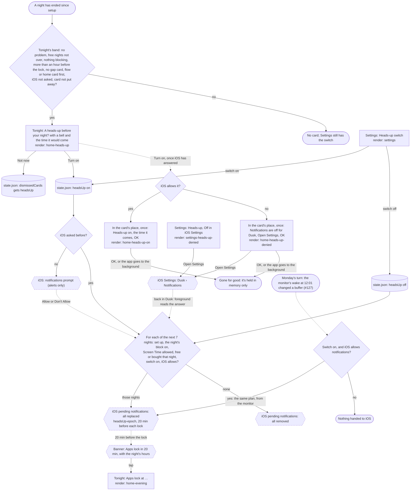

# The heads-up before the night

**What it's for:** one quiet local notification 20 minutes before the apps lock, so the lock never comes as a surprise. It is Dusk's only notification. Permission is asked after the first night, from Tonight's card or Settings, never in onboarding.

**Implements:** D68 and D72 (one heads-up, asked after the first night, Settings can switch it off), D83 (it comes 20 minutes before the lock, not before bed), #127 (Monday's change moves it with Dusk closed), D65 (banners only: no sound, no badge).

**Code:** `TollCore/App/HeadsUp.swift` (who gets one and when), `TonightCard.headsUp`, `TollFeatures/App/AppModel+HeadsUp.swift`, `Settings/HeadsUpRow.swift`, `TollData/Notifications/NotificationAdapter.swift` (asks iOS), `TollScreenTime/HeadsUpNotifications.swift` (hands iOS the plan, from the app and the monitor), `TollCore/App/WeekTurn.swift`.

**When the plan is handed to iOS again:** on Monday, by the monitor at the week's turn when a buffer changed, so that night's heads-up moves with the lock while Dusk stays closed (#127); after every command the app sends, at launch and on every foreground (the plan is forgotten first, so it always goes again), and when the app's 20-second refresh sees a state the monitor wrote (a held edit applied at the end of a night). Only a plan that differs from the last one is handed over.

## Doubts
- **A heads-up already handed to iOS still arrives** if Screen Time is switched off, the night's block is switched off by another route, or a refund lands while Dusk stays closed: the extensions can't schedule (D72's open point).
- **The monitor's plan needs iOS's answer within 2 seconds** (`HeadsUpNotifications.replaceIfAllowed`); if iOS is slower, the old plan stays and Monday's heads-up comes at last week's time. A device row checks it.
- **The card's time** comes from `HeadsUp.nights(...).first`, which skips a night whose heads-up time has passed. The card never shows in the hour before the lock (Tonight's band), so it names tonight's whenever it shows on a day with a night.
