# Onboarding to the first night

**What it's for:** the shortest path from a first launch to a first locked night. Five screens: the free nights offered in full, when you get up, Screen Time, the apps, and Ready. No map, no location and no notification prompt; those are offered after the first night ([set-home.md](set-home.md), [heads-up.md](heads-up.md)).

**Implements:** D68 and D71 (the steps), D76 and D83 (a new install locks 15 minutes before bed, growing), D78 and D82 (the free nights' start follows the Keychain and the Apple ID), D50 (setup promises only what this phone has left), D74 (the words).

**Code:** `TollFeatures/Setup/SetupFlow.swift` (Welcome), `SetupModel.swift`, `WakeTimeView.swift`, `ScreenTimeView.swift`, `BlocklistView.swift`, `ReadyView.swift`; `AppModel.finishSetup`; `Engine.apply(.finishSetup)`; `RootView` decides between setup and the tabs.

```mermaid
flowchart TD
  launch(["Dusk opens"]) --> setupDone{"state.json has setupFinishedAt?"}
  setupDone -->|"yes"| tabs(["Tonight, see tonight.md"])
  setupDone -->|"no: a new install, or a state file that could not be read (data.md)"| keychain{"Free nights already started on this phone or Apple ID?<br/>(Keychain, both copies, earliest wins)"}
  keychain -->|"no"| welcomeFresh["Welcome: 14 nights free, two rows of seven empty segments<br/>render: welcome"]
  keychain -->|"yes, still running"| welcomeRunning["Welcome: the offer says when they end<br/>render: none"]
  keychain -->|"yes, used up"| welcomeUsed["Welcome: Free nights used, then the price<br/>render: none"]
  keychain -->|"bought"| welcomeBought["Welcome: Purchased<br/>render: none"]

  welcomeFresh -->|"Already bought it? Restore"| restore{{"App Store sync<br/>(may ask for the Apple Account)"}}
  welcomeRunning -->|"Already bought it? Restore"| restore
  welcomeUsed -->|"Already bought it? Restore"| restore
  restore -.->|"found"| savedBought[("state.json: trial.purchased")]
  savedBought --> welcomeBought
  restore -.->|"none found"| restoreNone["No purchase found<br/>render: none"]
  restoreNone -->|"OK: back to the Welcome it came from"| welcomeFresh

  welcomeFresh -->|"Start my free nights"| wake
  welcomeRunning -->|"Start my free nights"| wake
  welcomeUsed -->|"Set up Dusk"| wake
  welcomeBought -->|"Set up Dusk"| wake

  wake["When do you need to be up?<br/>the night drawn moon to sun<br/>render: wake"]
  wake -->|"turns the wheel: the start follows, 8 h 30 m before, until moved"| wake
  wake -->|"Different on weekends"| wakeWeekends["Fri and Sat nights get their own wake time<br/>render: wake-weekends"]
  wakeWeekends -->|"Continue"| screenTime
  wake -->|"Continue (off while the hours are invalid)"| screenTime

  screenTime["Allow Screen Time<br/>render: screen-time"]
  screenTime -->|"Allow"| fcPrompt{{"iOS: Family Controls prompt"}}
  fcPrompt -.->|"allowed"| stAllowed["Screen Time: tick badge<br/>render: screen-time-allowed"]
  fcPrompt -.->|"not allowed"| stDenied["Screen Time: warning badge and a note; no skip<br/>render: screen-time-denied"]
  stDenied -->|"Try again"| fcPrompt
  stAllowed -->|"Continue"| apps

  apps["What keeps you up?<br/>render: blocklist"]
  apps -->|"Choose apps / Choose more"| picker{{"Apple's apps picker"}}
  picker -.->|"picked"| appsCheck{"At least one app, site or category,<br/>and at most 40 apps and sites?"}
  appsCheck -->|"no"| apps
  appsCheck -->|"yes: Continue"| ready

  ready["You're set: Apps lock at 10:15 pm tonight.<br/>15 min before bed, Anywhere, the apps, 3 pauses, the free nights<br/>render: ready"]
  ready -->|"Done (no Back)"| begin[("Keychain: the free nights' start, this phone and iCloud<br/>state.json: the night's block with no place, gap 15 growing, setupFinishedAt")]
  begin --> inLock{"Inside tonight's lock already?"}
  inLock -->|"no"| evening["Tonight: Apps lock at, Anywhere · starts in …<br/>render: home-anywhere"]
  inLock -->|"yes"| locked["Tonight: Apps locked until<br/>render: none (home-blocked has home set)"]
  evening -.->|"lock time: the monitor wakes"| locked
  locked -.->|"the night ends"| morningAfter["Tonight: the morning card, with the home card<br/>render: home-morning-card"]
  morningAfter --> later(["Offers after the first night: set-home.md, heads-up.md"])

  classDef system stroke-dasharray: 5 3
  class restore,fcPrompt,picker system
```

Going Back from any step keeps what was chosen; leaving the app before Ready's Done saves nothing, so the next launch starts at Welcome again.

## Doubts
- **Welcome's other offers and restore have no render.** `welcome` shows only the fresh offer. A running, used or bought offer, and Welcome's "No purchase found" (the 374 pt `RestoreNoneSheet`, not the purchase sheet's outcome that `purchase-restore-none` shows), are not rendered.
- **A night that is on at Done has no render.** `ready` covers the title ("From now until 7:00 am"), but Tonight locked with home not set has no scenario: `home-blocked` has home set.
- **An unreadable state file sends a set-up phone back here.** `DuskStore.decode` returns an empty state when the file can't be decoded, so `setupFinishedAt` is nil and RootView shows Welcome. The Keychain still holds the free nights' start, so the offer is "running" or "used", and `nights.jsonl` keeps the nights. See `data.md`, risk 1.
- **Restore before setup** records `trial.purchased` in the state file before any block exists. Nothing checks it until Ready, where the offer is `.purchased` and the footnote is hidden; that matches the code, but no test covers the order.
