# Onboarding to the first night

**What it's for:** the shortest path from a first launch to a first locked night, fitted to the person's sleep (#144). Seven screens: Welcome with the whole deal, Fit Dusk to your sleep, Your sleep, The time around your sleep, Screen Time, the apps, and Ready. Apple Health is asked for where it's used, on "Fit Dusk to your sleep", and iOS's sheet asks for sleep alone. No map, no location and no notification prompt; those are offered after the first night ([set-home.md](set-home.md), [heads-up.md](heads-up.md)).

**Implements:** #144 (the steps, Health, the buffers before and after sleep, "Buy it now"), D68 and D71 (the shortest path; reversed in part by #144: Health is now asked here, not after night 1), D76 and D83 (the buffer before sleep grows weekly; #144 extends the rule to the buffer after waking and gives each its own target), D78 and D82 (the free nights' start follows the Keychain and the Apple ID), D50 (setup promises only what this phone has left), D74 (the words).

**Code:** `TollFeatures/Setup/SetupFlow.swift` (Welcome), `SetupModel.swift`, `FitDraft.swift`, `FitView.swift`, `SleepTimesView.swift`, `AroundView.swift`, `ScreenTimeView.swift`, `BlocklistView.swift`, `ReadyView.swift`, `NightPictureView.swift`; `AppModel+Health.swift` and TollData's `SleepSource` (Health); TollCore's `SleepNight`, `SleepEstimate`, `BufferSuggestion` and `Fit`; `AppModel.finishSetup`; `Engine.apply(.finishSetup)`; `RootView` decides between setup and the tabs.

```mermaid
flowchart TD
  launch(["Dusk opens"]) --> setupDone{"state.json has setupFinishedAt?"}
  setupDone -->|"yes"| tabs(["Tonight, see tonight.md"])
  setupDone -->|"no: a new install, or a state file that could not be read (data.md)"| keychain{"Free nights already started on this phone or Apple ID?<br/>(Keychain, both copies, earliest wins)"}
  keychain -->|"no"| welcomeFresh["1 · Welcome: 14 nights free, two rows of seven empty segments;<br/>Start my 14 free nights · Buy it now · $9.99 · Restore<br/>render: welcome"]
  keychain -->|"yes, still running"| welcomeRunning["Welcome: 14 nights free, without the segments<br/>render: none"]
  keychain -->|"yes, used up"| welcomeUsed["Welcome: Free nights used, then the price<br/>render: none"]
  keychain -->|"bought"| welcomeBought["Welcome: Purchased; no Buy it now<br/>render: none"]

  welcomeFresh -->|"Buy it now · $9.99"| buy{{"App Store purchase sheet"}}
  welcomeRunning -->|"Buy it now"| buy
  welcomeUsed -->|"Buy it now"| buy
  buy -.->|"bought: state.json trial.purchased"| fit
  buy -.->|"cancelled, pending or failed"| fit
  welcomeFresh -->|"Already bought it? Restore"| restore{{"App Store sync<br/>(may ask for the Apple Account)"}}
  restore -.->|"found"| welcomeBought
  restore -.->|"none found"| restoreNone["No purchase found<br/>render: none"]
  restoreNone -->|"OK"| welcomeFresh

  welcomeFresh -->|"Start my 14 free nights"| fit
  welcomeRunning -->|"Start my 14 free nights"| fit
  welcomeUsed -->|"Set up Dusk"| fit
  welcomeBought -->|"Set up Dusk"| fit

  fit["2 · Fit Dusk to your sleep: Health's tile → the moon;<br/>'Sleep only. Nothing is written to Health.'<br/>render: fit"]
  fit -->|"Use Apple Health"| hk{{"iOS: Health access sheet (read: Sleep only)"}}
  hk -.->|"answered, either way"| enough{"At least 7 nights in the last 28 days?<br/>(SleepEstimate; iOS never says if reading was refused)"}
  enough -->|"yes"| found["3 · Your sleep: 'You usually fall asleep around 11:20 pm and wake around 7:10 am',<br/>moon to sun, both ends on their rows<br/>render: setup-sleep-found"]
  enough -->|"yes, Fri and Sat differ by 45 min or more"| foundWeekends["Your sleep: weeknights, and Fri and Sat nights apart<br/>render: setup-sleep-weekends"]
  enough -->|"no: too few nights, or refused"| ask
  fit -->|"Set my hours myself"| ask["3 · Your sleep: 'When do you usually fall asleep and wake up?'<br/>the same rows; Different on weekends<br/>render: setup-sleep-ask"]
  found -->|"Continue"| around
  foundWeekends -->|"Continue"| around
  ask -->|"Continue (off while the hours are invalid)"| around

  around["4 · The time around your sleep: lock → sleep → wake → open;<br/>Before sleep 15 min tonight, growing to 60; After waking 10, growing to 30<br/>render: setup-around"]
  around -.->|"from Health: in bed over 30 min before sleep, or onset spread over 60 min"| aroundHealth["The same, suggested from your sleep: before grows to 75 or 90<br/>render: setup-around-health"]
  around -->|"Continue"| screenTime
  aroundHealth -->|"Continue"| screenTime

  screenTime["5 · Allow Screen Time<br/>render: screen-time"]
  screenTime -->|"Allow"| fcPrompt{{"iOS: Family Controls prompt"}}
  fcPrompt -.->|"allowed"| stAllowed["Screen Time: tick badge<br/>render: screen-time-allowed"]
  fcPrompt -.->|"not allowed"| stDenied["Screen Time: warning badge and a note; no skip<br/>render: screen-time-denied"]
  stDenied -->|"Try again"| fcPrompt
  stAllowed -->|"Continue"| apps

  apps["6 · What keeps you up?<br/>render: blocklist"]
  apps -->|"Choose apps / Choose more"| picker{{"Apple's apps picker"}}
  picker -.->|"picked"| appsCheck{"At least one app, site or category,<br/>and at most 40 apps and sites?"}
  appsCheck -->|"no"| apps
  appsCheck -->|"yes: Continue"| ready

  ready["7 · You're set: Apps lock at 11:05 pm tonight.<br/>lock · moon 11:20 pm – 7:10 am sun · open; before and after rows, Anywhere, the apps, 3 pauses, the free nights<br/>render: ready, ready-health"]
  ready -->|"Done (no Back)"| begin[("Keychain: the free nights' start, this phone and iCloud<br/>state.json: the night's block (sleep, no place), gap and after growing from their starts to their targets, health, setupFinishedAt")]
  begin --> inLock{"Inside tonight's lock already?"}
  inLock -->|"no"| evening["Tonight: Apps lock at, 15 min before sleep; the strip: before · sleep · after<br/>render: home-anywhere"]
  inLock -->|"yes"| locked["Tonight: Apps locked until<br/>render: none (home-blocked has home set)"]
  evening -.->|"lock time: the monitor wakes"| locked
  locked -.->|"the lock ends, after the buffer after waking"| morningAfter["Tonight: last night's card; the home card once it is put away<br/>render: home-morning-card"]
  morningAfter --> later(["Offers after the first night: set-home.md, heads-up.md"])

  classDef system stroke-dasharray: 5 3
  class buy,restore,hk,fcPrompt,picker system
```

Going Back from any step keeps what was chosen; leaving the app before Ready's Done saves nothing, so the next launch starts at Welcome again. Health's answer, the times and both buffers live in `FitDraft` until Done.

## Doubts
- **Welcome's other offers, restore and "Buy it now" outcomes have no render.** `welcome` shows only the fresh offer.
- **Health refused looks like Health with no nights.** iOS doesn't say which; both lead to the asking screen, which is what #144 asks for. A person who refused can't be told how to allow it without guessing.
- **"Use Apple Health" waits on iOS's sheet and the read, with the button disabled and nothing moving** (design §2.5 has no spinner). On a phone with years of sleep the read is a few hundred samples, so the wait should be short; it isn't measured.
- **The suggestion is v0** (`BufferSuggestion`, TollConfig `suggestion`): every person gets 60 before and 30 after, plus 15 before for each sign. #145 replaces it.
- **A night that is on at Done has no render.** `ready` covers the title ("From now until 7:20 am"), but Tonight locked with home not set has no scenario.
- **An unreadable state file sends a set-up phone back here.** See `data.md`.
