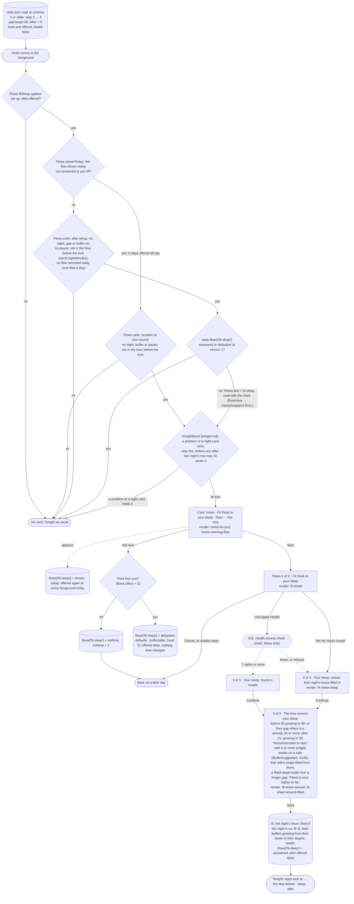

# One-time flow #1: Fit Dusk to your sleep

**What it's for:** people set up before #144 have a night but no buffer after waking, no target of their own for the buffer before sleep, and were never asked about Apple Health. Schema 4's migration step keeps their night exactly as it was; this flow offers them, once, onboarding's steps 2 to 4 (Fit Dusk to your sleep, Your sleep, The time around your sleep) in a sheet, starting from their own night and gap.

**Implements:** #144 (the flow), #140 and D92 (the registry, its calm moments and "Not now"), D86, D91 and D94 (Tonight's band, `TonightBand`), D76 (the weekly rule, now both sides).

**Code:** `TollCore/App/Flows.swift` (`Flows.fitSleep`, `due`, `calm`, `record`), `Persist/Migration.swift` (`v3to4`), `App/Fit.swift` (`Fit.existing`, `Fit.apply`), `Domain/BufferSuggestion.swift`, `Domain/BufferNight.swift`, `Persist/NightHistory.swift` (`NightLog.buffers`); `TollFeatures/Setup/FitFlowSheet.swift`, `FitView.swift` (`FitChoice`), `SleepTimesView.swift`, `AroundView.swift`, `FitDraft.swift`; `Home/HomeView.swift` (`HomeNote.flow`), `Home/TonightCardView.swift` (`BandCard`); `App/RootView.swift`, `AppModel.foreground` (`dueFlow`), `AppModel+Intents.swift` (`flow`).

**Applies** (`applies`): `setupFinishedAt` is set and `after.offered` is true. The 3 → 4 step sets `after.offered` for every file it migrates (and `Migration.fromV1` for schema 1); a new install's `finishSetup` never does. Version 1.

**The defaults** leave the person's night exactly as it was: sleep is the hours they set, the buffer before is their gap (still growing or fixed, with D76's 60 as the target), and there is no buffer after. After the third "Not now" the flow never shows again; Settings › Sleep still offers everything it did.

## Doubts
- **One flow a day, offered all day** (fixed in this branch): `Flows.due` keeps a flow shown today offered at every calm foreground that day, until it is answered or put off; `calm` still lets no second flow start that day (`FlowTests.theFlowOfferedTodayStaysAllDay`).
- **The gap offer and this flow overlap** for a person from before D76: both are about the buffer before sleep. The flow comes first in the band; answering it sets the gap and clears the offer, and putting it off for good leaves the offer for later.
- **No render shows Health found inside the sheet.** The onboarding renders (`setup-sleep-found`, `setup-sleep-weekends`) show the same screen.
