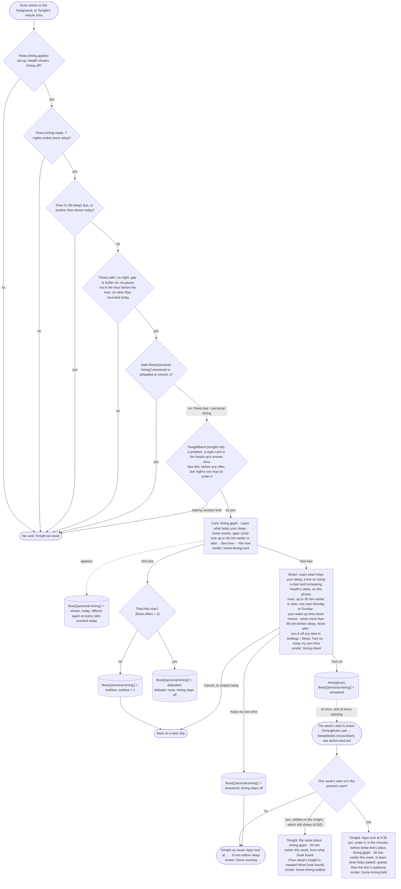

# One-time flow #2: Personal timing

**What it's for:** personal timing (D66, D99, D107) moves the week's lock start up to 30 minutes either way so the sleep model can learn what helps a person fall asleep, and it is off for everyone until they choose it. D65 says it's offered once, in plain words, after the first week, only with Apple Health (the model learns only from Health's sleep), and can be turned off at any time. This flow is that offer: a card in Tonight's band, and a sheet saying what it does, what it never does, and where it's turned off.

**Implements:** #171, D65 (offered once after the first week, needs Health, can be turned off), D92 (the registry, its calm moments and "Not now"), D94 (Tonight's band, the flow kind), D105 (Tonight's reason never outshouts or moves the time), D107 (`Command.timing`, `TimingRules`, `DuskState.timing`).

**Code:** `TollCore/App/Flows+Timing.swift` (`Flows.timing`, `nightsEnded`), `App/Flows.swift` (`ready`, `due`, `calm`, `record`), `App/TimingLine.swift` (`HeldStart`, `TimingSetting`), `Copy/Copy+Timing.swift`, `TollConfig.timing.offerAfterNights`; `TollFeatures/Home/TonightBandView.swift` (`.flow`), `Home/TimingOfferSheet.swift`, `Home/HomeHero.swift` (`held`), `Settings/TimingRow.swift`, `Settings/BeforeBedRow.swift` (`SleepSettingsView`), `App/AppModel+Timing.swift` (`answerTiming`, `setTiming`), `App/RootView.swift`.

**Applies** (`applies`): `setupFinishedAt` is set, `health` is true, and `timing.on` is false. **Ready** (`ready`): at least `timing.offerAfterNights` (7) of the night's hours have ended since setup, however each went (`Flows.nightsEnded`). Version 1. It comes after flow #1 in the registry, so someone from before #144 is fitted first, and asked this another day.

**The defaults** change nothing: after the third "Not now" the offer never shows again and timing stays off. Settings › Sleep keeps the switch either way ([settings.md](settings.md)); turned on there, the offer no longer applies. Turned off after answering, it isn't offered again.

## Doubts
- **The settled reason** (#182). A week whose start settled on the insight (`Hold.settled`, on the side it supports) reads "from what Dusk found" while the insight still shows on Your sleep. A week drawn to learn keeps "to learn what helps" even if the insight appears mid-week, and so does a settled week whose insight stops holding, or a settled person's week of exploring the other side. The line names where the insight is rather than its minutes, so it never reads as a promise for tonight.
- **Nights, not Health nights.** The first week is 7 of the night's hours ended since setup, however each went (away, paused, Screen Time off), not 7 nights with Health's sleep. The model learns from whatever Health has; a person without a watch gets the offer and learns little, which their Health choice already allows.
- **The reason takes the minutes-before-sleep line** rather than adding one, so the time doesn't move (D105). In a held week Tonight doesn't say "90 min before sleep"; the strip still draws the longer buffer.
