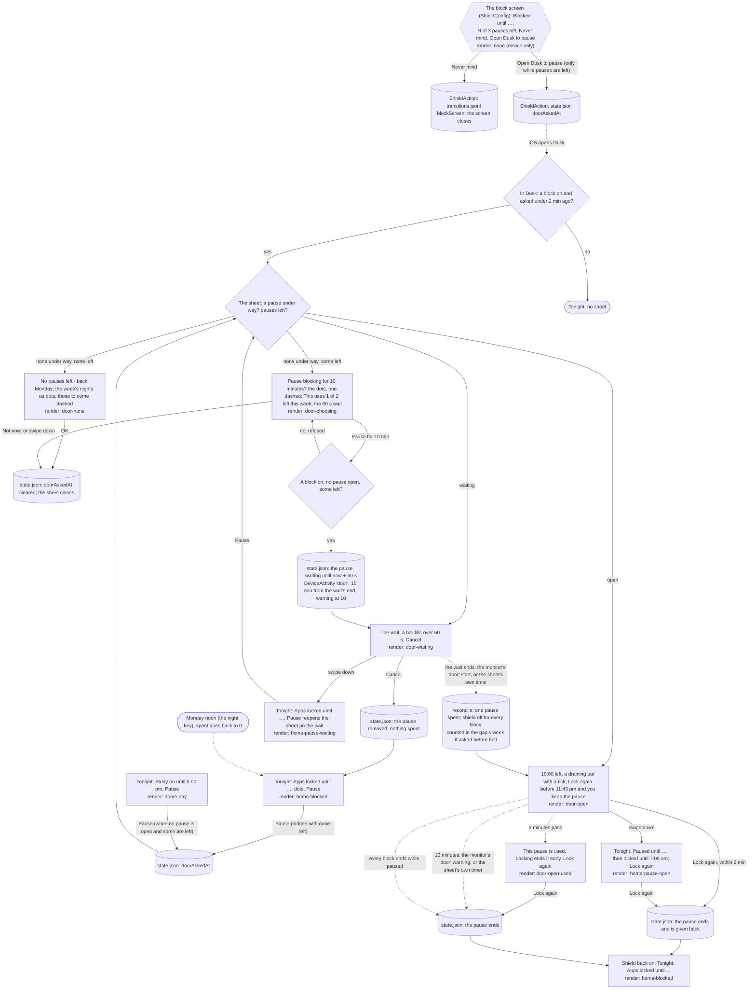

# The pause

**What it's for:** the one way out while apps are locked. A 60-second wait that costs nothing to cancel, then every block's shield lifts for 10 minutes and comes back by itself. Three a week, shared by every block, back to three when Monday's night starts at noon. "Lock again" in the first 2 minutes gives the pause back. The code keeps the spec's names (`Door`, `Unlock`); people see "Pause".

**Implements:** D67 and D70 (the pause), D-3 (a free wait), D-4 (the 2-minute regret), D-7 (one at a time), D31 (the DeviceActivity warning is the timer), D32 and D84 (the block screen's buttons and words), D47 (no dead ends), D75 (the sheet can be swiped away; Tonight shows the paused state), D76 (a pause asked for before bed counts against the gap's week), D87 (the sheet keeps one height).

**Code:** `TollCore/App/DoorRules.swift`, `Domain/Door.swift` (`Door`, `UnlockSupply`), `App/ShieldText.swift`; `ios/ShieldAction/ShieldActionExtension.swift`, `ios/ShieldConfig/ShieldConfigurationExtension.swift`, `ios/Monitor/DeviceActivityMonitorExtension.swift`; `TollScreenTime/ScheduleAdapter.swift` (`startDoor`); `TollFeatures/Door/DoorSheet.swift`, `DoorParts.swift`; `AppModel+Intents.swift` (`showsDoor`, `doorPending`, `askDoor`, `startDoor`, `cancelDoor`, `lockDoor`, `dismissDoor`); `RootView.LiveHome` (the sheet).

The sheet closes by itself when nothing is pending any more: the block ends, or the pause ends with no new ask (`AppModel.doorPending`).

## Doubts
- **When `door-none` is reached in practice** (intended, #141): Tonight hides Pause with none left and the block screen drops its button at 0 (D47), so the "No pauses left" sheet shows only when an ask arrives with none left, for example a block screen drawn before the last pause was spent. It stays as the answer to that stale ask. Worth a device check.
- **Swiping the sheet away during the wait** leaves the wait running; Tonight's state shows "Apps locked until" (the pause isn't open yet), with Pause to reopen (`home-pause-waiting`). The pause is spent only when the wait ends (`DoorRules.advance`), so Pause stays while the wait runs, even if it is to spend the week's last (#124).
- **Every bar of the sheet keeps one line** (#135): choosing's "Not now" has an empty room under Cancel and Lock again (`LinkRoom`, TollUI). The bar steps with its countdown once a second, with no motion of its own (design §2.5, #151).
- **Two timers end a pause:** the monitor's DeviceActivity warning and the sheet's own `Task.sleep`. Each sends a reconcile, and reconcile reads the stored times, so both are safe; the transition log can show two lines for one end.
- **The block screen can't be rendered** (Family Controls in the simulator), so its node has no scenario; its words are tested in `ShieldTextTests` and checked in `docs/device-protocol.md`.
