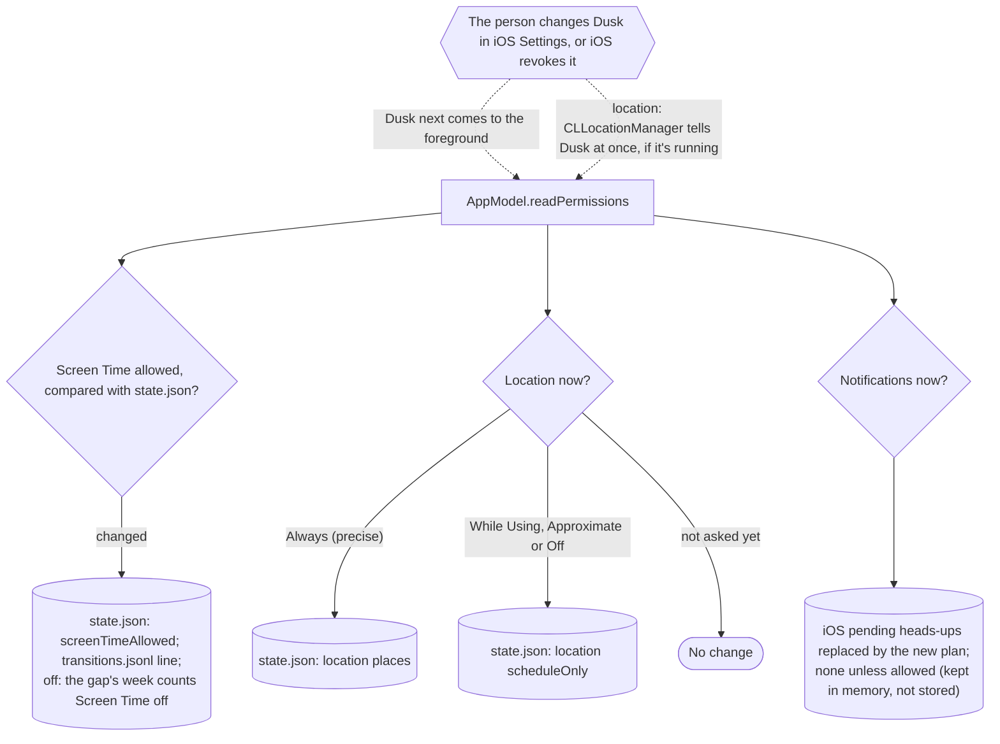
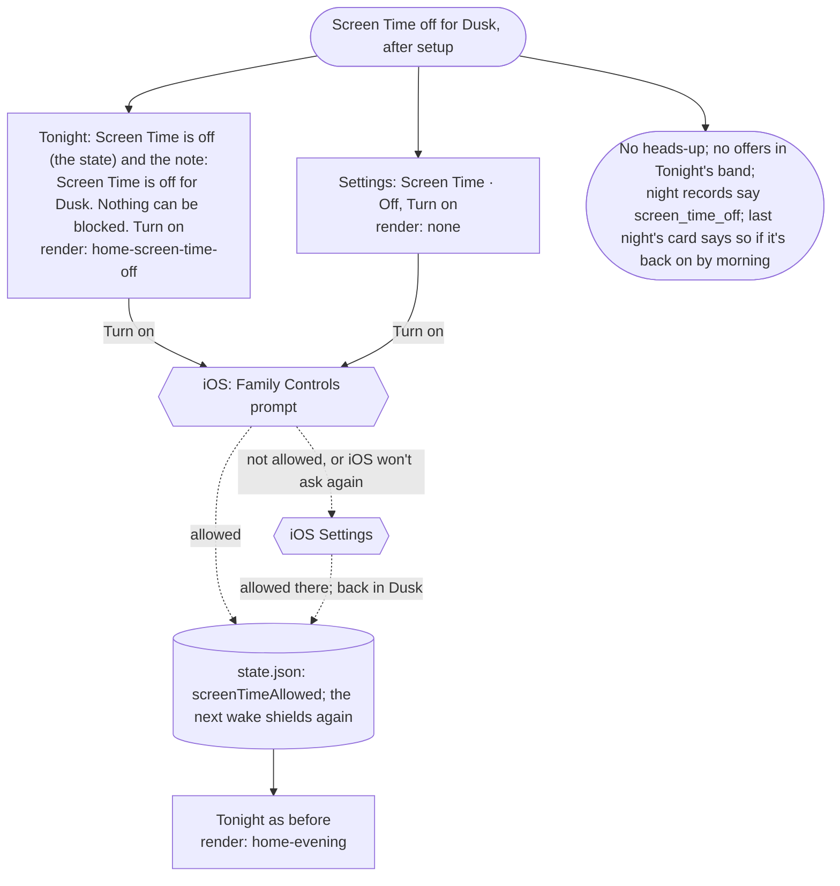
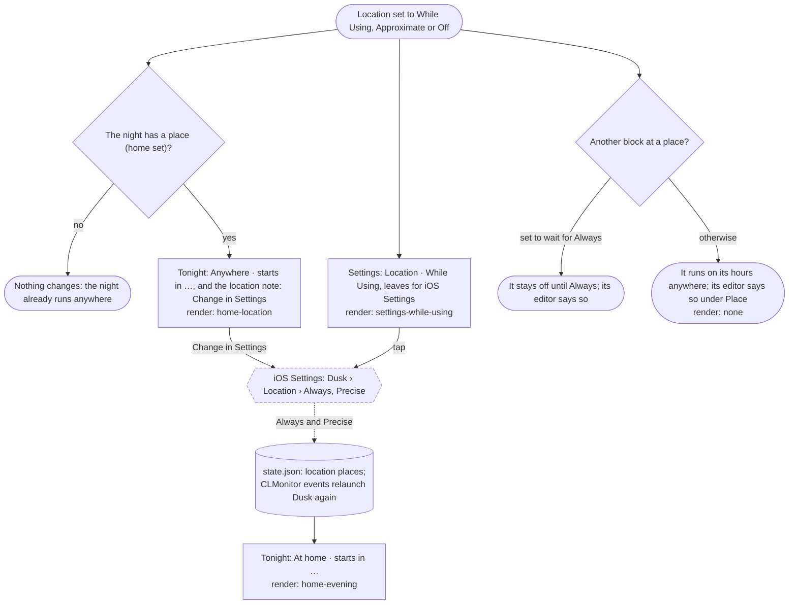
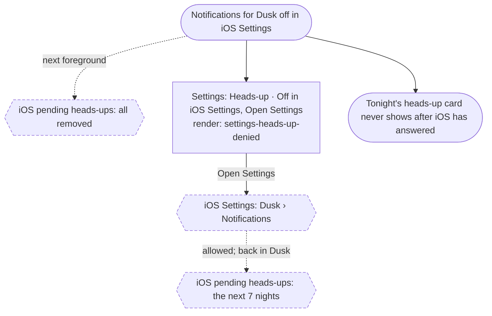

# Permission loss and recovery

**What it's for:** what happens when a permission Dusk relies on is taken away in iOS Settings, how Dusk notices, what it says, and the way back. Screen Time is the one loss that stops everything, so it's the one warning that's red. Location short of Always only means the night keeps its set times anywhere. Notifications off only stops the heads-up.

**Implements:** #45 and D48 (Screen Time off is said, and Settings' row is a button), #60 (the state records whether Screen Time was allowed, so the log and night records say a night couldn't block), D8, D10 and D37 (without Always and Precise, places are ignored and blocks run on their hours), #63 (a day block can wait for Always instead), D72 (after iOS says no, Settings leaves for iOS Settings), D76 (Screen Time switched off eases the gap and holds it for 2 weeks).

**Code:** `TollFeatures/App/AppModel.swift` (`readPermissions`, `locationMode`), `AppModel+Intents.swift` (`turnOnScreenTime`), `AppModel+HeadsUp.swift`; `TollScreenTime/ScreenTimeAuthorization.swift`; `TollData/Location/LocationAccess.swift`, `PlaceMonitor.swift`; `TollData/Notifications/NotificationAdapter.swift`; `Engine.apply(.screenTime, .location)`, `Engine.isAtPlace`; `HomeSnapshot` (`screenTimeOff`, `locationBanner`).

## How Dusk notices

The extensions can't read Screen Time's authorization or StoreKit; they log what the app last stored. Until the app runs again, a night with Screen Time off is still recorded by them as on, and the app's next `screenTime(false)` line marks it.

## Screen Time off

## Location short of Always

## Notifications off

## Doubts
- **What iOS does to the shield and the DeviceActivity schedules when Screen Time is revoked** isn't in the code; the engine keeps its blocks "on" and the snapshot says nothing can block. `docs/device-protocol.md` is where the device answer belongs.
- **Screen Time off with the free nights over:** the Off state wins over the Screen Time state, but the red note still shows (see [tonight.md](tonight.md)).
- **Nothing asks for location at launch.** The place watch and its Always session open only once Dusk has Always (D98); opened earlier, iOS shows the location prompt over Welcome.
- **Location changed while Dusk isn't running** is only seen at the next foreground; until then the monitor still decides with the stored mode. With Always gone, region events no longer relaunch Dusk, so presence goes stale rather than wrong.
- **Precise off with Always on** reads as `approximate` (`LocationAccess.state`), which is `scheduleOnly`: places are ignored, as D8 says.
