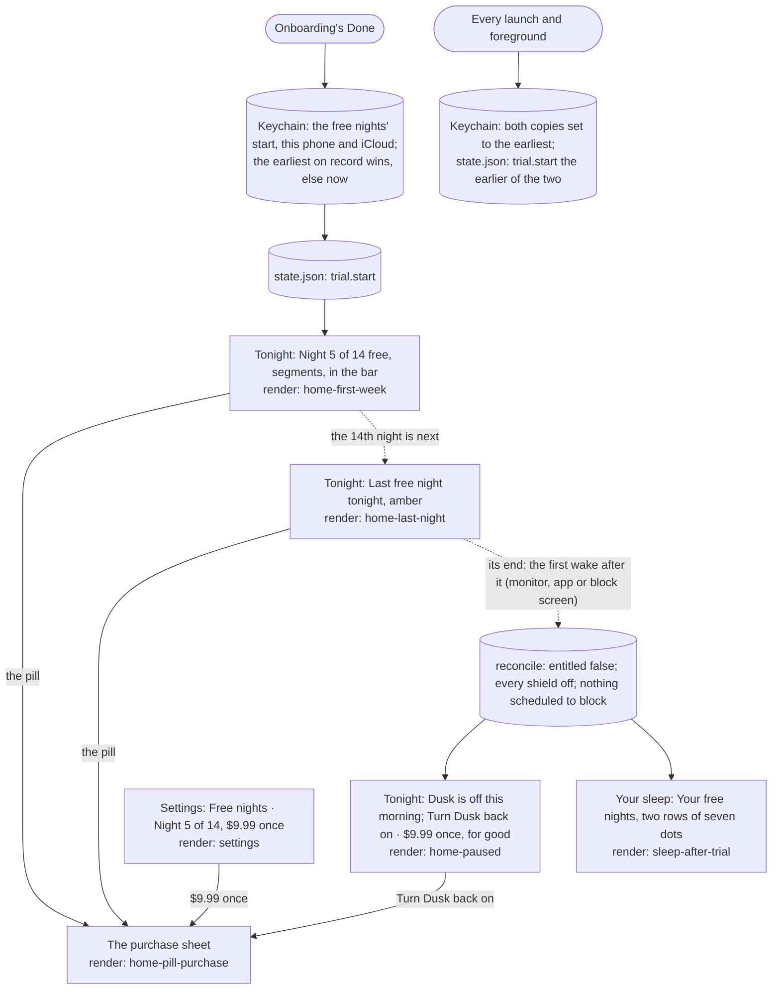
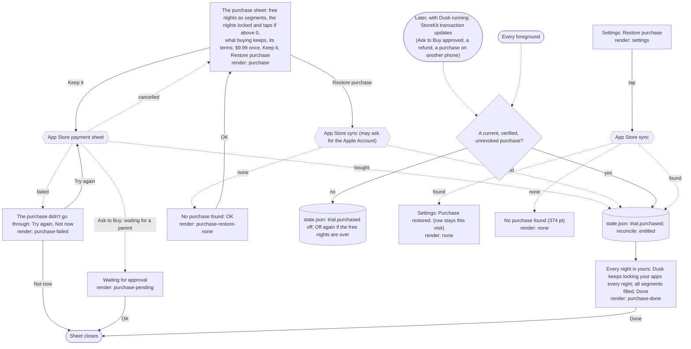

# The free nights, their end and the purchase

**What it's for:** 14 nights free, then $9.99 once. The free nights' start is kept in the phone's Keychain and in iCloud Keychain, so deleting the app or moving to a new phone on the same Apple ID doesn't start them again. Nothing is sold while anything is blocked. When the free nights end, Dusk is Off until bought; buying, restoring or an Ask to Buy approval turns it back on.

**Implements:** P-1 to P-4, D7 (the deal stated in full), D23 (entitlement worked out at every wake), D33 (selling only when nothing blocks), D34 (the price), D50 (setup promises only what's left), D74 (Off, not "Paused"), D78 and D82 (14 nights, both Keychain copies, earliest wins), D84 (the sheet hides zeros; "Purchase restored."), D87 (outcomes keep the offer's height).

**Code:** `TollCore/Domain/Trial.swift`, `TrialStart.swift`; `Engine.reconcile` (`Trial.isEntitled`); `HomeSnapshot.pill`, `FreeWeek`; `TollData/Purchase/Purchase.swift` (`Purchase`, `TrialClock`), `Keychain/Keychain.swift`; `TollFeatures/Purchase/PurchaseSheet.swift`; `AppModel.start`, `foreground`, `buy`, `restore`, `setPurchased`; `Settings/SettingsView.swift` (Free nights, Restore).

## The free nights and their end

No pill shows while any block is on, while away, or with no night (D33, D75). Off also stops the heads-up ([heads-up.md](heads-up.md)) and the Tonight cards ([tonight.md](tonight.md)).

## Buying and restoring

Welcome's "Already bought it? Restore" is the same restore; see [onboarding.md](onboarding.md).

Every outcome's button sits on the offer's "Keep it" line (#135): the terms left the bar for the scrolling content, and an outcome with one button keeps the restore link's room under it, empty (`LinkRoom`). There is no spinner in "Keep it" while the App Store answers: a spinner loops, which design §2.5 never allows; the button dims until Apple's sheet appears (#129).

## Doubts
- **An approved Ask to Buy reaches Dusk only while it runs** (`Transaction.updates`) or at the next foreground. Until then the monitor still treats the night as Off, so a night can stay unlocked after approval if Dusk isn't opened. Intended (#141): the extensions never import StoreKit (spec §9, CLAUDE.md), and the pending sheet already asks the person to come back; proposed for the decisions log.
- **A refund while Dusk stays closed** keeps blocking until the next foreground: the extensions read `trial.purchased` from the state file, and only the app asks StoreKit.
- **The free nights after the trial on Your sleep** ("Your free nights"): `sleep-after-trial`.
- **The Off state's name in code:** `home-paused` is the render id for Off, and night records call it `dusk.paused` (see `data.md`). Both predate D74's rename; the pause itself is `door` in code.
