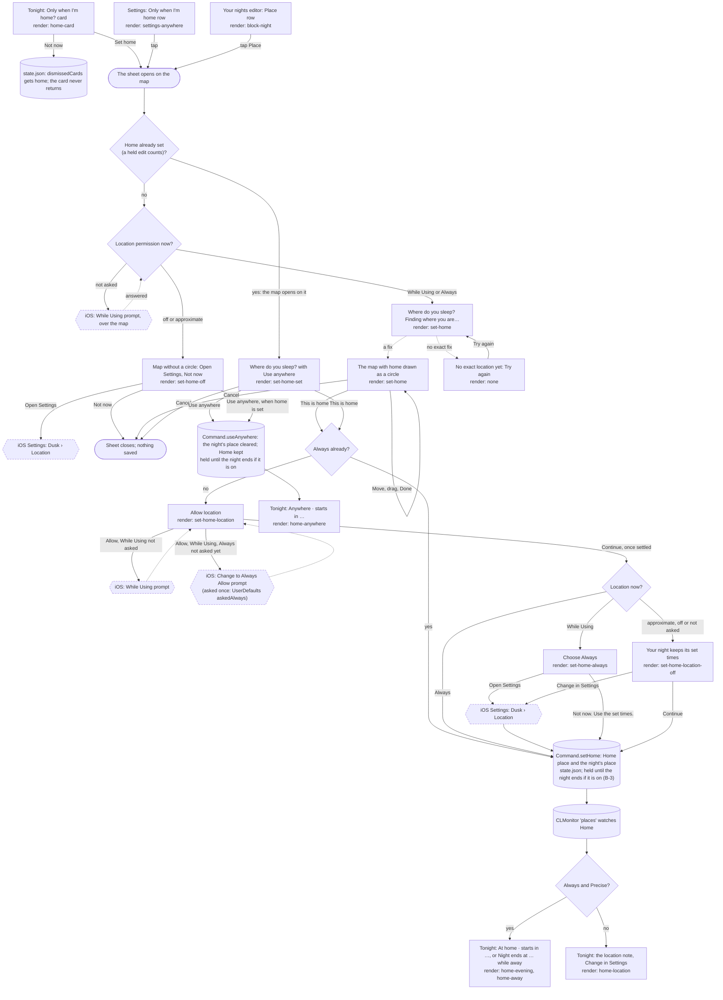

# Only when I'm home

**What it's for:** after the first night, letting the night wait until the phone is home. It is the one place Dusk asks for location: While Using on the map, then Always once. Short of Always and Precise, home is still saved and the night keeps its set times wherever the phone is. Once home is set, the same sheet offers the way back, "Use anywhere".

**Implements:** D68 and D71 (offered after the first night, saved once at the end), D84 (one home picker from Tonight, Settings and the night's editor; "Use anywhere"), D8, D10 and D37 (without Always and Precise, the night runs on its hours), B-3 (a change during the night waits until it ends).

**Code:** `TollFeatures/Setup/SetHomeFlow.swift`, `SetHomeModel.swift`, `HomeMapView.swift`, `PermissionsView.swift` (`LocationView`, `AlwaysView`, `LocationOffView`); `Engine+Home.swift` (`setHome`, `useAnywhere`); `TonightCard.home`; `AppModel.readPermissions` and `locationMode`.

The night's editor reads the saved place back when the sheet closes (`BlockEditorModel.homeChanged`), so its own Save doesn't undo the sheet's change. Settings' row reads "On from 7:00 am" or "Off from 7:00 am" while a change is held (`DuskState.homeChangeAt`).

## When the card shows
The home card is one of Tonight's offers ([tonight.md](tonight.md), Tonight's band): no problem showing, the free nights not over, nothing blocking, not in the hour before the lock, a night ended since setup, no gap card or flow due, home not set and the card not put away. Last night's row may sit under it in the morning.

## Doubts
- **"Open Settings" on Choose Always saves home at once** and closes the sheet while the person is still in iOS Settings. That is the code (`AlwaysView` calls `openSystemSettings()` then `finish()`), and it means the result of the Settings visit is only seen as Tonight's location note or its absence.
- **No render shows the map without a fix** ("No exact location yet") or the Allow screen after While Using was given.
- **"Not now" on the blocked map** shows only when home isn't set; with home set, the blocked map offers "Use anywhere" instead, so the only way out without changing anything is the toolbar's Cancel.
