# Settings

**What it's for:** is everything working, the few choices Dusk has, and help. Pushed from Tonight's gear; Back returns to Tonight. Rows that leave the app carry the leave glyph; rows that only report have no chevron.

**Implements:** D36 (dark first, switchable), #45 and D48 (Screen Time off is a button here), D68 and D72 (the heads-up switch, and iOS Settings after a denial), D71 and D84 (Only when I'm home, the one home picker; held changes say when they apply), D83 and D85 (Before bed holds the gap and the helpers), D84 ("Last night · Mon 10:30 pm – 7:00 am", "Purchase restored.", the version line), D62 (the night records can be shared from the activity log).

**Code:** `TollFeatures/Settings/SettingsView.swift`, `SettingsParts.swift` (`HowItWorks`, `AppearancePicker`), `HeadsUpRow.swift`, `BeforeBedRow.swift`, `TransitionLogView.swift`; `App/Appearance.swift`, `TollCore/App/Appearance.swift` (the evening rule); `RootView.HomeDestination`.

```mermaid
flowchart TD
  tonight["Tonight<br/>render: home-evening"] -->|"gear"| settings["Settings<br/>render: settings"]

  settings --> stRow{"Screen Time allowed?"}
  stRow -->|"yes"| stOn(["Screen Time · On (reports only)"])
  stRow -->|"no"| stOffRow["Screen Time · Off, Turn on<br/>render: none"]
  stOffRow -->|"Turn on"| fcPrompt{{"iOS: Family Controls prompt"}}
  fcPrompt -.->|"still not allowed"| iosSettingsSt{{"iOS Settings"}}

  settings --> locRow{"Home set and location short of Always?"}
  locRow -->|"yes"| locLeaves["Location · While Using, leaves for iOS Settings<br/>render: settings-while-using"]
  locLeaves -->|"tap"| iosSettingsLoc{{"iOS Settings: Dusk › Location"}}
  locRow -->|"no"| locReport(["Location · Always, While Using, Approximate or Off (reports only)"])

  settings -->|"Only when I'm home · On, Off, or On/Off from 7:00 am"| setHome["The home map sheet, see set-home.md<br/>render: set-home-set, or set-home from settings-anywhere"]
  settings -->|"Before bed · Grows with you, now 15, next 30"| beforeBed["Before bed sheet, see before-bed.md<br/>render: settings-before-bed"]
  settings --> headsUpRow{"iOS said no to notifications?"}
  headsUpRow -->|"no"| headsUpSwitch["Heads-up switch: arrives 20 min before the lock<br/>render: settings"]
  headsUpRow -->|"yes"| headsUpDenied["Heads-up · Off in iOS Settings, Open Settings<br/>render: settings-heads-up-denied"]
  headsUpSwitch -->|"switch, see heads-up.md"| headsUpFlow(["heads-up.md"])
  headsUpDenied -->|"Open Settings"| iosSettingsN{{"iOS Settings: Dusk › Notifications"}}
  settings --> lastNight(["Last night · Mon 10:30 pm – 7:00 am, or Not yet (reports only)"])

  settings -->|"Appearance: Dark, Light, Match phone"| appearance[("UserDefaults: appearance (this phone)")]
  settings --> notDark{"Light or Match phone?"}
  notDark -->|"yes"| evening["Dark in the evening switch: From 4 pm until 5 am<br/>render: settings-light"]
  evening --> darkInEvening[("UserDefaults: darkInEvening (this phone)")]
  settings --> bought{"Bought?"}
  bought -->|"no"| freeNights["Free nights · Night 5 of 14, $9.99 once<br/>render: settings"]
  freeNights -->|"$9.99 once"| purchase["The purchase sheet, see purchase.md<br/>render: purchase"]
  bought -->|"yes"| purchased(["Purchased · Every night is yours (reports only)"])
  settings -->|"Restore purchase (gone once bought)"| restore(["See purchase.md: Purchase restored., or No purchase found"])

  settings -->|"How it works"| how["How it works sheet: Done<br/>render: none"]
  settings -->|"Privacy (when a link is set)"| privacy{{"Safari: the privacy page"}}
  settings -->|"Contact (when an address is set)"| mail{{"Mail"}}
  settings -->|"Activity log · testing only"| log["Activity log: version, Share night records, every transition<br/>render: none"]
  log -->|"Share night records"| shareSheet{{"iOS share sheet: nights.jsonl"}}

  classDef system stroke-dasharray: 5 3
  class fcPrompt,iosSettingsSt,iosSettingsLoc,iosSettingsN,privacy,mail,shareSheet system
```

## Doubts
- **No render shows Screen Time off in Settings, How it works, or the activity log.** `home-screen-time-off` covers Tonight only.
- **The Location row with home not set** only reports, even when location is off; there's nothing for location to do until home is set (D68). Matches the code.
- **The activity log** is labelled "testing only" and kept "until the founders remove it" (spec §2); its Share is the only way night records leave the phone, and only by the person's own share (D62). Removing the screen removes that path for the pilot's replays.
- **Privacy and Contact rows depend on `AppLinks`**; when the links aren't configured the rows don't show, so a build without them has no way to reach support from the app.
