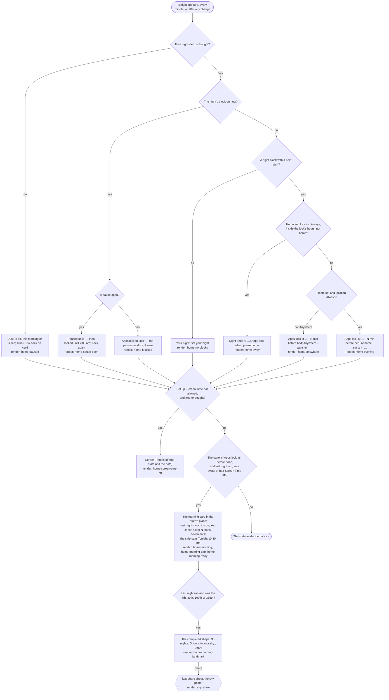
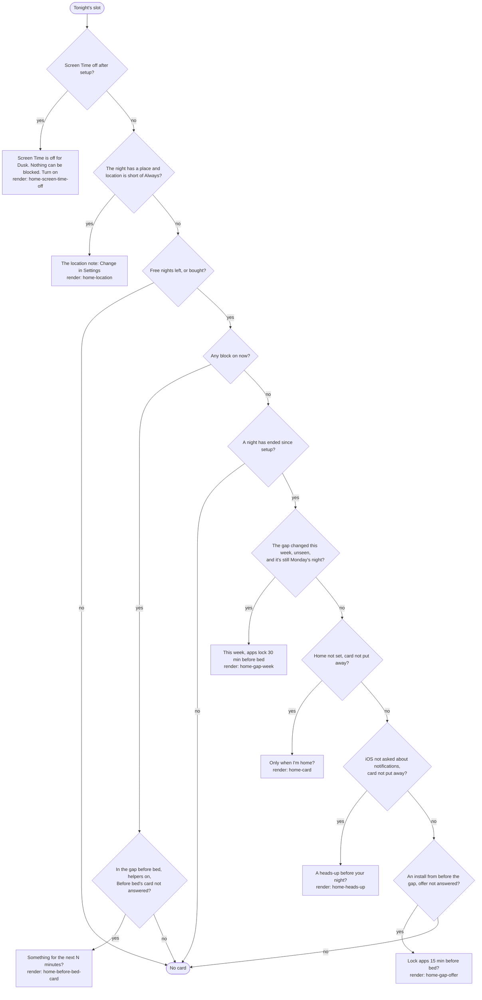
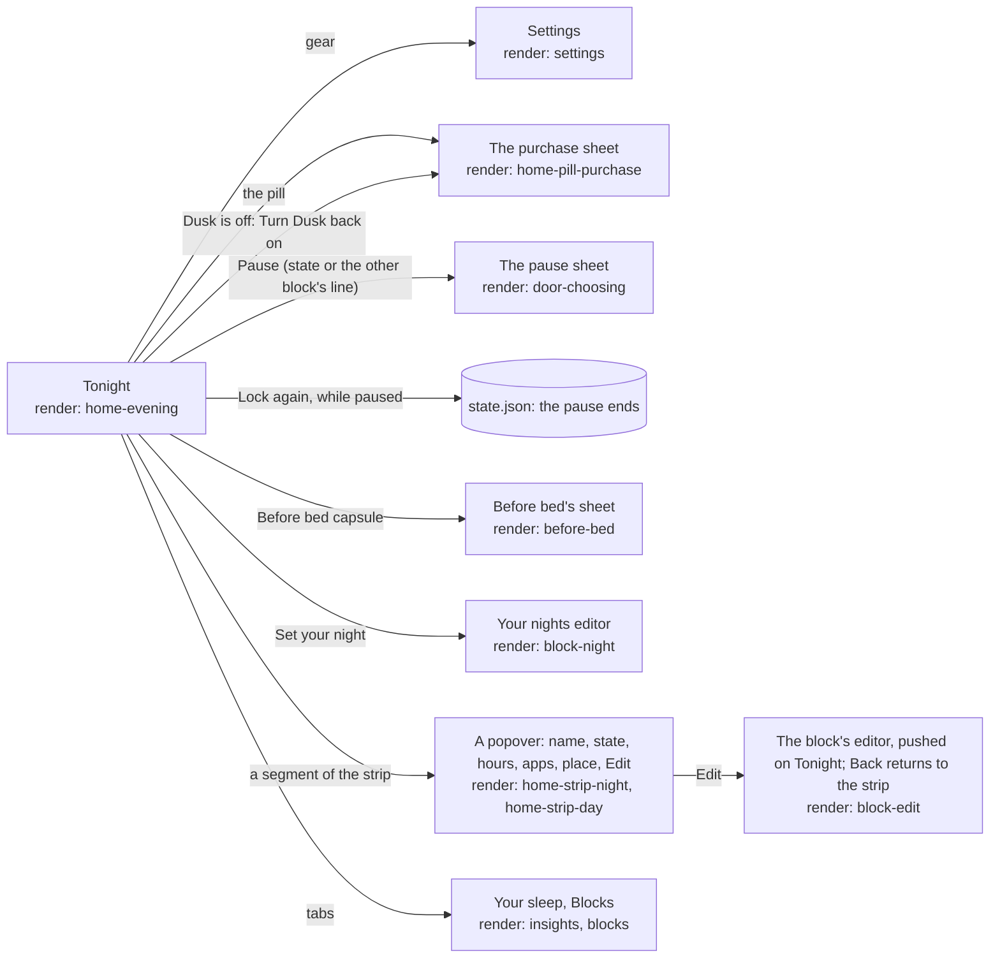
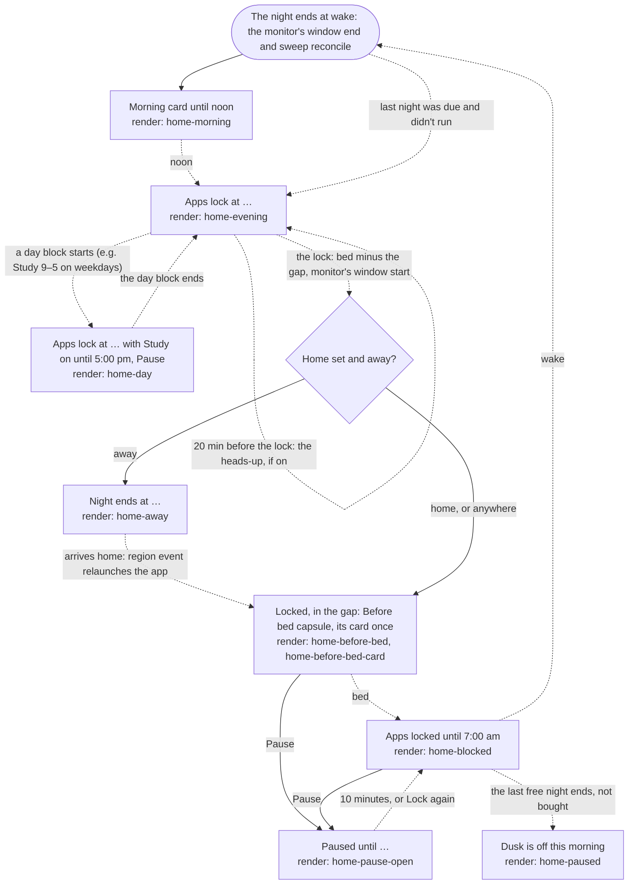

# Tonight through a day

**What it's for:** Tonight is the glance: what the night is doing now, what to do about it if anything, and the whole day as a strip. This chart covers what the state shows and in which order the code decides it, the one card slot, what each part opens, and how a day moves through the states.

**Implements:** D63 and D64 (Tonight is a tab and a composition), D69 (the morning card), D73 (one quiet line for another block), D75 (eyebrows say what the time means; the strip is the whole day; only what's tappable looks tappable), D76 and D83 (the lock before bed), D80 and D85 (Before bed), D86 (the card floats and never moves the state), D33 (no selling at night), D48 (Screen Time off is said), D67 and D70 (the pause), D79 and D81 (landmark mornings).

**Code:** `TollCore/App/HomeSnapshot.swift` (the hero, the pill, the eyebrow), `TonightCard.swift` (the slot), `Morning.swift`, `DayTimeline*.swift`, `GapSnapshot.swift`; `TollFeatures/Home/` (`HomeView`, `HomeHero`, `MorningCard`, `TonightCardView`, `DayStrip`, `StripSnippet`, `OtherBlockLine`, `PillView`, `HomeParts`); `App/RootView.swift` (`LiveHome`: what each tap opens; a 20-second refresh and a per-minute clock).

> **Being reworked:** the morning card (`Home/MorningCard.swift`, `TollCore/App/Morning.swift`) is being changed on another branch at the time of writing. The morning parts below are as `main` has them; update them with that change.

## What the state shows

The checks run in this order (`HomeSnapshot.hero`, then the Screen Time and morning overrides). The night's times are the lock's: bed minus the gap.

Around the state, independent of it:
- **The free-night pill** in the bar ("Night 5 of 14 free", "Last free night tonight") shows while the free nights run, nothing is blocking, and the state isn't away or Set your night (`render: home-first-week`, `home-last-night`). It opens the purchase sheet (`render: home-pill-purchase`, [purchase.md](purchase.md)).
- **Another block on** (Study, Work, Gym, Other) is one quiet line under the state, "Study on until 5:00 pm", with Pause when the state doesn't already offer it (`render: home-day`).
- **The strip** is the day from wake to wake, every block on it (`render: home-evening`, `home-day`).

## The card slot

One note or card at a time, the first that applies. It floats where it fits and never moves the state (D86).

What each opens: Turn on, [permissions.md](permissions.md); Change in Settings, iOS Settings; Before bed and the gap cards, [before-bed.md](before-bed.md); home, [set-home.md](set-home.md); the heads-up, [heads-up.md](heads-up.md). "Not now" puts an offer away for good; Monday's "OK" puts away only this week's.

## What Tonight opens

## A day through Tonight

## Doubts
- **The morning card is being reworked** on another branch; this chart is `main`'s.
- **"Your night" with Set your night** (`home-no-blocks`) is reachable only when the night's block has no rule that starts again; onboarding can't produce that, and the editor refuses an empty schedule, so it may be unreachable outside a damaged state file.
- **Screen Time off replaces the state, but not while the free nights are over:** the Off state wins then (`if screenTimeOff, state.trial.entitled`). The note still shows (the note checks only `screenTimeOff`). Intended by #45 as far as the code says.
- **The morning card beside another block:** only the night's block decides the state (`HomeSnapshot.hero`), so a block on in the morning (say Study from 9) leaves the morning card in place with Study's line under it. No render pairs them.
- **The pill and the card slot both hide for any block,** not only the night: `state.isBlocking` is true while Study is on, so on a weekday at 11 am there is no pill and no offer (D33 says "no selling at night"). Matches the code.
- **A night with Screen Time off shows a morning card only if Screen Time is back on**; while it's still off, the Screen Time state replaces everything, so that morning's facts aren't shown.
