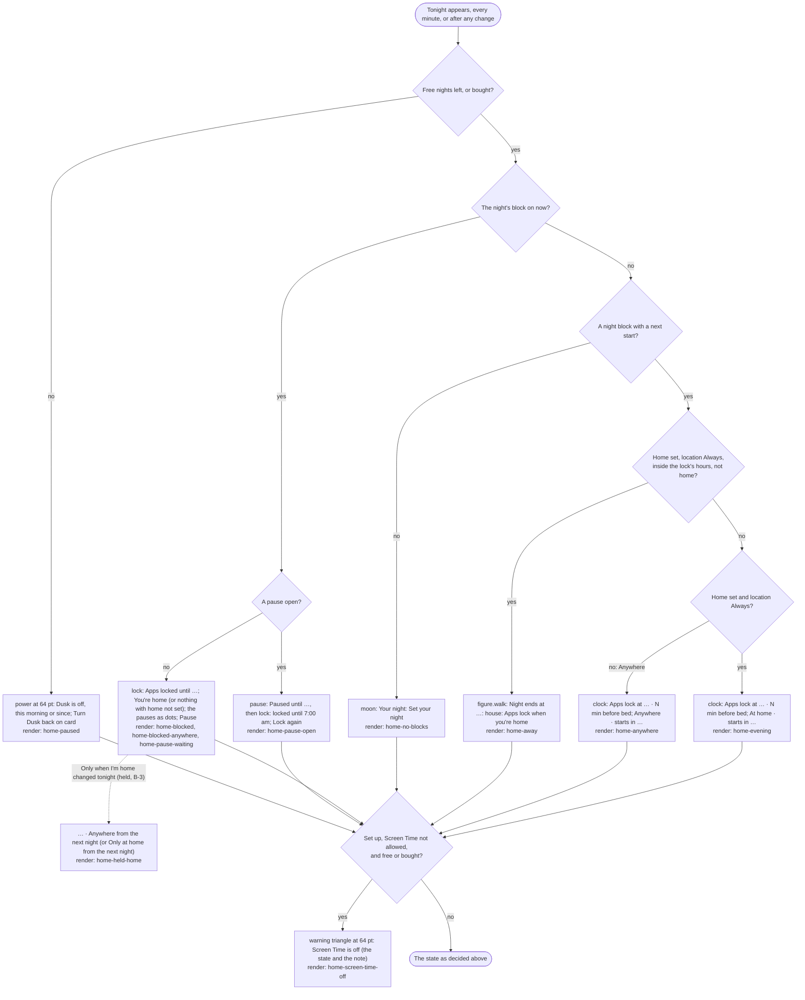
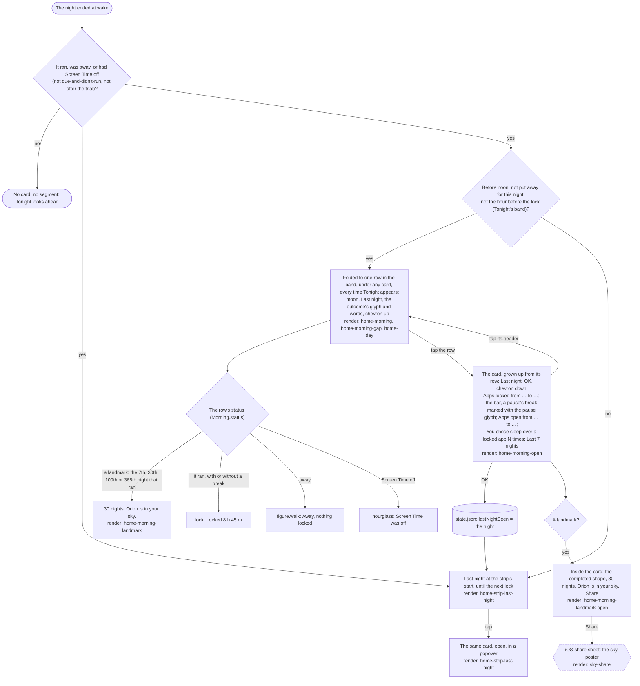
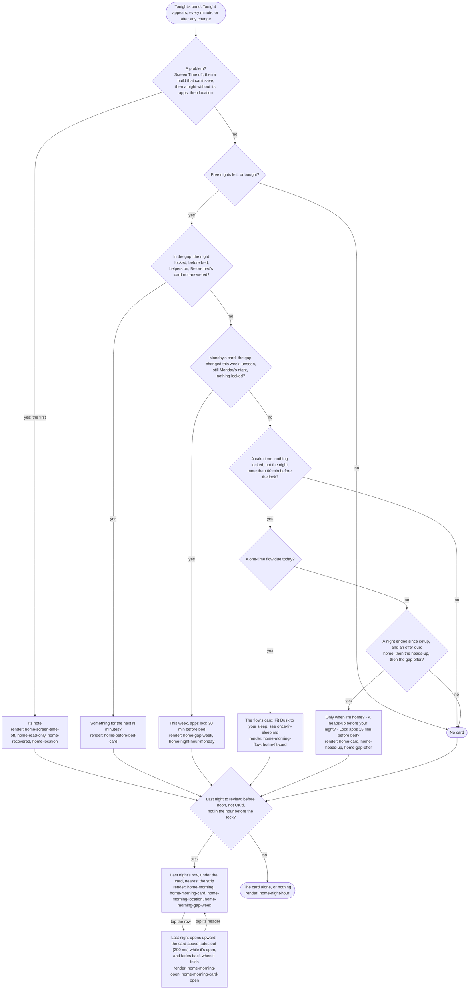
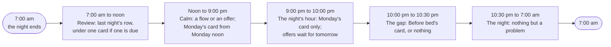
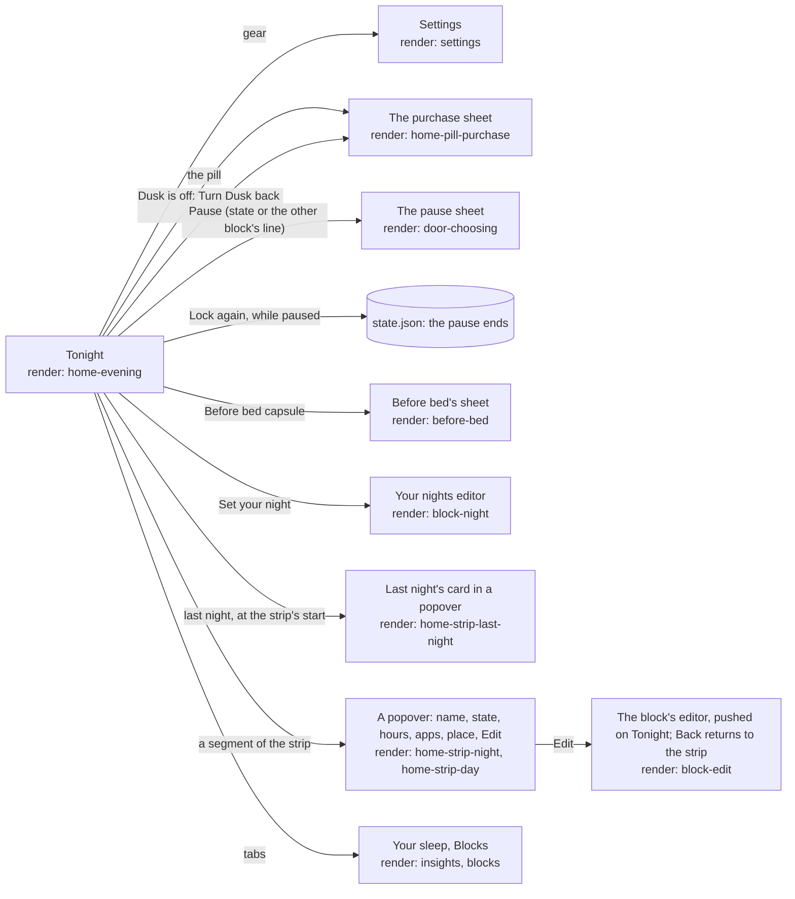
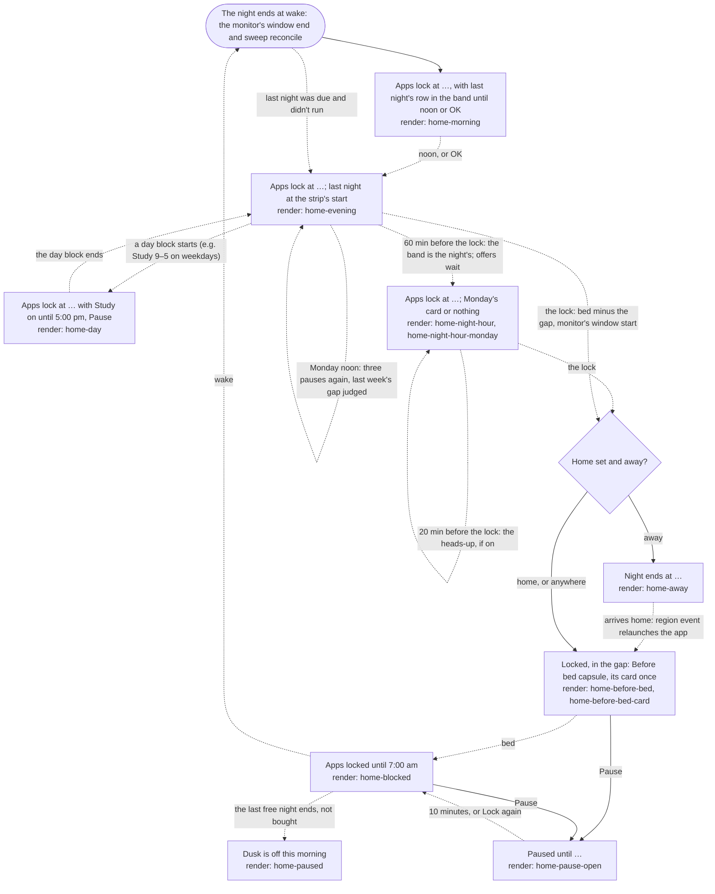

# Tonight through a day

**What it's for:** Tonight is the glance: what the night is doing now, what to do about it if anything, and the whole day as a strip. This chart covers what the state shows and in which order the code decides it, Tonight's band (which card, and last night's row, when), what each part opens, and how a day moves through the states.

**Implements:** D63 and D64 (Tonight is a tab and a composition), D69 (last night's card, a review since the founder's call of 25 Nov), D73 (one quiet line for another block), D75 (eyebrows say what the time means; the strip is the whole day; only what's tappable looks tappable), D76 and D83 (the lock before bed), D80 and D85 (Before bed), D86 (the card floats and never moves the state), the band system (one rule for the band, amending D86, D91 and D93), D33 (no selling at night), D48 (Screen Time off is said), D67 and D70 (the pause), D79 and D81 (landmark mornings).

**Code:** `TollCore/App/HomeSnapshot.swift` (the hero, the pill, the eyebrow), `TonightBand.swift` (the band's rule), `TonightCard.swift` (each card's own facts), `Morning.swift` (last night, and its folded row's status), `DayTimeline*.swift`, `GapSnapshot.swift`; `TollFeatures/Home/` (`HomeView`, `HomeHero`, `TonightBandView` (the band), `LastNightBand` (last night's row), `LastNightCard`, `TonightCardView`, `DayStrip`, `StripSnippet`, `OtherBlockLine`, `PillView`, `HomeParts`); `App/RootView.swift` (`LiveHome`: what each tap opens; a 20-second refresh and a per-minute clock).

## What the state shows

The checks run in this order (`HomeSnapshot.hero`, then the Screen Time override). Each state leads with its glyph over the eyebrow (`StateMark`, named first in each box), so the states tell apart with every word wiped (#74). The night's times are the lock's: bed minus the gap. Last night never takes the state's place: it is a row in Tonight's band each morning and a segment at the strip's start all day (below).

Around the state, independent of it:
- **The free-night pill** in the bar ("Night 5 of 14 free", "Last free night tonight") shows while the free nights run, nothing is blocking, and the state isn't away or Set your night (`render: home-first-week`, `home-last-night`). It opens the purchase sheet (`render: home-pill-purchase`, [purchase.md](purchase.md)).
- **Another block on** (Study, Work, Gym, Other) is one quiet line under the state, "Study on until 5:00 pm", with Pause when the state doesn't already offer it (`render: home-day`).
- **The strip** is the day from wake to wake, every block on it (`render: home-evening`, `home-day`). While the state is "Apps lock at" and last night ended within the day (it ran, was away, or had Screen Time off), last night sits at the strip's start as a faint amber stub with its moon; a tap opens last night's card in the popover (`render: home-strip-last-night`).

## Last night's card

## Tonight's band

What floats between the state and the strip (`TonightBand`). Every item has a kind, and each kind has its part of the day, so kinds rarely meet. When more than one is due, one full card shows, picked by kind, and last night's folded row may sit under it, nearest the strip. Never more than two items. The band goes where it fits without moving the state (D86): 20 pt above the strip, else under the bar (not when it holds last night's row), else under the state, where the screen scrolls.

| Kind | Items | When it may show | When it competes |
|---|---|---|---|
| 1. Problem | Screen Time off, a build that can't save, a night without its apps, location short of Always | Any time, until fixed | Takes the card. Last night's row may sit under it |
| 2. Night | Before bed's card; Monday's gap card | Before bed's: in the gap only. Monday's: from Monday noon until Tuesday noon, while nothing is locked, the hour before the lock included | Loses only to a problem. On Tuesday morning, last night's row sits under Monday's card |
| 3. Flow | A one-time flow's card (D92) | At a calm time: nothing locked, free nights left or bought, not in the hour before the lock, not during the night | Loses to a problem or a night card, and waits a day. Last night's row may sit under it |
| 4. Setup | Home, then the heads-up, then the gap offer (one at a time) | At a calm time, and only after a night has ended since setup | Loses to all of the above and waits for a calm time. Last night's row may sit under it |
| 5. Review | Last night's folded row | From the night's end until noon, until OK, never in the hour before the lock | Always the row, never the card: it sits under whichever card shows |

From 60 minutes before the lock (`TollConfig.band.nightMinutes`) until the night ends, the band belongs to the night. Before the gap, it shows at most one card about the night (Monday's). In the gap, it shows Before bed's card, or nothing. Setup offers and flows wait for tomorrow. A problem still shows: it stays until fixed.

What each opens: Turn on, [permissions.md](permissions.md); Change in Settings, iOS Settings; Before bed and the gap cards, [before-bed.md](before-bed.md); home, [set-home.md](set-home.md); the heads-up, [heads-up.md](heads-up.md). "Not now" puts an offer away for good; Monday's "OK" puts away only this week's; last night's "OK" puts away only that night's row, and the strip still opens it.

### Who owns the band through a day

For a night from 10:30 pm to 7:00 am with a 30-minute gap, so the lock is at 10:00 pm. A problem can show in every stretch.

## What Tonight opens

## A day through Tonight

## Doubts
- **"Your night" with Set your night** (`home-no-blocks`) is reachable only when the night's block has no rule that starts again; onboarding can't produce that, and the editor refuses an empty schedule, so it may be unreachable outside a damaged state file. With no night block at all, the button isn't drawn (`setNight` is nil): state files always hold one (`DuskState`, D73), and a lost file comes back from the night record (#140), so that state isn't reached (#124).
- **Screen Time off replaces the state, but not while the free nights are over:** the Off state wins then (`if screenTimeOff, state.trial.entitled`). The note still shows (the note checks only `screenTimeOff`). Intended (#141): the state says the larger fact (nothing blocks until it's bought), and the note is a problem that holds until fixed (the band's rule), since after buying nothing could block with Screen Time still off.
- **Last night's card beside another block:** the card is a review, not an offer, so it floats while Study is on in the morning, with Study's line under the state (`render: home-day`). Offers still wait while any block is on.
- **The pill and the band's offers both hide for any block,** not only the night: `state.isBlocking` is true while Study is on, so on a weekday at 11 am there is no pill and no offer. Intended (#141): the band's calm times say "nothing is locked", and D85 keeps every offer away while apps are locked.
- **A night with Screen Time off shows last night's card only if Screen Time is back on**; while it's still off, the Screen Time state replaces everything, so that night's facts aren't shown.
- **The card floats only until noon,** as the morning card did; after that, and after OK, the strip's start is the way back to it until the next lock.
- **The row is folded each time Tonight appears** (a tab switch, or the app coming back from the background), so an open card never greets the person. OK is only in the open card: the folded row stays until noon.
- **Where the open card goes:** it grows up from its row while its bottom edge stays 20 pt above the strip. Where it no longer fits there, it goes under the state and the screen scrolls (D86's last place), never under the bar, so it never jumps away from its row. A card above the row fades out while last night is open, so the open card never pushes it into the state or covers it.
- **A problem and last night's row together:** the location note, a lost night's apps or a build that can't save sit above last night's row each morning. Screen Time off is the exception: the state says so and last night isn't shown at all.
- **Monday's card on Tuesday morning:** it shows until Tuesday noon, as before, so a person who didn't open Dusk on Monday still sees it; that morning it sits over last night's row.
- **A flow's calm and the band's calm differ:** `Flows.calm` keeps the last 20 minutes before the lock quiet, the band the last 60. The band is the stricter, so a flow is never shown inside the hour; `Flows.due` may still call one due there.
