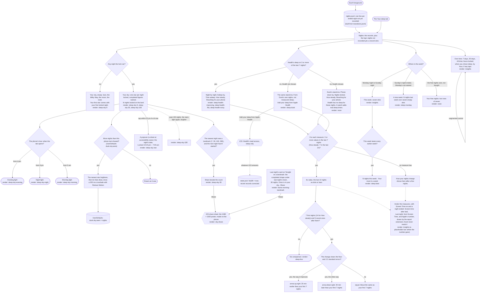

# Your sleep, the sky and landmarks

**What it's for:** the second tab. It opens onto the person's sky, where each night the lock ran is one star, in a fixed order that completes real constellations. Under it, how the person's nights are changing (#88): when they fell asleep, how long, how steady, and how often they reached for a locked app, each against their own first nights, from Health's sleep or, without it, Dusk's own nights. Then Apple's own count of screen time after bed last night (#65), then this week as seven dots, a personal best when there is one, and the hours locked over 7 days, 30 days or all time. At 7, 30, 100 and 365 nights a landmark morning offers the sky as a picture to share; nothing leaves the phone otherwise.

**Implements:** D63 (the tab), D65 (true numbers, no shortfall), D69 (the week, "A new week", personal bests), D79 and D81 (the sky, landmarks, sharing only at landmarks), D82 (the free nights frozen after the trial), D84 (every range reads the night records), D88 (the full-bleed sky, its light by the phone's hour, a star's night in a popover, the newest star's arrival), #87 and #88 (the measures and their trends), #65 (Apple's screen time after bed, its own row).

**Code:** `TollCore/App/YourSleep.swift`, `SleepTrends.swift` (the measures, `TollConfig.trends`), `PastNight.swift` (`merged`, `NightsRan`), `InsightsSnapshot.swift`, `Sky.swift`, `SkyCatalogue.swift`, `SkyStars.swift`, `SkyLayout.swift`, `SkyArt.swift`; `TollFeatures/Insights/` (`InsightsView`, `TrendCards`, `TrendChart`, `SkyHeader`, `SkyScene`, `SkyStarsLayer`, `SkyBackdrop`, `SkyPoster`, `SleepCards`); `Home/LandmarkLine.swift`; `AfterBed/AfterBedRow.swift` and `TollCore/App/AfterBed.swift` (last night for Apple's report), `ios/Report/` (the report extension); `AppModel.recordNights`.

> **Being reworked:** the sky's names are being changed on another branch at the time of writing. The chart is `main`'s; the flow should not change, only the words.

## What the sky is made of
Nothing about the sky is stored. It is worked out each time from the nights the lock ran (`NightsRan`: the night records, the transition log and the state together) and the fixed order in `SkyCatalogue`. The only thing kept is how many nights this phone last showed (`dusk.sky.seen`), so the newest star arrives once. See `data.md`.

## Doubts
- **The measures are only as true as their nights.** Without Health, "Phone down by" is the last reach for a locked app, which says nothing on a night with no reach and hasn't been checked against measured sleep; it is named as Dusk's own and never as sleep. The first nights are the first seven with a value since setup, not Health's history before Dusk.
- **The sleep model's one causal line** ("when the lock started earlier, you were asleep N minutes sooner", D66) isn't shown: no model chooses the start yet, so it never fires. It belongs beside these measures once personal timing is on.
- **Nights reach the records only on foreground.** Until Dusk is opened, the log's nights fill in; if Dusk isn't opened for long enough that the log is trimmed past a night before it's recorded, that night's star never comes. See `data.md`, risk 3.
- **Changing the catalogue's order, or the rule for a night that ran, redraws every person's sky** and moves which star belongs to which night (`YourSleep.starNight` is positional). Nothing records the order a person's stars were lit in.
- **A landmark's Share on Tonight and on Your sleep both last until the next night starts:** Your sleep while the newest star is new (`Sky.isNew`), Tonight in last night's card, which floats until noon and then opens from the strip's start.
- **The free nights' frozen dots:** `sleep-after-trial` (#129).
