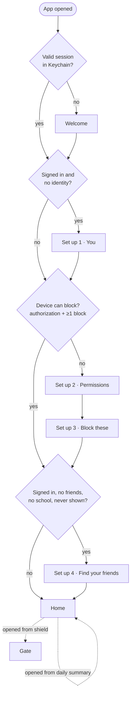
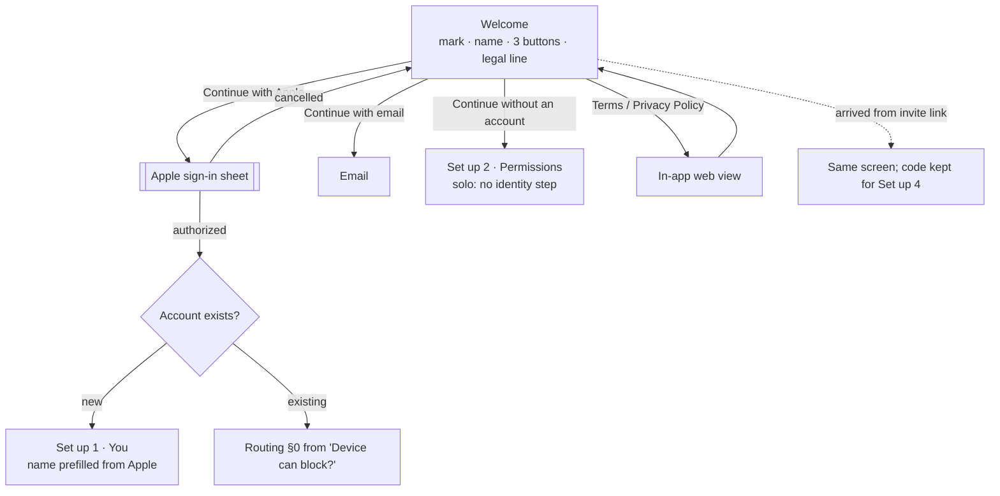
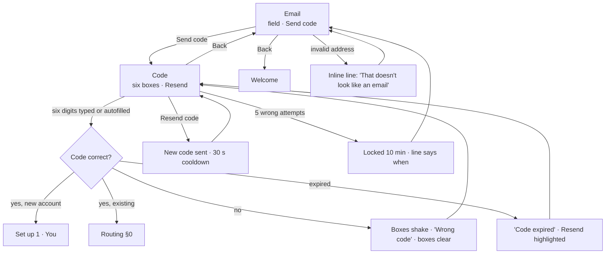
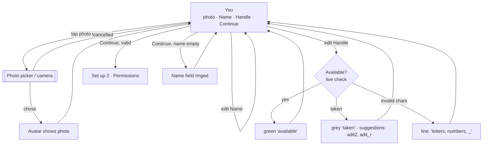
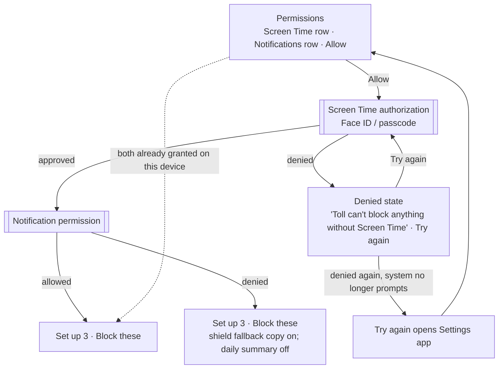
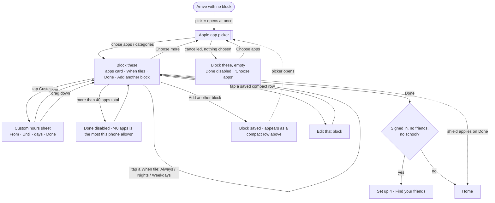
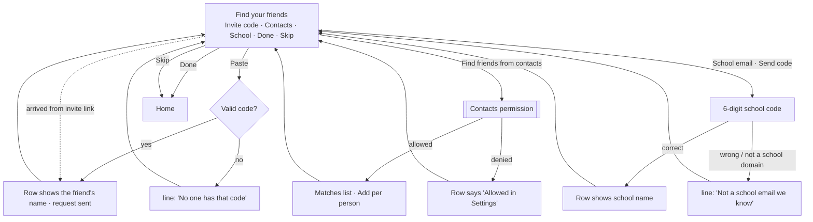
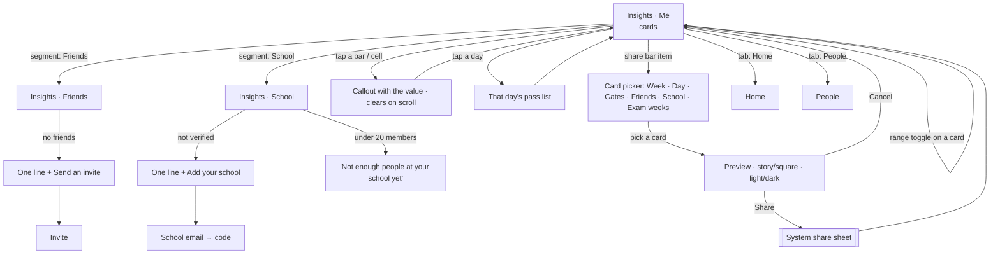
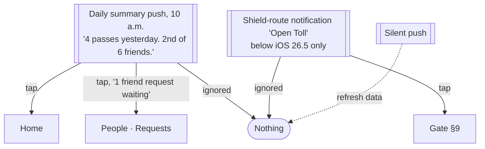

# Toll — User Flows (v0.1)

Every node a person can be at, with every choice available there and where each one leads. Diagrams are Mermaid; the rendered page is the companion artifact. Node names match screen names in `toll-design.md`; rule ids match `toll-mvp-spec.md`.

Conventions: rounded boxes are screens; diamonds are decisions the app makes from state; thick-bordered boxes are Apple system sheets Toll does not control; dashed edges are things that happen without the person doing anything.

## 0. Launch routing (spec O-1…O-6)

Every open of the app passes through this. "First arrival at Home" is per account, not per install.



## 1. Welcome



## 2. Email and code



## 3. Set up 1 · You (signed-in new accounts only)



## 4. Set up 2 · Permissions



## 5. Set up 3 · Block these (also New block, same screen)



Naming is not part of this screen; see §10.

## 6. Set up 4 · Find your friends



## 7. Home

```mermaid
flowchart TD
  H[Home<br>hero · week strip · pinned · friends · footer · tab bar]
  H -- tap hero or week strip --> IN[Insights · Me]
  H -- tap a friend row --> FD[Friend detail sheet]
  H -- long-press a friend row --> CM[Context menu: Remove · Block · Report]
  H -- tap pinned 'removed block' --> FD
  H -- tap pinned 'off since Tuesday' --> FD
  H -- gear --> ST[Settings]
  H -- tab: Insights --> IN
  H -- tab: People --> PE[People]
  H -- pull to refresh -. sync .-> H
  H -- empty friends: Send an invite --> IV[Invite sheet]
  H -. a wait is running .-> WO[Wait overlay over Home]
  H -. a session is active .-> SL[Session line at top: 'Instagram is open · ends after 10 min of use']
  H -. opened within 120 s of a block hit .-> G[Gate §9]
  H -. Screen Time off / tokens expired / no blocks .-> DS[Device-state line · Fix]
  DS -- Fix: Screen Time off --> SA[[Authorization sheet]] --> H
  DS -- Fix: tokens expired --> PK[[App picker]] --> H
  DS -- Add apps --> NB[New block]
```

## 8. Shield (system-rendered, Toll copy)

```mermaid
flowchart TD
  T([Person taps a blocked app<br>inside its schedule]) --> SH[[Shield<br>'Instagram is blocked.' · Open Toll · Dismiss]]
  SH -- Dismiss --> X([Back to home screen])
  SH -- Open Toll, iOS 26.5+ -. block_hit written .-> G[Gate, Toll opens]
  SH -- Open Toll, below 26.5 -. block_hit written .-> NT[[Local notification 'Open Toll']]
  NT -- tap --> G
  NT -- ignored --> X
  SH -- Open Toll, notifications off, below 26.5 --> SH2[[Shield subtitle: 'Open Toll from your home screen']]
  SH2 -- Dismiss, open Toll by hand within 120 s --> G
  T -. outside the block's schedule .-> O([App opens normally, nothing recorded])
```

## 9. Gate

```mermaid
flowchart TD
  G([Toll opens from a block hit]) --> FP{Free pass left today?}
  FP -- yes -. pass free recorded .-> SP[Session picker on the card]
  FP -- no --> WS{Wait already running?}
  WS -- yes, same app --> WO[Wait overlay<br>countdown continues]
  WS -- yes, different app --> WO2[Wait overlay<br>same wait; both apps unlock]
  WS -- no -. wait_started, duration from ladder .-> WO
  WO -- app has no tag --> NM[Card also asks 'Which app is this?' §10]
  WO -- Cancel -. wait_abandoned .-> H[Home]
  WO -- leave Toll -. wait keeps running .-> AW([Away])
  AW -- come back before it ends --> WO
  AW -- come back after it ends --> SP
  WO -. countdown reaches 0 in app .-> SP
  SP -- 5 / 10 / 15 min · Open --> SE([Session: app unshielded<br>spec G-6])
  SE -. threshold reached / window ends / expiry seen .-> RS([Re-shielded · session_ended])
  SE -- tap the app again during session --> OK([Opens, no shield])
  RS -- tap the app --> SH[Shield §8]
```

## 10. Naming (first wait for an app)

```mermaid
flowchart TD
  N[Wait card with 'Which app is this?' chips]
  N -- tap a chip -. tag stored by app ref .-> N1[Chips fade · wait continues]
  N -- ignore it --> N2[Wait continues · pass recorded as 'a blocked app']
  N2 -. next wait for the same app .-> N
  N1 -. later .-> BE[Blocks → tap the app's name → chips] 
  BE -- choose a different tag -. history re-labels .-> BE
```

## 11. Friend detail (sheet over Home)

```mermaid
flowchart TD
  FD[Friend detail<br>avatar · today · week · Today list · Yesterday list · blocks · actions]
  FD -- drag down / tap outside --> H[Home]
  FD -- Remove friend --> RC{Confirm 'Remove Adi?'}
  RC -- Remove -. visibility ends both ways .-> H
  RC -- Keep --> FD
  FD -- Block --> BC{Confirm 'Block Adi? You won't see each other anywhere.'}
  BC -- Block --> H
  BC -- Cancel --> FD
  FD -- Report --> RP[Report sheet<br>reason list · optional text · Send]
  RP -- Send --> RT[Thanks line · back to detail] --> FD
  RP -- Cancel --> FD
```

## 12. People

```mermaid
flowchart TD
  PE[People<br>Requests · Friends · Mutuals · In your contacts · School · Invite]
  PE -- Accept a request -. mutual friendship .-> PE
  PE -- Decline --> PE
  PE -- tap a friend --> FD[Friend detail §11]
  PE -- Add a mutual --> PE1[Row shows 'Requested'] --> PE
  PE -- Add from contacts --> PE1
  PE -- tap School row --> SM[School members · mutuals at your school]
  SM -- Add --> PE1
  PE -- tap Invite row / bar item --> IV[Invite sheet §13]
  PE -- no school yet: Add your school --> SE[School email → code §6]
  PE -- contacts never granted: Find friends from contacts --> CP[[Contacts permission]] --> PE
  PE -- tab: Home --> H[Home]
  PE -- tab: Insights --> IN[Insights]
```

## 13. Invite (sender and recipient)

```mermaid
flowchart TD
  IV[Invite sheet<br>code · Share link]
  IV -- Share link --> SS[[System share sheet]] --> IV
  IV -- drag down --> PE[People]
  SS -. link lands in Messages etc. .-> R([Recipient taps toll.app/i/K4Q7])
  R --> RI{Toll installed?}
  RI -- no --> AS[[App Store]] -. installs, opens .-> W[Welcome · code kept]
  RI -- yes, signed in --> PR[People · request to sender sent · row 'Requested']
  RI -- yes, solo --> SI[Prompt: 'Sign in to add Adit' → Welcome sign-in options]
  W -. completes setup .-> F4[Set up 4 with the code prefilled · request sent]
  PR -. sender accepts .-> MF([Mutual friends])
```

## 14. Blocks, New block, Custom hours

```mermaid
flowchart TD
  BL[Blocks<br>rows · Add a block]
  BL -- Add a block -. picker opens .-> NB[New block<br>apps · tags · When · name · Done]
  BL -- tap a row --> NB
  BL -- swipe a row: Remove --> RM{'Remove Instagram? Your friends will see this.'}
  RM -- Remove -. block_removed · pinned for friends .-> BL
  RM -- Keep --> BL
  BL -- 8 blocks reached --> BL1[Add a block disabled] 
  NB -- Choose more --> PK[[App picker]] --> NB
  NB -- tap an app's tag --> TC[Tag chips] -- choose --> NB
  NB -- swipe an app: remove from block --> NB
  NB -- When tile --> NB
  NB -- Custom --> CU[Custom hours sheet] -- Done --> NB
  NB -- Block name --> NM[Text field · Done] --> NB
  NB -- Done, schedule loosened -. block_changed · pinned for friends .-> BL
  NB -- Done, otherwise -. block_changed / block_added .-> BL
  NB -- Back without Done --> DC{Discard changes?} -- Discard --> BL
  DC -- Keep editing --> NB
  BL -- Back --> ST[Settings]
```

## 15. Insights and sharing



## 16. Settings

```mermaid
flowchart TD
  ST[Settings]
  ST -- Account row --> AC[Edit name · handle · photo · Save] --> ST
  ST -- Sign out --> SO{Sign out? Blocks stay on this phone.} -- Sign out --> W[Welcome]
  ST -- School: Leave --> LS{Leave Waterloo?} -- Leave --> ST
  ST -- School: none --> SE[School email → code §6] --> ST
  ST -- One summary a day toggle --> ST
  ST -- Time --> TP[Time picker] --> ST
  ST -- Let contacts find me toggle --> ST
  ST -- Blocked apps --> BL[Blocks §14]
  ST -- Export my data --> EX[JSON of your events · share sheet] --> ST
  ST -- Delete account --> D1{Are you sure? Friends, history, everything.}
  D1 -- Continue --> D2[[Re-authenticate]]
  D2 -- ok -. server deletes · local wipe .-> W
  D1 -- Cancel --> ST
  ST -- Privacy policy / Terms --> WV[In-app web view] --> ST
  ST -- support@toll.app --> ML[[Mail]] --> ST
  ST -- Donate --> DW[[Donation page in browser]] --> ST
  ST -- Back --> H[Home]
```

## 17. Notifications



## 18. Returning users

```mermaid
flowchart TD
  R([Reinstall, new phone, or restore])
  R --> K{Session in Keychain?}
  K -- yes --> P2[Set up 2 · Permissions<br>bar of 2]
  K -- no --> W[Welcome] -- sign in --> P2
  P2 --> P3[Set up · Block these again]
  P3 -- Done -. shield applied .-> H[Home · friends, school, history all present]
  P3 -- Add another block --> P3
  H -. first wait for a re-picked app .-> NM{Tag known for a token?}
  NM -- no, tokens are new on this device --> N[Naming §10, one tap each]
```

Tokens never survive a reinstall; tags do (by app ref on the server), but a fresh pick creates fresh app refs, so the first wait asks once more. This is the one cost of a reinstall and it is one tap per app.

## 19. Things going wrong while installed

```mermaid
flowchart TD
  A([Screen Time permission revoked in Settings])
  A -. next daily check-in missed .-> A1[Friends see nothing yet]
  A1 -. second missed check-in .-> A2[Friends: 'Toll has been off on Adi's phone since Tuesday']
  A -. person opens Toll .-> H1[Home: 'Screen Time is off · Fix']
  H1 -- Fix --> SA[[Authorization sheet]] -- approved -. check-in resumes .-> H[Home]
  B([Tokens expired · iOS 26.5 tokensDidExpire]) -. person opens Toll .-> H2[Home: 'Blocks need re-picking · Fix']
  H2 -- Fix --> PK[[App picker]] --> H
  C([App deleted]) -. two missed check-ins .-> A2
  D([Phone off / offline for days]) -. two missed check-ins .-> A2
  A2 -. any check-in arrives .-> H
  E([Wait running, Toll killed]) -. end time persisted .-> E1[Reopen: remaining computed from the clock]
  F([Clock moved back]) -. monotonic guard .-> F1[Wait end recomputed, never shortened]
```

## 20. Solo user who later wants friends

```mermaid
flowchart TD
  SO([Solo: no account, blocks working])
  SO -- People tab --> P0[People, empty<br>'Sign in to add friends' · Sign in]
  SO -- Settings → Account → Sign in --> P0
  SO -- opens a friend's invite link --> P0
  P0 -- Sign in --> SI[Welcome's sign-in options as a sheet]
  SI -- new account --> Y[Set up 1 · You] -. local history uploads A2 .-> P4[Set up 4 · Find your friends]
  SI -- existing account --> MG{Merge local history into it?}
  MG -- Yes --> P4
  MG -- No, keep phone-only --> P4
  P4 --> H[Home]
```

## 21. School verification

```mermaid
flowchart TD
  S[School email field] -- Send code --> V{Domain in school list?}
  V -- no --> S1['Not a school email we know' · link: 'Tell us'] --> S
  V -- yes --> C[6-digit code sent]
  C -- correct --> OK[Joined · school row shows name]
  C -- wrong --> C1['Wrong code'] --> C
  C -- expired --> C2[Resend] --> C
  OK -. under 20 active members .-> OK1[School screens show 'Not enough people at your school yet']
  OK -- Settings: Leave --> L{Leave?} -- Leave --> S
```

## 22. Report and block a person

```mermaid
flowchart TD
  X([From Friend detail, a People row, or a Mutual row])
  X -- Report --> RP[Reason: name · photo · harassment · other<br>optional text · Send]
  RP -- Send -. report stored · founders emailed .-> RA{Also block this person?}
  RA -- Block --> BK
  RA -- Not now --> back([Back])
  X -- Block --> BC{Block Adi? You won't see each other anywhere.}
  BC -- Block --> BK([Blocked both ways · removed from friends, mutuals, school lists])
  BC -- Cancel --> back
  SET[Settings → Blocked people] -- Unblock --> UB([Visible again; friendship not restored])
```

## Coverage check

Screens on the canvas: Welcome, Email, Code, You, Permissions (+denied), Block these (+add another, +returning), Find your friends, Home (+wait, +naming, +session picker), Shield, People, Friend detail, Invite, Blocks, New block, Custom hours, Settings, Insights Me/Friends/School, Share cards. Each appears in at least one diagram above. Flows that exist in the spec but have no dedicated screen (report sheet, school members list, blocked people, edit account, discard-changes confirm, export) are named in the diagrams and are standard grouped lists or alerts in `toll-design.md` terms.
